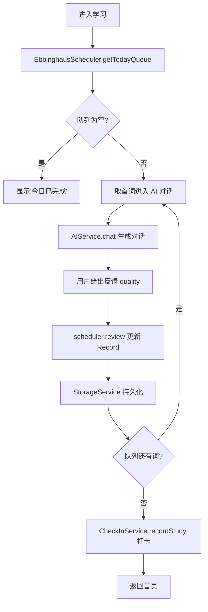
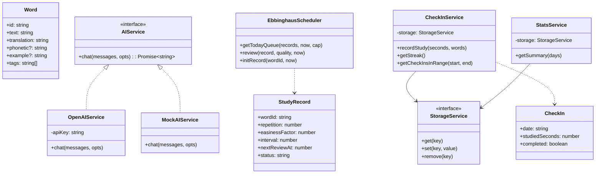
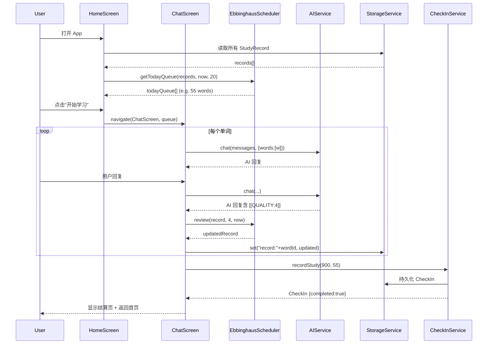

# 单词盒子 (WordBox) — 系统架构设计文档

**作者**: Bob (Architect)
**版本**: v1.0
**日期**: 2025-01
**依赖**: PRD.md v1.0

---

## 1. 技术选型 (Technology Stack)

| 层 | 选型 | 理由 |
|----|------|------|
| 移动端框架 | **React Native 0.73 + TypeScript** | 跨 iOS/Android、社区成熟、热更新能力强；TS 提供类型安全 |
| 导航 | **@react-navigation/native** (bottom-tab + stack) | 官方推荐、生态完善 |
| 状态管理 | **Zustand** | 比 Redux 轻量、比 Context 易扩展，适合单 App 规模 |
| 本地存储 | **AsyncStorage + 抽象 StorageService** | 原生、零依赖、接口可替换为 MMKV/SQLite |
| HTTP 客户端 | **fetch (原生) + AbortController** | 免依赖、支持取消请求 |
| AI Provider | **OpenAI Chat Completions API** (抽象 AIService 接口) | 文本生成能力强、latency 可接受；可替换 |
| 日期处理 | **date-fns** | Tree-shakable、API 清晰 |
| 测试 | **Jest + ts-jest** | RN 官方推荐，支持 TypeScript |
| UI 组件 | **原生 View/Text + 少量自研组件** | 避免第三方 UI 库锁定，便于后续接入设计系统 |

### 抽象层设计理念

所有外部依赖（AI、存储、时间）都通过 **Service 接口**抽象，实现可替换与易测试：

```
AIService (interface) ──> OpenAIService (impl)
                     └──> MockAIService (for tests)

StorageService (interface) ──> AsyncStorageAdapter (impl)
                          └──> MemoryStorageAdapter (for tests)

Clock (interface) ──> SystemClock (impl)
                 └──> FakeClock (for tests)
```

---

## 2. 模块划分 (Module Decomposition)

```
src/
├── App.tsx                           # 入口、导航、Provider 注入
├── models/                           # 纯数据结构 + 类型
│   ├── Word.ts                       # 单词实体
│   ├── StudyRecord.ts                # 学习记录 / 艾宾浩斯字段
│   └── CheckIn.ts                    # 打卡记录
├── services/                         # 业务逻辑层
│   ├── EbbinghausScheduler.ts        # 艾宾浩斯调度算法 (SM-2 改进)
│   ├── StorageService.ts             # 持久化抽象 + 实现
│   ├── AIService.ts                  # AI 对话抽象 + OpenAI 实现
│   ├── CheckInService.ts             # 打卡 / 连续计算
│   └── StatsService.ts               # 学习统计
├── screens/                          # 页面
│   ├── HomeScreen.tsx                # 首页
│   ├── ChatScreen.tsx                # AI 对话学习
│   ├── VocabularyScreen.tsx          # 生词本
│   ├── CalendarScreen.tsx            # 打卡日历
│   └── StatsScreen.tsx               # 学习统计
├── components/                       # 复用组件
│   ├── WordCard.tsx                  # 单词卡片
│   └── CheckInHeatmap.tsx            # 打卡热力图
└── utils/                            # 工具函数
    ├── dateUtils.ts
    └── seedData.ts                   # 初始 300 词考研词表
```

---

## 3. 核心数据结构 (Data Model)

### 3.1 Word（单词）
```typescript
interface Word {
  id: string;              // uuid
  text: string;            // "ephemeral"
  phonetic?: string;       // "/ɪˈfem.ər.əl/"
  translation: string;     // "短暂的"
  definition?: string;     // 英文释义
  example?: string;        // 例句
  tags: string[];          // ["考研", "形容词"]
  createdAt: number;       // unix ms
}
```

### 3.2 StudyRecord（学习记录 + 艾宾浩斯）
```typescript
interface StudyRecord {
  wordId: string;
  repetition: number;      // 已复习次数 (SM-2 n)
  easinessFactor: number;  // EF (SM-2: 初始 2.5, min 1.3)
  interval: number;        // 下次复习间隔（天）
  nextReviewAt: number;    // 下次复习时间戳
  lastReviewedAt: number;  // 上次复习时间戳
  lastQuality: number;     // 上次反馈质量 0-5
  status: 'new' | 'learning' | 'review' | 'mastered';
}
```

### 3.3 CheckIn（打卡记录）
```typescript
interface CheckIn {
  date: string;            // 'YYYY-MM-DD' 本地日期
  studiedSeconds: number;  // 学习时长
  wordsLearned: number;    // 本日学词数
  completed: boolean;      // 是否达成 ≥15 分钟
}
```

### 3.4 ChatMessage（AI 对话消息）
```typescript
interface ChatMessage {
  role: 'system' | 'user' | 'assistant';
  content: string;
  timestamp?: number;
}
```

---

## 4. 接口定义 (Interfaces)

### 4.1 AIService
```typescript
interface AIService {
  chat(messages: ChatMessage[], opts?: { words?: Word[] }): Promise<string>;
  // opts.words: 当前学习的单词上下文，注入 system prompt
}
```

### 4.2 StorageService
```typescript
interface StorageService {
  get<T>(key: string): Promise<T | null>;
  set<T>(key: string, value: T): Promise<void>;
  remove(key: string): Promise<void>;
  keys(): Promise<string[]>;
}
```

### 4.3 EbbinghausScheduler（核心算法）
```typescript
interface EbbinghausScheduler {
  // 获取今日应复习词（含新词池）
  getTodayQueue(allRecords: StudyRecord[], now: number, newCap: number): StudyRecord[];
  // 根据反馈更新 StudyRecord
  review(record: StudyRecord, quality: 0 | 1 | 2 | 3 | 4 | 5, now: number): StudyRecord;
  // 为新词初始化一条 StudyRecord
  initRecord(wordId: string, now: number): StudyRecord;
}
```

### 4.4 CheckInService
```typescript
interface CheckInService {
  recordStudy(seconds: number, wordsCount: number): Promise<CheckIn>;
  getStreak(): Promise<number>;                 // 连续天数
  getCheckInsInRange(start: Date, end: Date): Promise<CheckIn[]>;
}
```

### 4.5 StatsService
```typescript
interface StatsService {
  getSummary(days: 7 | 30 | 90): Promise<{
    totalWords: number;
    masteredWords: number;
    totalSeconds: number;
    dailyCounts: number[];
  }>;
}
```

---

## 5. 艾宾浩斯调度算法实现逻辑 (SM-2 改进)

### 5.1 算法概述

基于 SuperMemo SM-2 算法的改进版：
- 每个词维护 EF（难度因子，1.3 ~ 2.5+）
- 用户对每次复习给出 quality 反馈（0~5）
- 质量越高，EF 上升；质量低则 EF 下降，且 interval 重置

### 5.2 核心公式

```
用户反馈 quality ∈ {0,1,2,3,4,5}
  0-2 = 不记得 (failed)
  3-5 = 记得 (passed, 难度递减)

if quality < 3:
    repetition = 0
    interval = 1
else:
    if repetition == 0:
        interval = 1
    elif repetition == 1:
        interval = 3
    else:
        interval = round(interval * EF)
    repetition += 1

# 更新 EF
EF = EF + (0.1 - (5 - q) * (0.08 + (5 - q) * 0.02))
EF = max(1.3, EF)

nextReviewAt = now + interval * 86400000
```

### 5.3 今日队列获取逻辑

```
今日队列 = 复习池 ∪ 新词池

复习池 = { r | r.nextReviewAt ≤ now }  // 已到期的老词
新词池 = { new words } 取前 newCap 个 (默认 20)

按 nextReviewAt 升序 + 新词置后
```

### 5.4 流程图 (Mermaid)



---

## 6. AI 对话服务抽象层设计

### 6.1 设计目标

1. **Provider 可替换**: 今天用 OpenAI，明天可以无缝换到文心/通义
2. **可测试**: 单元测试用 MockAIService，无需真实 API Key
3. **上下文注入**: 自动将当前学习的单词注入 system prompt

### 6.2 实现结构

```typescript
// 接口
interface AIService {
  chat(messages: ChatMessage[], opts?: ChatOptions): Promise<string>;
}

// OpenAI 实现
class OpenAIService implements AIService {
  constructor(private apiKey: string, private model = 'gpt-4o-mini') {}
  async chat(messages, opts) {
    const sysPrompt = this.buildSystemPrompt(opts?.words);
    const body = { model: this.model, messages: [sysPrompt, ...messages] };
    const resp = await fetch('https://api.openai.com/v1/chat/completions', {
      method: 'POST',
      headers: {
        'Authorization': `Bearer ${this.apiKey}`,
        'Content-Type': 'application/json'
      },
      body: JSON.stringify(body)
    });
    const json = await resp.json();
    return json.choices[0].message.content;
  }
  private buildSystemPrompt(words?: Word[]): ChatMessage { /* ... */ }
}

// Mock 实现（测试用）
class MockAIService implements AIService {
  async chat(messages) { return 'mocked reply'; }
}
```

### 6.3 Prompt 策略

```
system: 你是「单词盒子」的 AI 学习教练。当前学生要学的单词是:
  - ephemeral (短暂的): The beauty of cherry blossoms is ephemeral.
  - ornate (华丽的): ...

要求:
  1. 用中英混合方式让学生理解单词
  2. 主动造句并让学生仿写
  3. 如果学生写错，温和纠正并给出对比
  4. 每轮对话结束后，请用 [[QUALITY:n]] 标签标注学生对当前词的掌握度 (0-5)
```

---

## 7. 类图 (Class Diagram)



---

## 8. 时序图：一次完整的学习流程



---

## 9. 持久化 Key 约定

| Key 模式 | 值类型 | 说明 |
|----------|-------|------|
| `word:${id}` | Word | 单个单词 |
| `words:index` | string[] | 所有 word id 列表 |
| `record:${wordId}` | StudyRecord | 学习记录 |
| `records:index` | string[] | 所有 record 的 wordId 列表 |
| `checkin:${YYYY-MM-DD}` | CheckIn | 当日打卡 |
| `checkins:index` | string[] | 所有打卡日期 |
| `settings` | object | 用户设置 |

---

## 10. 待明确事项 (Open Architecture Questions)

| # | 问题 | 建议 |
|---|------|------|
| AQ1 | AsyncStorage 在 iOS 上 6MB 限制，超量怎么办？ | MVP 足够；P2 迁 MMKV 或 SQLite |
| AQ2 | AI API Key 如何保护？客户端直连风险？ | MVP 本地配置；生产环境应走 BFF 中转 |
| AQ3 | 网络断开时 AI 对话如何降级？ | fallback 到本地模板句型 |
| AQ4 | 艾宾浩斯 quality 如何从 AI 回复自动解析？ | 用 `[[QUALITY:n]]` 标签正则匹配；匹配失败默认 3 |
| AQ5 | 跨设备数据同步延后到 P2，MVP 是否做数据版本号？ | 每个 record 加 `updatedAt`，P2 合并方便 |

---

**本文档作为项目经理 Eve 下一阶段的输入。**
