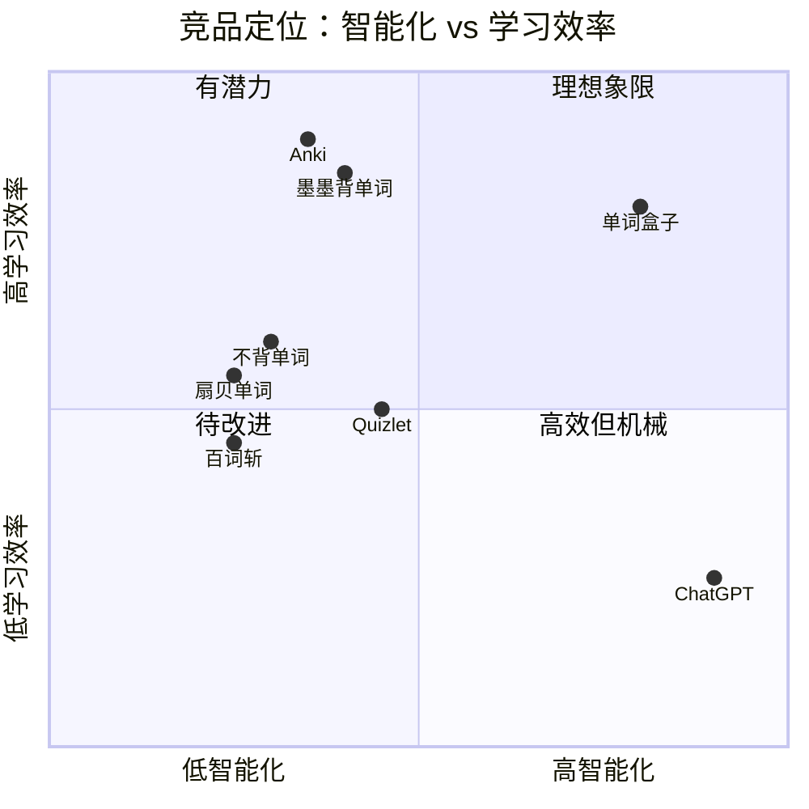

# 单词盒子 (WordBox) — 产品需求文档 PRD

**作者**: Alice (Product Manager)
**版本**: v1.0
**日期**: 2025-01
**状态**: Draft

---

## 1. 产品目标 (Product Goals)

以下 3 个目标正交、可度量、聚焦核心价值：

| # | 目标 | 成功度量 |
|---|------|---------|
| G1 | **让每天 15 分钟学单词成为可持续的习惯** | 次日留存 ≥ 45%，7 日打卡连续率 ≥ 30% |
| G2 | **用 AI 对话取代"抽认卡"的机械记忆，让单词在语境中自然复现** | 单词上下文记忆正确率较传统抽认卡 ≥ +20% |
| G3 | **用艾宾浩斯曲线把"遗忘"变成可调度的事件，每次复习都踩在遗忘前夜** | 30 天后词汇留存率 ≥ 70% |

---

## 2. 用户故事 (User Stories)

### US-01 考研党 · 小陈（22 岁，大三在读）
> "作为一个备考英一的学生，我希望每天地铁通勤 15 分钟就能刷完当天的新词 + 复习，**这样我就不用再额外挤时间背单词了**。"

- 进入 App → 首页显示"今日待学 20 新词 + 35 复习"
- 点击"开始学习" → 进入 AI 对话模式，AI 用当日新词造句 / 提问 / 纠正发音
- 15 分钟倒计时结束 → 自动结算，更新打卡状态

### US-02 出国党 · 小徐（24 岁，已毕业，备考 GRE）
> "作为一个 GRE 考生，我经常在 reading 里遇到忘记的词，我希望能**随时长按截图取词加入生词本**，然后晚上复习时 AI 能用这些词给我出题。"

- 使用剪贴板分享 / OCR 快速加词到生词本
- 生词本自动进入艾宾浩斯调度队列
- 晚间学习时，AI 优先用生词本中的词做对话练习

### US-03 长期学习者 · Lily（28 岁，职场白领，想保持英语能力）
> "作为一个上班族，我不想被每日学习任务绑架，但我希望**当我打开 App 时能看到我的连续打卡记录和进步曲线**，给我继续学下去的动力。"

- 首页顶部显示连续打卡天数、日历热力图
- 统计页显示 7/30/90 日词汇掌握曲线
- 支持"休息日"机制（每周最多 1 天不掉连续）

### US-04 碎片用户 · 王工（32 岁，软件工程师）
> "作为一个工作忙的人，我可能几天才有空学一次，我希望**即使断更，AI 也能根据我的遗忘情况重新给我排复习计划**，而不是让我从头再来。"

- 断更恢复后，艾宾浩斯算法根据实际间隔重新计算 EF (Easiness Factor)
- 大于 7 天未学的词自动降级为"需重学"

---

## 3. 竞品分析 (Competitive Analysis)

| 产品 | 核心优势 | 核心劣势 | 我们的差异化 |
|------|---------|---------|-------------|
| **扇贝单词** | 词书体系完善、社区活跃 | 学习模式机械（选词 / 填空），缺少语境 | 主打 AI 对话，词汇在语境中复现 |
| **不背单词** | 真人例句丰富、UI 设计好 | 复习策略弱，无个性化调度 | 艾宾浩斯 + 个性化 EF，调度精准 |
| **墨墨背单词** | 艾宾浩斯算法口碑好、上瘾机制强 | 收费重（按词收费），无 AI 互动 | 免费核心功能 + AI 对话差异化 |
| **Anki** | 算法最强（SM-2）、高度可定制 | 学习曲线陡、无 AI、UI 老旧 | 开箱即用 + 现代 UI + AI |
| **Quizlet** | 内容丰富、多模式 | 中文用户体验差、付费墙重 | 本地化 + AI 对话原生中文 |
| **百词斩** | 图片记忆法，趣味性强 | 记忆效率随词汇量增加下降 | AI 对话覆盖全词汇量级 |
| **ChatGPT** | AI 能力强 | 非学习工具，无调度、无持久化 | 专注背单词场景的 AI + 调度 |

### 竞品象限图 (Mermaid)



---

## 4. 功能清单与优先级 (Feature Pool)

### P0 — 核心必做 (MVP)

| ID | 功能 | 描述 |
|----|------|------|
| F-01 | 每日学习首页 | 显示今日新词数 + 复习数，一键开始 |
| F-02 | AI 对话学习 | 与 AI 就当日词汇进行对话、造句、纠错 |
| F-03 | 生词本 | 手动 / 自动添加，支持搜索、删除、分组 |
| F-04 | 艾宾浩斯调度 | 基于 SM-2 改进算法，每次学习反馈调整 EF |
| F-05 | 本地存储 | 单词数据、学习记录、打卡数据全部本地持久化 |
| F-06 | 打卡 & 打卡日历 | 每日完成 15 分钟学习自动打卡，日历热力图 |

### P1 — 重要增强

| ID | 功能 | 描述 |
|----|------|------|
| F-07 | 学习统计 | 7/30/90 日词汇掌握曲线、总学习时长 |
| F-08 | 导出 / 导入 | 生词本支持 CSV 导出 |
| F-09 | AI 语音对话 | TTS 发音 + 可选 STT 听写 |
| F-10 | 词书选择 | 考研、GRE、托福、雅思预置词书 |
| F-11 | 休息日 | 每周允许 1 天不掉连续 |

### P2 — 后续迭代

| ID | 功能 | 描述 |
|----|------|------|
| F-12 | 社交分享 | 分享打卡海报到微信 / 小红书 |
| F-13 | OCR 取词 | 拍照 / 截图识别单词加入生词本 |
| F-14 | 云同步 | 跨设备数据同步 |
| F-15 | 订阅付费 | AI 对话高级模型 / 无限词书 |

---

## 5. UI 设计稿要点 (ASCII Wireframe)

### 首页 HomeScreen
```
┌─────────────────────────────┐
│ 🔥 连续 12 天                │
│                             │
│   今日任务                   │
│   ┌───────────────────┐     │
│   │ 新词 20  复习 35   │     │
│   │                   │     │
│   │  [ 开始学习 ]      │     │
│   └───────────────────┘     │
│                             │
│   本周打卡: ✓✓✓✓✗✓○        │
│                             │
│ [首页][生词本][统计][我的]  │
└─────────────────────────────┘
```

### 对话学习页 ChatScreen
```
┌─────────────────────────────┐
│ ← 今日学习  ⏱ 12:43/15:00  │
├─────────────────────────────┤
│ AI: 今天我们学 "ephemeral",│
│     它描述存在时间很短的事物│
│                             │
│ You: 造个句子？             │
│                             │
│ AI: "The beauty of cherry  │
│     blossoms is ephemeral."│
│                             │
├─────────────────────────────┤
│ 今日词: [ephemeral] [ornate]│
│                             │
│ [🎤] [输入消息...]      [发送]│
└─────────────────────────────┘
```

### 打卡日历页 CalendarScreen
```
┌─────────────────────────────┐
│ 2025 年 1 月                │
│ 日 一 二 三 四 五 六        │
│        1  2  3  4  5        │
│       ■  ■  ■  ■  ■        │
│  6  7  8  9 10 11 12        │
│  ■  ■  □  ■  ■  ■  ■       │
│ ...                         │
│                             │
│ 本月打卡: 23 / 26 天        │
│ 最长连续: 15 天              │
└─────────────────────────────┘
```

---

## 6. 待确认问题 (Open Questions)

| # | 问题 | 负责方 | 优先级 |
|---|------|--------|--------|
| Q1 | AI 对话使用哪家模型？（OpenAI GPT-4o-mini / 文心 / 通义 / 本地 llama） | 架构师 | P0 |
| Q2 | 是否需要账号体系？MVP 阶段是否允许游客模式本地存储？ | PM + 架构师 | P0 |
| Q3 | 词书版权如何处理？MVP 是否自建 500 词核心词表？ | PM | P0 |
| Q4 | 语音功能放 P1 还是 P2？iOS / Android TTS 差异如何抹平？ | 架构师 | P1 |
| Q5 | "连续天数"是否计入跨时区？使用本地时间还是 UTC？ | 架构师 | P1 |

### 初步决议（MVP 默认）
- Q1 → **OpenAI API（可替换的 AIService 抽象层）**
- Q2 → **MVP 游客模式 + 本地存储，账号系统放 P2**
- Q3 → **自建 300 词考研核心词表（MVP 内置）**
- Q5 → **本地时间，以 00:00 为日切**

---

## 7. 非功能需求 (NFR)

- **性能**: 首页加载 < 500ms；对话首 token < 2s
- **可用性**: 离线可查看生词本、打卡日历、统计（AI 对话需联网）
- **隐私**: 学习数据本地存储，不上传；AI 对话仅上传当前词汇 + 对话上下文
- **平台**: iOS 13+ / Android 8+，React Native 0.73+

---

**本文档作为架构师 Bob 下一阶段的输入。**
