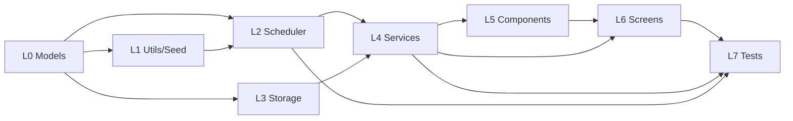

# 单词盒子 (WordBox) — 任务拆解文档

**作者**: Eve (Project Manager)
**版本**: v1.0
**依赖**: PRD.md v1.0, ARCHITECTURE.md v1.0

---

## 1. Required Packages

```json
{
  "dependencies": {
    "react": "18.2.0",
    "react-native": "0.73.0",
    "@react-navigation/native": "^6.1.9",
    "@react-navigation/bottom-tabs": "^6.5.11",
    "@react-navigation/native-stack": "^6.9.17",
    "@react-native-async-storage/async-storage": "^1.21.0",
    "zustand": "^4.4.7",
    "date-fns": "^2.30.0",
    "react-native-screens": "^3.29.0",
    "react-native-safe-area-context": "^4.8.0"
  },
  "devDependencies": {
    "typescript": "^5.3.0",
    "jest": "^29.7.0",
    "ts-jest": "^29.1.1",
    "@types/react": "^18.2.45",
    "@types/jest": "^29.5.10"
  }
}
```

---

## 2. Logic Analysis（按依赖顺序排序）

### 层级 L0 — 纯模型（无依赖）
| # | 文件 | 职责 |
|---|------|------|
| 1 | `src/models/Word.ts` | 定义 `Word` 类型 + `createWord(partial)` 工厂 |
| 2 | `src/models/StudyRecord.ts` | 定义 `StudyRecord` + 状态枚举 + 默认值 |
| 3 | `src/models/CheckIn.ts` | 定义 `CheckIn` 类型 + `isCompleted` helper |

### 层级 L1 — 工具与种子数据（仅依赖 L0）
| # | 文件 | 职责 |
|---|------|------|
| 4 | `src/utils/dateUtils.ts` | 日期格式化、今日 00:00 时间戳、日期区间生成 |
| 5 | `src/utils/seedData.ts` | 内置 30 个考研核心词（MVP 样本） |

### 层级 L2 — 核心算法（仅依赖 L0+L1）
| # | 文件 | 职责 |
|---|------|------|
| 6 | `src/services/EbbinghausScheduler.ts` | SM-2 改进算法，`review` / `initRecord` / `getTodayQueue` |

### 层级 L3 — 存储抽象
| # | 文件 | 职责 |
|---|------|------|
| 7 | `src/services/StorageService.ts` | StorageService 接口 + AsyncStorage 实现 + Memory 实现 |

### 层级 L4 — 业务服务（依赖 L0~L3）
| # | 文件 | 职责 |
|---|------|------|
| 8 | `src/services/AIService.ts` | AIService 接口 + OpenAIService + MockAIService + quality 解析 |
| 9 | `src/services/CheckInService.ts` | 打卡记录、连续天数计算 |
| 10 | `src/services/StatsService.ts` | 学习统计：总词数、掌握数、每日活跃 |

### 层级 L5 — UI 组件（依赖 L0~L4）
| # | 文件 | 职责 |
|---|------|------|
| 11 | `src/components/WordCard.tsx` | 单词卡片 |
| 12 | `src/components/CheckInHeatmap.tsx` | 打卡热力图 |

### 层级 L6 — 页面（依赖所有）
| # | 文件 | 职责 |
|---|------|------|
| 13 | `src/screens/HomeScreen.tsx` | 首页 |
| 14 | `src/screens/ChatScreen.tsx` | AI 对话 |
| 15 | `src/screens/VocabularyScreen.tsx` | 生词本 |
| 16 | `src/screens/CalendarScreen.tsx` | 打卡日历 |
| 17 | `src/screens/StatsScreen.tsx` | 统计 |
| 18 | `src/App.tsx` | 入口 + 导航 |

### 层级 L7 — 测试
| # | 文件 | 职责 |
|---|------|------|
| 19 | `tests/unit/EbbinghausScheduler.test.ts` | 算法单测 |
| 20 | `tests/unit/StorageService.test.ts` | 存储抽象单测 |
| 21 | `tests/unit/AIService.test.ts` | AI 服务单测（含 quality 解析） |
| 22 | `tests/unit/CheckInService.test.ts` | 打卡/连续天数单测 |
| 23 | `tests/unit/StatsService.test.ts` | 统计单测 |
| 24 | `tests/integration/learningFlow.test.ts` | 从初始化→学习→打卡的端到端集成测试 |

---

## 3. 任务依赖图



---

## 4. Full API Spec

### 4.1 AI 外部 API（OpenAI）

**POST** `https://api.openai.com/v1/chat/completions`

Request:
```json
{
  "model": "gpt-4o-mini",
  "messages": [
    { "role": "system", "content": "你是单词盒子的 AI 教练..." },
    { "role": "user", "content": "..." }
  ],
  "temperature": 0.7
}
```

Response (截选):
```json
{
  "choices": [
    { "message": { "role": "assistant", "content": "..." } }
  ]
}
```

### 4.2 内部 Service API

```typescript
// EbbinghausScheduler
getTodayQueue(records: StudyRecord[], now: number, newCap?: number): StudyRecord[]
review(record: StudyRecord, quality: 0|1|2|3|4|5, now: number): StudyRecord
initRecord(wordId: string, now: number): StudyRecord

// StorageService
get<T>(key: string): Promise<T | null>
set<T>(key: string, value: T): Promise<void>
remove(key: string): Promise<void>
keys(): Promise<string[]>

// AIService
chat(messages: ChatMessage[], opts?: { words?: Word[] }): Promise<string>
parseQuality(reply: string): number   // 解析 [[QUALITY:n]]

// CheckInService
recordStudy(seconds: number, wordsCount: number): Promise<CheckIn>
getStreak(now?: number): Promise<number>
getCheckInsInRange(startYMD: string, endYMD: string): Promise<CheckIn[]>

// StatsService
getSummary(days: 7 | 30 | 90): Promise<StatsSummary>
```

---

## 5. Shared Knowledge

### 5.1 常量
```typescript
// src/services/EbbinghausScheduler.ts
export const SM2_INITIAL_EF = 2.5;
export const SM2_MIN_EF = 1.3;
export const DEFAULT_NEW_CAP = 20;
export const MS_PER_DAY = 86400000;

// src/services/CheckInService.ts
export const DAILY_GOAL_SECONDS = 15 * 60;  // 15 分钟
```

### 5.2 Storage Key 规约（架构文档第 9 节）

### 5.3 日期约定
- 所有"日期"用 `YYYY-MM-DD` 本地时间字符串
- 所有"时间戳"用 unix ms (number)
- "今日"以本地时间 00:00:00 为界

### 5.4 错误处理约定
- Service 层不吞错，向上抛 typed Error
- UI 层 try/catch 并降级到友好提示

### 5.5 测试约定
- 所有 Service 都要有单元测试
- 集成测试覆盖"首页进入→学习→打卡"的完整路径
- 使用 FakeClock/MemoryStorage/MockAIService 保证测试确定性

---

## 6. 交付顺序

**按 L0 → L7 顺序串行实现**，每完成一层立即对齐下层所需接口。

**总任务数：24 个源文件 + 测试文件**
**预期代码量：约 1500~2000 行**

---

**本文档作为工程师 Alex 下一阶段的输入。**
