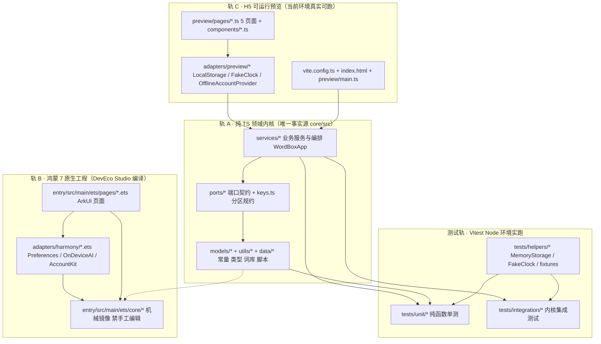
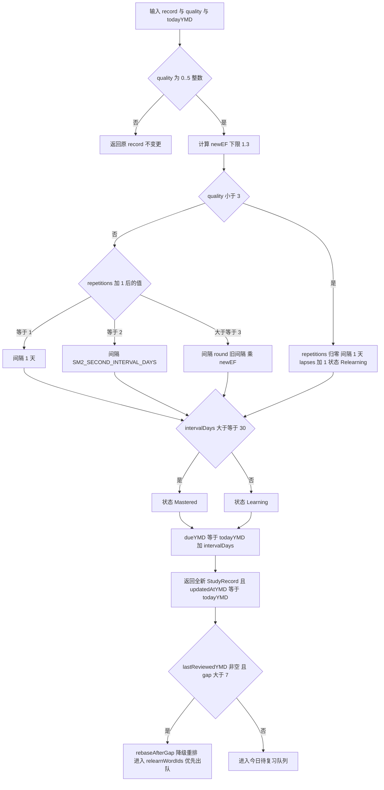
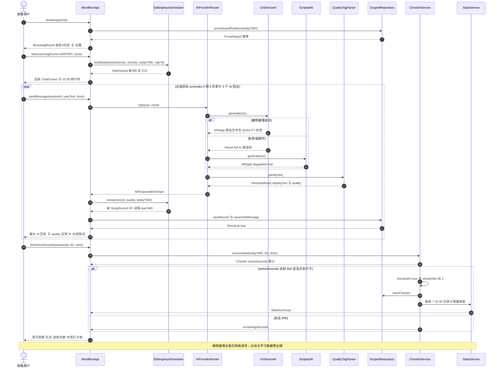
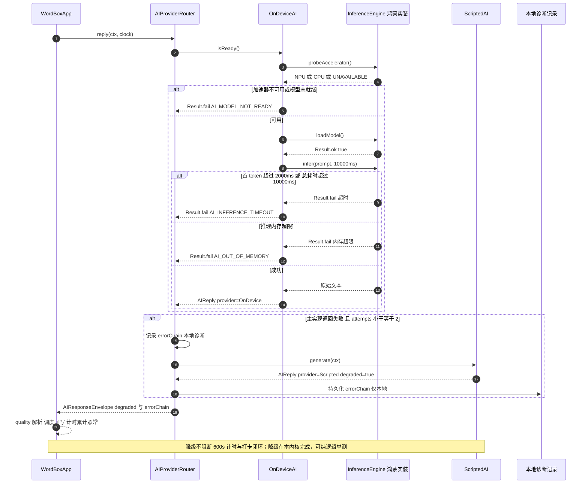
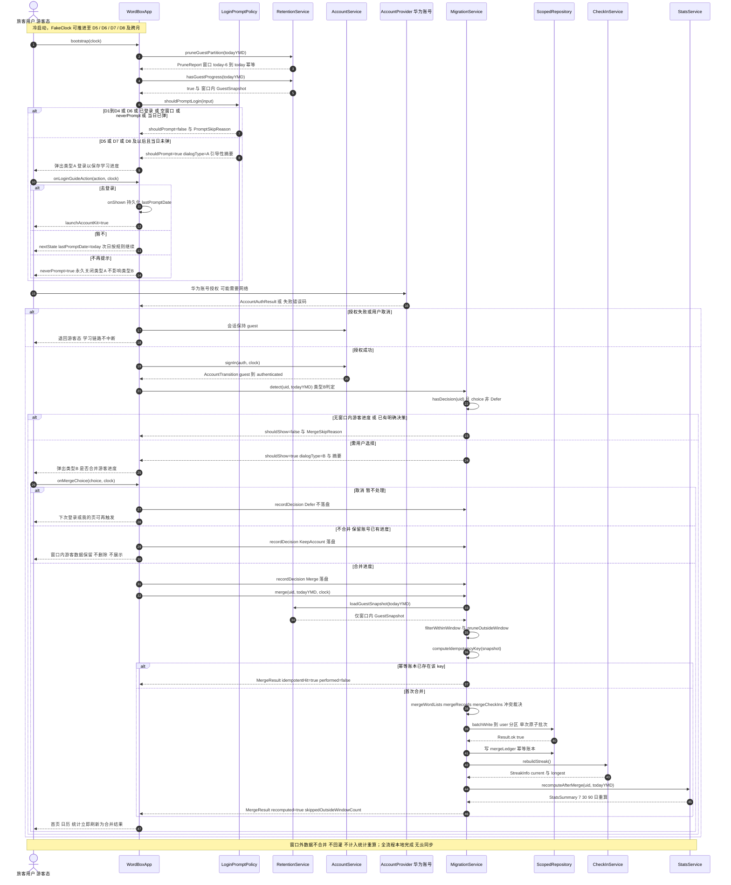
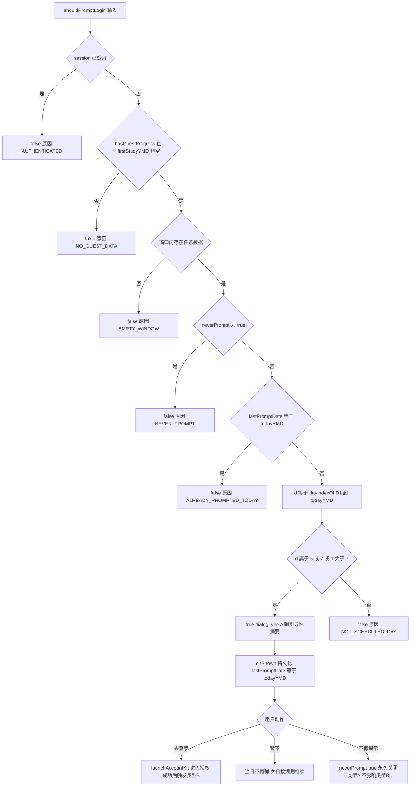
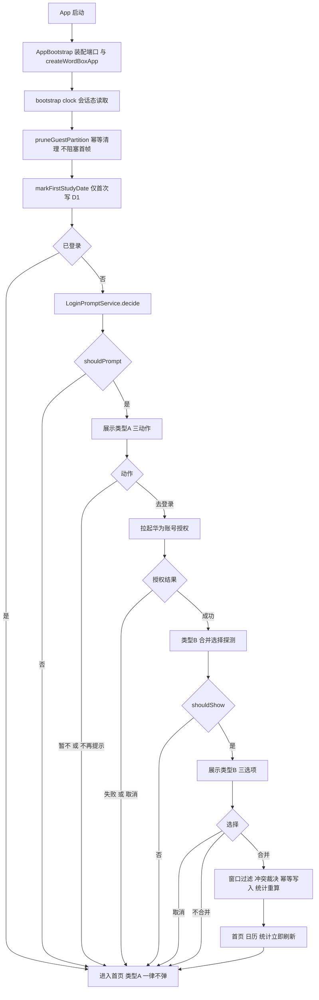

# 单词盒子 WordBox — 系统架构设计（ARCHITECTURE.md）

| 项目 | 内容 |
|------|------|
| 项目名 | `wordbox_harmony` / 单词盒子 (WordBox) |
| 文档版本 | v1.0（架构定稿） |
| 架构师 | 高见远（Bob / Architect） |
| 上游输入 | `PRD.md` v1.1（579 行）+ `ARCHITECT_FINAL_BRIEF.md`（唯一有效决议总表 Q1~Q13） |
| 目标平台 | 鸿蒙 7（HarmonyOS 7 / NEXT，API 12+）ArkTS + ArkUI 原生 App |
| 目标用户 | 准备出国旅游 / 出境的人群 |
| 核心价值 | 每天 10 分钟，通过端侧 AI 旅行情景对话学「用得上的旅行单词」 |
| 工程现实 | 构建环境仅 Node 22.22.2 + npm 10.9.7，**无 DevEco Studio / 鸿蒙 SDK / 真机**；但要求「可运行工程代码 + 真实实跑测试报告」 |
| 配套文档 | `TASK_BREAKDOWN.md`（逐文件任务清单与完整 API Spec） |

> **架构第一原则（防漂移）**：领域逻辑只有一份实现，位于 `core/src/`（纯 TypeScript、零平台依赖、ArkTS 严格子集兼容）。轨 B（鸿蒙原生）与轨 C（H5 预览）**只写平台适配层与 UI，不重写任何业务规则**。轨 B 的 `entry/src/main/ets/core/` 是 `core/src/` 的**机械镜像**（`scripts/sync-core.mjs` 生成 + `scripts/check-core-sync.mjs` 哈希校验），禁止手工编辑；轨 C 通过 Vite alias 直接 import `core/src/` 源码。任何业务规则变更**只允许改 `core/src/`**。

---

## 1. 技术选型表

| 分层 | 选型 | 版本 / 形态 | 理由 |
|------|------|-------------|------|
| **鸿蒙平台侧（轨 B）** | ArkTS + ArkUI 声明式 UI | HarmonyOS 7 / NEXT，API 12+，`compileSdkVersion 12` | PRD A5 硬约束：原生、禁 RN / WebView 混合；声明式 UI 与 `@State`/`@Prop` 适合 5 页面状态驱动 |
| 鸿蒙本地存储 | `@ohos.data.preferences`（`@kit.ArkData`） | API 12+ | 轻量 KV、进程内持久化、杀进程不丢；实现 `StorageService` 字符串 KV 端口的最小代价方案 |
| 鸿蒙账号 | `@kit.AccountKit`（华为账号一键登录） | API 12+ | Q2 决议：`AccountProvider` 端口的鸿蒙实装；仅在授权 / 令牌刷新时可能需要网络，与 AI 推理解耦 |
| 鸿蒙端侧推理 | `OnDeviceAI` + `HarmonyInferenceEngine` | NPU 探测 + CPU 回退 | Q1/A10 决议：模型随包或首启解压、首 token ≤ 2s、单次推理超时 ≤ 10s、失败降级 `ScriptedAI`；推理不出端、无 INTERNET 依赖 |
| 鸿蒙构建 | DevEco Studio 5.x + hvigor + ohpm | `build-profile.json5` / `oh-package.json5` / `module.json5` | 标准工程结构，装 SDK 的机器可直接编译；本环境**只落盘源码、不编译** |
| **领域内核侧（轨 A）** | 纯 TypeScript 严格子集 | TS 5.7，`strict: true`，零运行时依赖 | Vitest 可直接 import 实跑；同时能被 sync 脚本改扩展名为 `.ets` 后在 ArkTS 下编译（禁 `any`、禁 DOM/Node API、禁动态类型技巧） |
| 内核算法 | 纯函数 + 不可变更新 + 依赖注入 | `Clock` / `StorageService` / `InferenceEngine` / `AccountProvider` 四端口 | A1/A4/A7/A11/A12：可注入 FakeClock 与内存存储，窗口、弹窗、合并、调度 100% 可单测 |
| 序列化 | `JSON.stringify` / `JSON.parse` + 字段校验 | 唯一允许的 `as T` 断言点 `JsonCodec` | StorageService 为字符串 KV，内核不暴露 `any`；ArkTS 兼容边界收敛到单文件 |
| **H5 预览侧（轨 C）** | Vite 6 + 原生 TypeScript（无前端框架） | Node 22 可实跑 | 零框架避免额外编译约束；`npm run dev` 即可真实交互；通过 alias 复用同一 `core/src` 内核，天然不漂移 |
| 预览适配 | `LocalStorageAdapter` / `FakeClock` / `OfflineAccountProvider` / `ScriptedAI` / `MockAI` | 浏览器 localStorage + 可推进时钟面板 | 支持 FakeClock 模拟 D1→D8，完整演示游客态 7 天窗口、类型 A/B 弹窗、合并与统计重算 |
| **测试侧** | Vitest 2 + `@vitest/coverage-v8` + `tsc --noEmit` | `environment: 'node'`，**不需要 jsdom** | 内核零 DOM 依赖，Node 环境直接实跑；`npm test` / `test:unit` / `test:integration` / `test:coverage` 四条脚本均可真实执行并产出报告 |
| 测试替身 | `MemoryStorageService` / `FakeClock` / `MockAI` / `OfflineAccountProvider` | 内核或 `tests/helpers` 内 | 不依赖真机、不依赖网络、不依赖鸿蒙 SDK，满足 NFR「可测试性」硬门禁 |
| 代码同步 | Node 原生脚本 `sync-core.mjs` / `check-core-sync.mjs` | 零依赖 `.mjs` | 保证轨 B 镜像与内核字节级一致，`check:core-sync` 可进 CI，杜绝三轨实现漂移 |

**不选型 / 不引入**：React / React Native / WebView 混合（A5 禁止）、云侧大模型 HTTP API（Q1 作废）、IndexedDB / SQLite / RDB（KV 已足够且更易跨轨）、jsdom（内核无 DOM）、任何需要鸿蒙 SDK 才能安装的 npm 运行时包。

---

## 2. 总体分层架构与三轨复用边界

### 2.1 三轨分层架构图



### 2.2 三轨职责与可运行性

| 轨 | 输入（复用内核） | 本轨独有实现 | 可运行性 / 验证方式 |
|----|------------------|--------------|---------------------|
| **A 内核** | — | `models` / `utils` / `data` / `ports` / `services` 全部；`ScriptedAI`、`MockAI`、`OnDeviceAI`（依赖端口）、`MemoryStorageService`、`SystemClock`、SM-2、打卡、统计、账号会话、7 天窗口、登录引导状态机、迁移合并 | **Node 22 + Vitest 直接 import 实跑**，单元测试 + 集成测试 + 覆盖率报告；`tsc --noEmit` 静态校验 |
| **B 鸿蒙** | `entry/src/main/ets/core/` = `core/src/**/*.ts` → `.ets` 机械镜像（仅扩展名与文件头注释变化，业务字节一致） | `HarmonyPreferencesStorage`、`HarmonyClock`、`HarmonyInferenceEngine`（NPU/CPU 探测 + 模型加载 + infer）、`HuaweiAccountProvider`、ArkUI 6 页面 + 2 弹窗组件、`EntryAbility.ets`、`AppBootstrap.ets`、`module.json5` | 本环境**不编译**；源码满足 DevEco Studio 5.x / API 12+ 工程结构，装有 SDK 的机器可编译；`npm run check:core-sync` 校验镜像一致性 |
| **C 预览** | Vite alias `@core` → `core/src/index.ts`，**直接 import 同一份 `.ts` 源码**（零拷贝、零漂移） | `LocalStorageAdapter`、`FakeClock` + 时钟推进面板、`OfflineAccountProvider`（离线模拟华为账号授权成功 / 取消 / 失败）、H5 5 页面 + 类型 A/B 弹窗组件、CSS | **当前环境 `npm run dev` 真实可运行、可交互**；FakeClock 面板一键推进 D1→D8，验证全部游客态流程；浏览器手工验证，不进 Vitest（无 DOM 测试依赖） |
| **测试** | 直接 import `core/src` | 测试替身与断言 | `npm test` / `test:unit` / `test:integration` / `test:coverage` 全部真实实跑，产出报告 |

### 2.3 复用边界与「只在哪一轨落地」清单（硬约束）

| 能力 | 内核 A | 鸿蒙 B | 预览 C | 说明 |
|------|:------:|:------:|:------:|------|
| SM-2 调度、打卡、统计、词本、场景 | ✅ 唯一实现 | ❌ 禁止重写 | ❌ 禁止重写 | 纯函数 / 服务，注入 `Clock` 与 `StorageService` |
| 7 天窗口过滤与清理、登录引导状态机、合并冲突与幂等 | ✅ 唯一实现 | ❌ | ❌ | A12 / A11 纯函数化，100% 内核单测 |
| `guest:` / `user:{uid}:` 分区与读取层门禁 | ✅ 唯一实现 | ❌ | ❌ | A9 / Q10 解释 A；UI 只渲染 `Gated<T>` 结果 |
| `ScriptedAI` / `MockAI` / `OnDeviceAI`（含降级判定） | ✅ 唯一实现 | ❌ | ❌ | 降级逻辑可测；`OnDeviceAI` 只依赖 `InferenceEngine` 端口 |
| `StorageService` 实装 | ✅ `MemoryStorageService` | ✅ `HarmonyPreferencesStorage` | ✅ `LocalStorageAdapter` | 端口在内核，实现分轨 |
| `Clock` 实装 | ✅ `SystemClock` | ✅ `HarmonyClock` | ✅ `FakeClock`（+ SystemClock） | 端口在内核 |
| `InferenceEngine` 实装 | ❌ 仅端口 + 测试替身 | ✅ `HarmonyInferenceEngine` | ❌ 预览走 `ScriptedAI`/`MockAI` | Q1：端侧推理只在鸿蒙轨落地，内核不得引入任何厂商 SDK |
| `AccountProvider` 实装 | ❌ 仅端口 + 测试替身 | ✅ `HuaweiAccountProvider` | ✅ `OfflineAccountProvider` | Q2：UI 层禁硬编码厂商 SDK |
| ArkUI / DOM 页面与组件 | ❌ | ✅ | ✅ | 两轨各自实现，但**只调用同一 `WordBoxApp` 门面** |
| `CloudAI` | 仅扩展点（无文件、无类） | ❌ | ❌ | Q1：不实现，仅靠 `AIService` 接口 + `AIProviderRouter` 构造参数预留可插拔性 |
| `SpeechService` | 仅端口声明（P1） | P1 实装 | P1 实装 | Q6：MVP 不启用，端口声明不产生运行时代码 |

> **防漂移三条机械保障**：① `core/src` 是唯一可编辑业务源；② `npm run sync:core` 单向生成轨 B 镜像，`npm run check:core-sync` 比对 `core-manifest.json` 哈希，不一致即失败；③ 轨 B / 轨 C 的页面禁止直接 import `@ohos.*` / `window.*` 到内核，所有平台能力必须经端口注入。

---

## 3. 模块划分：完整目录树

```
wordbox-harmony-delivery/
├── PRD.md                                     # 上游产品需求（v1.1）
├── ARCHITECTURE.md                            # 本文档
├── TASK_BREAKDOWN.md                          # 任务拆解 + 完整 API Spec
├── package.json                               # Node 侧依赖与 4 条测试脚本
├── tsconfig.json                              # strict / noEmit / paths alias
├── vitest.config.ts                           # environment: node + coverage 配置
├── vite.config.ts                             # 轨 C：alias @core -> core/src
├── index.html                                 # 轨 C 入口
├── core-manifest.json                         # sync 脚本生成的内核文件哈希清单
├── docs/
│   ├── sequence-diagram.mermaid               # 3 张时序图抽取件
│   └── class-diagram.mermaid                  # 类图抽取件
├── scripts/
│   ├── sync-core.mjs                          # core/src/**/*.ts → harmony/**/*.ets（镜像）
│   ├── check-core-sync.mjs                    # 校验镜像哈希一致性
│   └── gen-core-manifest.mjs                  # 生成 core-manifest.json
├── core/src/                                  # ★ 轨 A：唯一事实源（零平台依赖）
│   ├── index.ts                               # barrel 导出（供 B/C/测试统一 import）
│   ├── models/
│   │   ├── constants.ts                       # 全部共享常量（含 600 / 7 / [5,7] / 2.5 / 1.3）
│   │   ├── types.ts                           # 全部 interface / enum / Result
│   │   └── errors.ts                          # ErrorCode 枚举 + ok/fail + 错误映射表
│   ├── utils/
│   │   ├── date.ts                            # YMD 纯函数：addDays/diffDays/dayIndexOf/windowFrom
│   │   ├── id.ts                              # 确定性 ID + FNV-1a 幂等键
│   │   └── collection.ts                      # 排序 / 去重 / 分组（不可变）
│   ├── data/
│   │   ├── seedWords.ts                       # 8 场景 × 30 词 = 240 词内置种子
│   │   └── scriptTemplates.ts                 # 每场景 ≥3 套离线脚本，支撑 ≥6 回合
│   ├── ports/
│   │   ├── ports.ts                           # Clock / StorageService / AIService / InferenceEngine / AccountProvider / SpeechService
│   │   ├── keys.ts                            # Storage Key 规约 + 分区函数（唯一来源）
│   │   └── codec.ts                           # JsonCodec：唯一 as T 断言点 + 字段校验
│   ├── adapters/
│   │   ├── memoryStorage.ts                   # MemoryStorageService（内核自带、测试/预览可用）
│   │   └── systemClock.ts                     # SystemClock（Date 兼容层，无 Node/DOM 专有 API）
│   ├── services/
│   │   ├── scheduler.ts                       # EbbinghausScheduler（纯函数 + 不可变）
│   │   ├── quality.ts                         # QualityTagParser：[[QUALITY:n]] 解析
│   │   ├── prompt.ts                          # PromptStrategy：旅行角色 Prompt 组装
│   │   ├── scriptedAI.ts                      # ScriptedAI（离线兜底，AIService 实装）
│   │   ├── mockAI.ts                          # MockAI（可注入故障，测试用）
│   │   ├── onDeviceAI.ts                      # OnDeviceAI（依赖 InferenceEngine 端口）
│   │   ├── aiRouter.ts                        # AIProviderRouter：超时/重试/降级/errorChain
│   │   ├── repository.ts                      # ScopedRepository：双分区 + 日期索引 + 门禁读层
│   │   ├── progressGate.ts                    # ProgressGate：F-20 读取层门禁
│   │   ├── wordbook.ts                        # WordBookService
│   │   ├── scene.ts                           # SceneService
│   │   ├── checkin.ts                         # CheckInService（600s + 连续天数）
│   │   ├── stats.ts                           # StatsService（7/30/90 + 日历 + 重算）
│   │   ├── account.ts                         # AccountService（会话态 + 跃迁 + 游客进度探测）
│   │   ├── retention.ts                       # GuestRetentionPolicy + RetentionService
│   │   ├── loginPrompt.ts                     # LoginPromptPolicy + LoginPromptService（类型 A）
│   │   ├── migration.ts                       # ProgressMergeService + MigrationService（类型 B / 幂等）
│   │   └── appFacade.ts                       # WordBoxApp：全部用例编排门面
├── adapters/preview/                          # 轨 C 平台适配
│   ├── localStorage.ts                        # LocalStorageAdapter : StorageService
│   ├── fakeClock.ts                           # FakeClock : Clock（D1→D8 推进）
│   ├── offlineAccountProvider.ts              # OfflineAccountProvider : AccountProvider
│   └── previewAI.ts                           # 预览 Provider 装配（ScriptedAI / MockAI）
├── preview/                                   # 轨 C：H5 真实可运行
│   ├── main.ts                                # 装配 Application + 启动
│   ├── router.ts                              # 5 页面 hash 路由
│   ├── style.css                              # 全局样式（竖屏 / 深色适配）
│   ├── components/
│   │   ├── shell.ts                           # 顶栏 + 底部 5 tab
│   │   ├── modal.ts                           # 通用弹窗基座
│   │   ├── typeADialog.ts                     # 类型 A 登录引导（三动作）
│   │   ├── typeBDialog.ts                     # 类型 B 合并选择（三选项）
│   │   ├── gateView.ts                        # F-20 门禁引导视图
│   │   └── clockPanel.ts                      # FakeClock D1→D8 演示面板
│   └── pages/
│       ├── home.ts                            # F-01 首页
│       ├── chat.ts                            # F-02 情景对话（600s 计时）
│       ├── vocabulary.ts                      # F-03 生词本
│       ├── calendar.ts                        # F-07 打卡日历
│       ├── stats.ts                           # F-08 学习统计
│       └── account.ts                         # F-19 我的 / 账号 + 再次合并入口
├── harmony/                                   # 轨 B：DevEco Studio 工程（本环境不编译）
│   ├── AppScope/
│   │   ├── app.json5
│   │   └── resources/base/element/string.json
│   ├── build-profile.json5
│   ├── oh-package.json5
│   ├── hvigorfile.ts
│   ├── entry/
│   │   ├── build-profile.json5
│   │   ├── hvigorfile.ts
│   │   ├── oh-package.json5
│   │   └── src/main/
│   │       ├── module.json5                   # 权限白名单：仅 INTERNET(账号) / VIBRATE(可选)
│   │       ├── ets/
│   │       │   ├── entryability/EntryAbility.ets
│   │       │   ├── core/                     # ★ sync-core.mjs 机械镜像（禁手工编辑）
│   │       │   ├── adapters/
│   │       │   │   ├── HarmonyPreferencesStorage.ets
│   │       │   │   ├── HarmonyClock.ets
│   │       │   │   ├── HarmonyInferenceEngine.ets
│   │       │   │   └── HuaweiAccountProvider.ets
│   │       │   ├── components/
│   │       │   │   ├── LoginGuideDialog.ets  # 类型 A
│   │       │   │   ├── MergeChoiceDialog.ets # 类型 B
│   │       │   │   └── GateView.ets          # F-20
│   │       │   ├── pages/
│   │       │   │   ├── HomeScreen.ets
│   │       │   │   ├── ChatScreen.ets
│   │       │   │   ├── VocabularyScreen.ets
│   │       │   │   ├── CalendarScreen.ets
│   │       │   │   ├── StatsScreen.ets
│   │       │   │   └── AccountScreen.ets
│   │       │   └── app/
│   │       │       ├── AppBootstrap.ets       # 装配端口 + 冷启动顺序
│   │       │       └── AppState.ets           # @Observed 全局会话/弹窗状态
│   │       └── resources/base/profile/main_pages.json
│   └── ...（其余资源文件按 DevEco 标准模板）
└── tests/
    ├── helpers/
    │   ├── fakeClock.ts                       # FakeClock（可 setYMD / advanceDays）
    │   ├── memoryStorage.ts                   # 复用 core/adapters/memoryStorage
    │   └── fixtures.ts                        # 240 词精简夹具 / 游客快照 / 账号快照
    ├── unit/
    │   ├── date.test.ts
    │   ├── scheduler.test.ts
    │   ├── quality.test.ts
    │   ├── aiRouter.test.ts
    │   ├── checkin.test.ts
    │   ├── stats.test.ts
    │   ├── wordbook.test.ts
    │   ├── account.test.ts
    │   ├── repository.test.ts
    │   ├── retention.test.ts
    │   ├── loginPrompt.test.ts
    │   └── migration.test.ts
    └── integration/
        ├── learningFlow.test.ts               # 时序图 ①
        ├── aiFallback.test.ts                 # 时序图 ②
        ├── guestLoginMerge.test.ts            # 时序图 ③ 类型 B
        ├── guestWindowD1toD8.test.ts          # 时序图 ③ 类型 A + 窗口
        └── gate.test.ts                       # F-20 读取层门禁
```

### 3.1 模块职责速查

| 模块 | 职责 | P0 功能落点 |
|------|------|-------------|
| `models/constants.ts` | 全部共享常量单一来源，禁止在别处硬编码 600 / 7 / [5,7] / 2.5 / 1.3 | A1 / A12 |
| `models/types.ts` | 全部数据结构、枚举、`Result<T>` | §4 |
| `ports/keys.ts` | 分区与 Key 构造，**任何 Service 不得自行拼 Key** | A9 / F-05 |
| `ports/codec.ts` | JSON 编解码与字段校验，唯一 ArkTS 断言点 | A4 |
| `services/repository.ts` | 双分区读写 + `guest:index:dates` 日期索引 + 门禁读层 | F-05 / F-20 |
| `services/scheduler.ts` | SM-2 纯函数、今日队列、断更重排 | F-04 |
| `services/checkin.ts` | 600s 累计、每日 1 次打卡、连续天数重算 | F-06 |
| `services/stats.ts` | 7/30/90 统计、月视图日历、门禁后 `Gated<T>` | F-07 / F-08 / F-20 |
| `services/account.ts` | 会话态持久化、`guest → authenticated` 跃迁、游客进度探测 | F-19 / A9 |
| `services/retention.ts` | `[today-6, today]` 窗口、幂等清理、游客快照 | F-22 / A12 |
| `services/loginPrompt.ts` | 类型 A 状态机（D5/D7/D8+ 每日一次 / 不再提示） | F-22 |
| `services/migration.ts` | 类型 B 决策、窗口前置过滤、冲突裁决、幂等账本、统计重算 | F-21 / A11 |
| `services/appFacade.ts` | 冷启动顺序、学习回合、弹窗 A→授权→B 时序编排 | F-01/02/19/21/22 |

---

## 4. 核心数据结构（完整 TypeScript interface）

> 所有字段 `readonly`；集合统一 `readonly T[]`；不使用 `any` / `unknown` / 动态属性访问；全部 ArkTS 严格子集兼容。所有跨日字段使用 `'YYYY-MM-DD'` 字符串（记为 `YMD`），所有时刻使用 epoch 毫秒。

```ts
// ============ 枚举 ============
export enum Scene {
  AIRPORT = 'airport', CUSTOMS = 'customs', HOTEL = 'hotel', DINING = 'dining',
  DIRECTIONS = 'directions', SHOPPING = 'shopping', TRANSPORT = 'transport', EMERGENCY = 'emergency',
}
export enum SessionKind { Guest = 'guest', Authenticated = 'authenticated' }
export enum WordStatus { New = 'new', Learning = 'learning', Relearning = 'relearning', Mastered = 'mastered' }
export enum WordSource { Seed = 'seed', User = 'user', Chat = 'chat' }
export enum AIProviderKind { OnDevice = 'onDevice', Scripted = 'scripted', Mock = 'mock' }
export enum AcceleratorKind { NPU = 'npu', CPU = 'cpu', UNAVAILABLE = 'unavailable' }
export enum ChatRole { AI = 'ai', User = 'user', System = 'system' }
export enum DialogType { LoginGuide = 'A', MergeChoice = 'B' }
export enum PromptActionKind { GoLogin = 'goLogin', Later = 'later', NeverPrompt = 'neverPrompt' }
export enum MergeChoiceKind { Merge = 'merge', KeepAccount = 'keepAccount', Defer = 'defer' }
export enum StatsWindow { D7 = 7, D30 = 30, D90 = 90 }
export enum DayState { Checked = 'checked', Missed = 'missed', Future = 'future' }
export enum GateReason { Ok = 'ok', Guest = 'guest' }
export enum PromptSkipReason {
  NONE = 'none', AUTHENTICATED = 'authenticated', NO_GUEST_DATA = 'noGuestData',
  EMPTY_WINDOW = 'emptyWindow', NEVER_PROMPT = 'neverPrompt',
  ALREADY_PROMPTED_TODAY = 'alreadyPromptedToday', NOT_SCHEDULED_DAY = 'notScheduledDay',
}
export enum MergeSkipReason {
  PERFORMED = 'performed', ALREADY_MERGED = 'alreadyMerged', NO_GUEST_DATA = 'noGuestData',
  OUTSIDE_WINDOW_ONLY = 'outsideWindowOnly', DECISION_KEEP_ACCOUNT = 'decisionKeepAccount',
  DECISION_DEFER = 'decisionDefer', NOT_AUTHENTICATED = 'notAuthenticated',
}
export enum ConflictRule { SAME_DAY_CHECKIN = 'sameDayCheckIn', RECORD_NO_REGRESSION = 'recordNoRegression', WORD_DEDUP = 'wordDedup' }
export enum ConflictSource { ACCOUNT = 'account', GUEST = 'guest', BLENDED = 'blended' }

// ============ 错误与结果 ============
export enum ErrorCode {
  NONE = '',
  INVALID_ARGUMENT = 'E_INVALID_ARGUMENT', INVALID_DATE = 'E_INVALID_DATE', INVALID_QUALITY = 'E_INVALID_QUALITY',
  STORAGE_READ_FAILED = 'E_STORAGE_READ', STORAGE_WRITE_FAILED = 'E_STORAGE_WRITE',
  STORAGE_BATCH_PARTIAL = 'E_STORAGE_BATCH_PARTIAL',
  NOT_AUTHENTICATED = 'E_NOT_AUTHENTICATED', ACCOUNT_AUTH_FAILED = 'E_ACC_AUTH_FAILED',
  ACCOUNT_NETWORK = 'E_ACC_NETWORK', ACCOUNT_USER_CANCELLED = 'E_ACC_CANCELLED',
  ACCOUNT_KIT_UNAVAILABLE = 'E_ACC_KIT_UNAVAILABLE', ACCOUNT_TOKEN_EXPIRED = 'E_ACC_TOKEN_EXPIRED',
  AI_MODEL_NOT_READY = 'E_AI_MODEL_NOT_READY', AI_NPU_UNAVAILABLE = 'E_AI_NPU_UNAVAILABLE',
  AI_FIRST_TOKEN_TIMEOUT = 'E_AI_FIRST_TOKEN_TIMEOUT', AI_INFERENCE_TIMEOUT = 'E_AI_INFERENCE_TIMEOUT',
  AI_OUT_OF_MEMORY = 'E_AI_OUT_OF_MEMORY', AI_EMPTY_REPLY = 'E_AI_EMPTY_REPLY', AI_ENGINE_ERROR = 'E_AI_ENGINE_ERROR',
  GATE_BLOCKED = 'E_GATE_BLOCKED',
  MERGE_NO_GUEST_DATA = 'E_MERGE_NO_GUEST_DATA', MERGE_OUTSIDE_WINDOW_ONLY = 'E_MERGE_OUTSIDE_WINDOW_ONLY',
  MERGE_DECISION_BLOCKED = 'E_MERGE_DECISION_BLOCKED', MERGE_NOT_AUTHENTICATED = 'E_MERGE_NOT_AUTHENTICATED',
  PROMPT_INVALID_STATE = 'E_PROMPT_INVALID_STATE',
}
export interface AppError { readonly code: ErrorCode; readonly message: string; readonly detail: string; }
export interface Result<T> {
  readonly ok: boolean;
  readonly value: T | undefined;
  readonly error: AppError | undefined;
}

// ============ 领域模型 ============
export interface Word {
  readonly id: string;               // 稳定 ID：'w-{scene}-{slug}'；用户词 'u-{fnv1a(text|scene)}'
  readonly text: string;             // 词条英文，如 'boarding pass'
  readonly phonetic: string;         // 音标；无则 ''
  readonly meaningZh: string;        // 中文释义
  readonly scene: Scene;             // 8 大旅行场景之一（A6）
  readonly locale: string;           // 目的地语种，MVP 固定 'en-US'；P2 多语种预留（F-18）
  readonly exampleInScene: string;   // 旅行实景例句（A6）
  readonly aiRolePrompt: string;     // 该场景下 AI 扮演角色提示词（A6）
  readonly source: WordSource;       // 内置种子 / 手动添加 / 对话取词
  readonly createdAtYMD: string;     // 落盘日 YMD，作为 7 天窗口判定日
}

export interface StudyRecord {
  readonly wordId: string;           // 关联 Word.id
  readonly ef: number;               // SM-2 易度因子，初始 2.5，下限 1.3
  readonly repetitions: number;      // 连续成功复习次数
  readonly intervalDays: number;     // 当前复习间隔（天）
  readonly dueYMD: string;           // 下次复习日 YMD
  readonly lastReviewedYMD: string;  // 上次复习日 YMD；从未复习为 ''
  readonly lapses: number;           // 失败（quality<3）累计次数
  readonly status: WordStatus;       // new / learning / relearning / mastered
  readonly totalReviews: number;     // 累计复习次数
  readonly correctReviews: number;   // quality>=3 的复习次数
  readonly createdAtYMD: string;     // 入调度队列日
  readonly updatedAtYMD: string;     // 最近一次回写日，作为游客窗口判定日
}

export interface CheckIn {
  readonly dateYMD: string;          // 本地 00:00 日切的自然日
  readonly activeSeconds: number;    // 前台对话页有效累计秒（后台/锁屏暂停）
  readonly goalSeconds: number;      // 达标快照，固定 600
  readonly checkedIn: boolean;      // 当日是否已打卡（每日仅 1 次）
  readonly checkedInAtMs: number;    // 打卡时刻 epoch ms；未打卡为 0
  readonly streakAfter: number;      // 打卡后连续天数
  readonly newWords: number;         // 当日新学词数
  readonly reviewedWords: number;    // 当日复习词数
}

export interface ChatMessage {
  readonly id: string;
  readonly sessionId: string;        // 单次学习会话 ID
  readonly role: ChatRole;
  readonly scene: Scene;
  readonly wordIds: readonly string[]; // 本轮带出的目标词（保证复现率 100%）
  readonly content: string;          // 展示文本，已剥离 [[QUALITY:n]]
  readonly quality: number;          // -1 = 该轮未计分；0..5 = 解析到的评分
  readonly createdAtMs: number;
  readonly provider: AIProviderKind; // 实际生成该轮的 Provider
  readonly degraded: boolean;        // 是否由 ScriptedAI 降级产出
}

export interface MasteryPoint { readonly dateYMD: string; readonly masteredWords: number; }
export interface SceneMastery {
  readonly scene: Scene; readonly total: number; readonly mastered: number; readonly ratio: number;
}
export interface StatsSummary {
  readonly windowDays: StatsWindow;
  readonly asOfYMD: string;
  readonly masteredWords: number;         // status=Mastered 或 intervalDays>=30
  readonly learningWords: number;
  readonly totalReviews: number;
  readonly correctReviews: number;
  readonly reviewCompletionRate: number; // 0..1，分母为到期任务数，无任务时为 0
  readonly totalActiveSeconds: number;
  readonly checkedInDays: number;
  readonly currentStreak: number;
  readonly longestStreak: number;
  readonly masteryCurve: readonly MasteryPoint[];
  readonly sceneDistribution: readonly SceneMastery[]; // 固定 8 项，顺序与 ALL_SCENES 一致
}

export interface AccountSession {
  readonly kind: SessionKind;
  readonly uid: string;               // 游客固定 'guest'；登录态为华为账号本地不可逆摘要
  readonly displayName: string;
  readonly partition: string;         // 'guest:' 或 'user:{uid}:'（由 keys.ts 生成，禁止手写）
  readonly authenticatedAtMs: number; // 游客为 0
  readonly tokenRefreshedAtMs: number;
}

export interface GuestPromptState {
  readonly firstStudyYMD: string;     // D1：游客首次产生学习数据的自然日；'' = 无数据
  readonly neverPrompt: boolean;      // 永久关闭类型 A；不影响类型 B
  readonly lastPromptDate: string;    // 最近一次类型 A 弹窗展示日 YMD；'' = 从未
  readonly lastDecisionYMD: string;   // 最近一次类型 B 明确决策日 YMD（审计用）
}

export interface MergeDecision {
  readonly uid: string;
  readonly choice: MergeChoiceKind;   // Merge / KeepAccount 落盘；Defer 不落盘
  readonly decidedAtMs: number;
  readonly idempotencyKey: string;    // 决策时游客窗口快照的 FNV-1a 键
}

export interface MergeResult {
  readonly performed: boolean;
  readonly reason: MergeSkipReason;
  readonly windowFromYMD: string;     // today-6
  readonly windowToYMD: string;       // today
  readonly mergedWordIds: readonly string[];
  readonly mergedRecordWordIds: readonly string[];
  readonly mergedCheckInDates: readonly string[];
  readonly skippedOutsideWindowCount: number; // 窗口外被过滤、不合并/不回灌的条数
  readonly conflictResolvedCount: number;
  readonly recomputed: boolean;       // 连续天数与 7/30/90 统计已重算
  readonly after: StatsSummary | undefined; // 重算结果；未执行合并为 undefined
  readonly idempotentHit: boolean;    // true = 幂等账本命中，零写入
}

export interface Settings {
  readonly dailyGoalSeconds: number;  // 600
  readonly newWordsPerDay: number;    // 8
  readonly restDayEnabled: boolean;   // P1，默认 false
  readonly preferredScenes: readonly Scene[];
  readonly darkMode: boolean;
  readonly aiProvider: AIProviderKind;
  readonly locale: string;
}

// ============ 复合/辅助结构 ============
export interface DateWindow { readonly fromYMD: string; readonly toYMD: string; readonly days: number; }
export interface DatedEntity<T> { readonly dateYMD: string; readonly payload: T; }
export interface PruneResult<T> { readonly kept: readonly T[]; readonly removed: readonly T[]; readonly changed: boolean; }
export interface PruneReport {
  readonly window: DateWindow;
  readonly removedKeys: readonly string[];
  readonly removedCount: number;
  readonly keptCount: number;
  readonly idempotent: boolean;      // 重复执行 removedCount=0 且 idempotent=true
  readonly rebuiltIndex: boolean;
}
export interface GuestSnapshot {
  readonly window: DateWindow;
  readonly words: readonly Word[];
  readonly records: readonly StudyRecord[];
  readonly checkIns: readonly CheckIn[];
  readonly chatMessages: readonly ChatMessage[];
  readonly promptState: GuestPromptState;
  readonly dateIndex: readonly string[];
}
export interface DailyQueue {
  readonly dateYMD: string;
  readonly newWordIds: readonly string[];
  readonly reviewWordIds: readonly string[];
  readonly relearnWordIds: readonly string[]; // 断更>7天，优先出队
  readonly total: number;
}
export interface StreakInfo {
  readonly current: number; readonly longest: number; readonly checkedInDates: readonly string[];
}
export interface GateDecision { readonly allowed: boolean; readonly reason: GateReason; readonly unlockHint: string; }
export interface Gated<T> {
  readonly allowed: boolean; readonly reason: GateReason;
  readonly data: T | undefined;       // 游客态恒为 undefined，读取层不返回任何进度数字
  readonly unlockHint: string;
}
export interface CalendarDay { readonly dateYMD: string; readonly state: DayState; readonly activeSeconds: number; }
export interface CalendarMonth {
  readonly month: string;             // 'YYYY-MM'
  readonly days: readonly CalendarDay[];
  readonly daysInMonth: number;
  readonly checkedInDays: number;
  readonly longestStreak: number;
  readonly totalActiveSeconds: number;
}
export interface SceneMeta {
  readonly scene: Scene; readonly labelZh: string; readonly icon: string;
  readonly aiRole: string; readonly seedCount: number;
}
export interface SceneWordCount { readonly scene: Scene; readonly count: number; }
export interface WordFilter { readonly scene: Scene | 'ALL'; readonly keyword: string; readonly status: WordStatus | 'ALL'; }
export interface NewWordInput { readonly text: string; readonly meaningZh: string; readonly scene: Scene; readonly exampleInScene: string; }
export interface WordEntry { readonly word: Word; readonly record: StudyRecord; }
export interface StorageEntry { readonly key: string; readonly value: string; }

// ============ AI 协议 ============
export interface AIContext {
  readonly scene: Scene;
  readonly dateYMD: string;
  readonly targetWordIds: readonly string[];
  readonly words: readonly Word[];
  readonly history: readonly ChatMessage[];
  readonly sessionId: string;
  readonly turnIndex: number;
}
export interface AIPrompt { readonly system: string; readonly user: string; readonly targetWords: readonly string[]; readonly qualityProtocol: string; }
export interface AIReply {
  readonly content: string;           // 原始文本，可含 [[QUALITY:n]]
  readonly provider: AIProviderKind;
  readonly latencyMs: number;
  readonly degraded: boolean;
  readonly errorCode: ErrorCode;      // 成功为 NONE
}
export interface ParsedAIReply {
  readonly displayText: string;       // 剥离标签后的展示文本
  readonly quality: number;           // -1 表示未解析到评分
  readonly wordIds: readonly string[];
}
export interface AIResponseEnvelope {
  readonly reply: AIReply;
  readonly parsed: ParsedAIReply;
  readonly degraded: boolean;
  readonly attempts: number;
  readonly errorChain: readonly AppError[]; // 仅本地诊断，不出端
}

// ============ 账号外部契约 ============
export interface AccountAuthResult {
  readonly uid: string;               // 由 Adapter 对华为 unionId 做本地不可逆摘要后给出
  readonly displayName: string;
  readonly expiresAtMs: number;
}
export interface AccountTransition {
  readonly before: AccountSession;
  readonly after: AccountSession;
  readonly guestProgressExists: boolean; // 窗口内游客进度存在性
  readonly shouldShowTypeB: boolean;     // = guestProgressExists && !decisionAlreadyMade
  readonly decisionAlreadyMade: boolean; // 该 uid 已有 Merge/KeepAccount 明确决策
}

// ============ 弹窗与编排 ============
export interface LoginPromptInput {
  readonly firstStudyYMD: string;
  readonly todayYMD: string;
  readonly state: GuestPromptState;
  readonly session: AccountSession;
  readonly hasGuestProgress: boolean;
  readonly window: DateWindow;
}
export interface PromptSummary {           // 引导性摘要，非统计页，不违反 F-20
  readonly studyDays: number; readonly wordsLearned: number; readonly totalMinutes: number;
  readonly windowFromYMD: string; readonly windowToYMD: string;
}
export interface LoginPromptDecision {
  readonly shouldPrompt: boolean;
  readonly dialogType: DialogType;        // 恒为 A
  readonly dayIndex: number;              // D1=1；无数据=0
  readonly reason: PromptSkipReason;
  readonly summary: PromptSummary;
}
export interface MergePromptDecision {
  readonly shouldShow: boolean;
  readonly dialogType: DialogType;        // 恒为 B
  readonly guestSnapshot: GuestSnapshot | undefined;
  readonly summary: PromptSummary;
  readonly reason: MergeSkipReason;
}
export interface GuideActionResult {
  readonly action: PromptActionKind;
  readonly nextState: GuestPromptState;
  readonly launchAccountKit: boolean;    // GoLogin=true
  readonly dialogType: DialogType;       // A
}
export interface AuthFlowResult {
  readonly transition: AccountTransition;
  readonly mergePrompt: MergePromptDecision;
  readonly loginGuideSuppressed: boolean; // 已登录 → 类型 A 一律关闭
}
export interface BootstrapResult {
  readonly session: AccountSession;
  readonly pruneReport: PruneReport;
  readonly loginGuide: LoginPromptDecision;
  readonly settings: Settings;
  readonly window: DateWindow;
}
export interface HomeOverview {
  readonly dateYMD: string;
  readonly queue: DailyQueue;
  readonly checkIn: CheckIn;
  readonly streakVisible: boolean;      // 游客态 false → 首页显示「登录解锁」而非数字
  readonly streak: number;
  readonly remainingSeconds: number;
  readonly weeklyGrid: readonly DayState[];
  readonly scene: Scene;
  readonly accountLabel: string;
  readonly gateHint: string;
}
export interface LearningTurn {
  readonly message: ChatMessage;
  readonly parsed: ParsedAIReply;
  readonly updatedRecords: readonly StudyRecord[];
  readonly providerUsed: AIProviderKind;
  readonly degraded: boolean;
  readonly checkIn: CheckIn;
}
export interface LearnSummary {
  readonly totalActiveSeconds: number;
  readonly checkedIn: boolean;
  readonly aiRounds: number;
  readonly wordsCovered: readonly string[];
  readonly targetWords: readonly string[];
  readonly allTargetWordsCovered: boolean;
  readonly streak: number;
}
export interface MergePlan<T> { readonly toWrite: readonly T[]; readonly conflicts: readonly MergeConflict[]; readonly skipped: number; }
export interface MergeConflict { readonly key: string; readonly rule: ConflictRule; readonly chosen: ConflictSource; }
```

---

## 5. 接口定义（全部 Service 签名，工程师严格照此实现）

> 约定：所有 `Promise<Result<T>>` 方法**不抛异常**，失败返回 `ok=false` + `AppError`；纯函数同步返回值，非法输入返回不变输入或 `Result.fail`。`clock` 一律显式注入，禁止在 Service 内部直接调用 `Date.now()` / `new Date()`（`SystemClock` 是唯一例外实现）。

```ts
// ---------- ports/ports.ts ----------
export interface Clock {
  nowMs(): number;                          // epoch ms；FakeClock 可覆盖
  todayYMD(): string;                       // 本地时间 00:00 日切后的 YMD（A8）
  ymdFromMs(ms: number): string;            // 本地时间分量 → YMD
  msFromYMD(ymd: string): number;           // 本地 00:00 → epoch ms
}
export interface StorageService {           // 字符串 KV；实现须保证 batchSet 原子性
  get(key: string): Promise<Result<string | undefined>>;
  set(key: string, value: string): Promise<Result<boolean>>;
  remove(key: string): Promise<Result<boolean>>;
  keys(prefix: string): Promise<Result<readonly string[]>>;
  batchSet(entries: readonly StorageEntry[]): Promise<Result<boolean>>;
  batchRemove(keys: readonly string[]): Promise<Result<boolean>>;
}
export interface AIService {
  readonly kind: AIProviderKind;
  readonly timeoutMs: number;
  isReady(): Promise<boolean>;
  generate(ctx: AIContext): Promise<Result<AIReply>>;
}
export interface InferenceEngine {          // 仅鸿蒙轨实装；内核只定义端口
  probeAccelerator(): Promise<AcceleratorKind>;
  loadModel(): Promise<Result<boolean>>;
  infer(prompt: string, timeoutMs: number): Promise<Result<string>>;
  unload(): Promise<Result<boolean>>;
}
export interface AccountProvider {          // 华为账号 / 离线模拟 / 测试替身
  signIn(): Promise<Result<AccountAuthResult>>;
  signOut(): Promise<Result<boolean>>;
  refreshToken(): Promise<Result<AccountAuthResult>>;
}
export interface SpeechService {            // Q6：P1 端口声明，MVP 不启用
  speak(text: string, locale: string): Promise<Result<boolean>>;
  listen(locale: string): Promise<Result<string>>;
}

// ---------- ports/keys.ts ----------
export function partitionOf(session: AccountSession): string;                 // 'guest:' | 'user:{uid}:'
export function wordsKey(p: string, wordId: string): string;
export function recordKey(p: string, wordId: string): string;
export function checkInKey(p: string, ymd: string): string;
export function chatKey(p: string, sessionId: string, msgId: string): string;
export function datesIndexKey(p: string): string;
export function settingsKey(p: string): string;
export function promptStateKey(): string;                                     // 'guest:meta:promptState'
export function mergeMarkerKey(): string;                                     // 'guest:meta:mergeMarker'
export function mergeDecisionKey(uid: string): string;
export function mergeLedgerKey(uid: string, key: string): string;
export function sessionKey(): string;                                         // 'global:account:session'
export function dateFromCheckInKey(key: string): string;

// ---------- ports/codec.ts ----------
export interface JsonCodec {
  encode<T>(value: T): string;
  decode<T>(raw: string, validate: (value: T) => boolean): Result<T>;
}

// ---------- utils/date.ts（纯函数） ----------
export function isYMD(s: string): boolean;
export function addDays(ymd: string, delta: number): string;                 // UTC 日算术，免疫 DST
export function diffDays(fromYMD: string, toYMD: string): number;
export function compareYMD(a: string, b: string): number;
export function dayIndexOf(firstYMD: string, todayYMD: string): number;      // D1=1；today<first 返回 0
export function windowFrom(todayYMD: string, days: number): DateWindow;      // [today-(days-1), today]
export function weekGrid(fromYMD: string, checked: readonly string[]): readonly DayState[];

// ---------- utils/id.ts（纯函数） ----------
export function fnv1a(input: string): string;                                // 32bit hex，确定性
export function wordIdOf(text: string, scene: Scene, source: WordSource): string;
export function sessionIdOf(uid: string, ymd: string, nowMs: number): string;

// ---------- services/scheduler.ts ----------
export interface EbbinghausScheduler {
  createRecord(wordId: string, todayYMD: string): StudyRecord;
  review(record: StudyRecord, quality: number, todayYMD: string): StudyRecord; // 纯函数、不可变
  isDue(record: StudyRecord, todayYMD: string): boolean;
  rebaseAfterGap(record: StudyRecord, todayYMD: string): StudyRecord;           // 断更>7天降级重排
  statusOf(intervalDays: number, lapses: number, relearn: boolean): WordStatus;
  buildDailyQueue(words: readonly Word[], records: readonly StudyRecord[], todayYMD: string, newCap: number): DailyQueue;
  progressRank(record: StudyRecord): number;                                    // 合并「不得回退」比较基准
}
export function createEbbinghausScheduler(): EbbinghausScheduler;

// ---------- services/quality.ts / prompt.ts ----------
export interface QualityTagParser {
  parse(raw: string): ParsedAIReply;        // 提取 [[QUALITY:n]]，n∈0..5；缺失返回 -1
  strip(raw: string): string;
  clamp(n: number): number;                 // 越界 → -1
}
export interface PromptStrategy {
  build(ctx: AIContext): AIPrompt;
}

// ---------- services/aiRouter.ts ----------
export interface AIProviderRouter {
  readonly primary: AIService;              // OnDeviceAI
  readonly fallback: AIService;             // ScriptedAI
  reply(ctx: AIContext, clock: Clock): Promise<AIResponseEnvelope>;
  currentProvider(): AIProviderKind;
}
export function createAIProviderRouter(primary: AIService, fallback: AIService, parser: QualityTagParser): AIProviderRouter;

// ---------- services/repository.ts / progressGate.ts ----------
export interface ProgressGate {
  check(session: AccountSession): GateDecision;
  guard<T>(session: AccountSession, data: T): Gated<T>;   // 游客 → data=undefined
  require(session: AccountSession): Result<AccountSession>;
}
export interface ScopedRepository {
  readonly storage: StorageService;
  readonly codec: JsonCodec;
  readonly gate: ProgressGate;
  partition(session: AccountSession): string;
  loadWords(session: AccountSession): Promise<Result<readonly Word[]>>;
  loadRecords(session: AccountSession): Promise<Result<readonly StudyRecord[]>>;
  loadCheckIns(session: AccountSession, fromYMD: string, toYMD: string): Promise<Result<readonly CheckIn[]>>;
  loadChatMessages(session: AccountSession, sessionId: string): Promise<Result<readonly ChatMessage[]>>;
  loadSettings(session: AccountSession): Promise<Result<Settings>>;
  saveWord(session: AccountSession, word: Word): Promise<Result<boolean>>;
  saveRecord(session: AccountSession, record: StudyRecord): Promise<Result<boolean>>;
  saveCheckIn(session: AccountSession, checkIn: CheckIn): Promise<Result<boolean>>;
  saveChatMessage(session: AccountSession, msg: ChatMessage): Promise<Result<boolean>>;
  saveSettings(session: AccountSession, settings: Settings): Promise<Result<boolean>>;
  dateIndex(partition: string): Promise<Result<readonly string[]>>;
  rebuildDateIndex(partition: string, dates: readonly string[]): Promise<Result<boolean>>;
  batchWrite(partition: string, entries: readonly StorageEntry[]): Promise<Result<boolean>>;
  batchRemove(partition: string, keys: readonly string[]): Promise<Result<boolean>>;
  loadGuestSnapshot(nowYMD: string): Promise<Result<GuestSnapshot>>;
}

// ---------- services/wordbook.ts / scene.ts ----------
export interface WordBookService {
  list(session: AccountSession, filter: WordFilter): Promise<Result<readonly Word[]>>;
  add(session: AccountSession, input: NewWordInput, clock: Clock): Promise<Result<WordEntry>>;
  addFromChat(session: AccountSession, word: Word, clock: Clock): Promise<Result<WordEntry>>;
  remove(session: AccountSession, wordId: string): Promise<Result<boolean>>;
  search(session: AccountSession, keyword: string, filter: WordFilter): Promise<Result<readonly Word[]>>;
  byScene(session: AccountSession): Promise<Result<readonly SceneWordCount[]>>;
}
export interface SceneService {
  all(): readonly SceneMeta[];
  wordsOf(scene: Scene): readonly Word[];        // 内置种子词，不落盘
  rolePrompt(scene: Scene): string;
  suggestedScenes(settings: Settings, todayYMD: string): readonly Scene[];
  labels(): Readonly<Record<Scene, string>>;
}

// ---------- services/checkin.ts / stats.ts ----------
export interface CheckInService {
  accumulate(dateYMD: string, deltaSeconds: number, clock: Clock): Promise<Result<CheckIn>>; // 达 600s 自动打卡，幂等
  snapshot(dateYMD: string): Promise<Result<CheckIn>>;
  remainingSeconds(dateYMD: string): Promise<Result<number>>;
  streak(): Promise<Result<StreakInfo>>;                    // 内部计算，首页经 ProgressGate 呈现
  rebuildStreak(): Promise<Result<StreakInfo>>;            // 合并后重算
  listRange(fromYMD: string, toYMD: string): Promise<Result<readonly CheckIn[]>>;
  writeCheckIn(checkIn: CheckIn): Promise<Result<boolean>>; // 供 MigrationService 批量回灌
}
export interface StatsService {
  summary(windowDays: StatsWindow, asOfYMD: string, session: AccountSession): Promise<Result<Gated<StatsSummary>>>;
  calendar(monthYMD: string, asOfYMD: string, session: AccountSession): Promise<Result<Gated<CalendarMonth>>>;
  recomputeAfterMerge(uid: string, asOfYMD: string): Promise<Result<StatsSummary>>; // 登录态内部重算，不受门禁影响
}

// ---------- services/account.ts ----------
export interface AccountService {
  current(): Promise<Result<AccountSession>>;
  signIn(auth: AccountAuthResult, clock: Clock): Promise<Result<AccountTransition>>;
  signOut(clock: Clock): Promise<Result<AccountSession>>;
  refresh(auth: AccountAuthResult, clock: Clock): Promise<Result<AccountSession>>;
  hasGuestProgress(nowYMD: string): Promise<Result<boolean>>;   // 仅窗口内探测
  partitionOf(session: AccountSession): string;
  isAuthenticated(session: AccountSession): boolean;
}

// ---------- services/retention.ts（A12 纯函数） ----------
export interface GuestRetentionPolicy {
  windowOf(nowYMD: string): DateWindow;                                        // [today-6, today]
  isWithinWindow(dateYMD: string, nowYMD: string): boolean;
  filterWithinWindow<T>(items: readonly DatedEntity<T>[], nowYMD: string): readonly DatedEntity<T>[];
  pruneOutsideWindow<T>(items: readonly DatedEntity<T>[], nowYMD: string): PruneResult<DatedEntity<T>>; // 幂等
  isIdempotent(prev: readonly DatedEntity<unknown>[], next: readonly DatedEntity<unknown>[], nowYMD: string): boolean;
}
export interface RetentionService {
  pruneGuestPartition(nowYMD: string): Promise<Result<PruneReport>>;          // 冷启动+读取时触发，不阻塞首帧
  loadGuestSnapshot(nowYMD: string): Promise<Result<GuestSnapshot>>;          // 仅窗口内数据
  hasGuestProgress(nowYMD: string): Promise<Result<boolean>>;
  markFirstStudyDate(nowYMD: string): Promise<Result<GuestPromptState>>;      // 仅首次写入 D1
  promptState(): Promise<Result<GuestPromptState>>;
  savePromptState(state: GuestPromptState): Promise<Result<boolean>>;
}
export function createGuestRetentionPolicy(): GuestRetentionPolicy;

// ---------- services/loginPrompt.ts（A12 状态机） ----------
export interface LoginPromptPolicy {
  shouldPromptLogin(input: LoginPromptInput): LoginPromptDecision;             // 纯函数，全分支见 §5.1
  applyAction(state: GuestPromptState, action: PromptActionKind, todayYMD: string): GuestPromptState;
  dayIndex(firstStudyYMD: string, todayYMD: string): number;
  buildSummary(snapshot: GuestSnapshot): PromptSummary;                       // 引导性摘要，非统计页
}
export interface LoginPromptService {
  decide(nowYMD: string): Promise<Result<LoginPromptDecision>>;               // 恒返回 dialogType=A
  onShown(nowYMD: string, action: PromptActionKind): Promise<Result<GuestPromptState>>;
  onAuthSucceeded(transition: AccountTransition, nowYMD: string): Promise<Result<MergePromptDecision>>; // 唯一产生 B 的入口
}
export function createLoginPromptPolicy(): LoginPromptPolicy;

// ---------- services/migration.ts（A11 幂等） ----------
export interface ProgressMergeService {                                       // 纯函数裁决器，100% 单测
  mergeWordLists(accountWords: readonly Word[], guestWords: readonly Word[]): MergePlan<Word>;
  mergeRecords(accountRecords: readonly StudyRecord[], guestRecords: readonly StudyRecord[]): MergePlan<StudyRecord>;
  mergeCheckIns(accountCheckIns: readonly CheckIn[], guestCheckIns: readonly CheckIn[]): MergePlan<CheckIn>;
  computeIdempotencyKey(snapshot: GuestSnapshot): string;                      // FNV-1a 规范化摘要
}
export interface MigrationService {
  detect(uid: string, nowYMD: string): Promise<Result<MergePromptDecision>>; // 类型 B 前置探测
  recordDecision(uid: string, choice: MergeChoiceKind, nowYMD: string, clock: Clock): Promise<Result<MergeDecision>>;
  merge(uid: string, nowYMD: string, clock: Clock): Promise<Result<MergeResult>>; // 窗口过滤→冲突→幂等→重算
  hasDecision(uid: string): Promise<Result<boolean>>;
}
export function createProgressMergeService(scheduler: EbbinghausScheduler): ProgressMergeService;

// ---------- services/appFacade.ts（编排门面） ----------
export interface WordBoxApp {
  bootstrap(clock: Clock): Promise<Result<BootstrapResult>>;                  // 清理窗口 → 会话 → 类型 A 判定
  todayOverview(clock: Clock): Promise<Result<HomeOverview>>;
  startLearning(scene: Scene, clock: Clock): Promise<Result<DailyQueue>>;
  sendMessage(sessionId: string, userText: string, clock: Clock): Promise<Result<LearningTurn>>;
  tickActiveSeconds(sessionId: string, seconds: number, clock: Clock): Promise<Result<CheckIn>>;
  finishLearning(sessionId: string, clock: Clock): Promise<Result<LearnSummary>>;
  onLoginGuideAction(action: PromptActionKind, clock: Clock): Promise<Result<GuideActionResult>>;
  onHuaweiAuthResult(auth: AccountAuthResult | undefined, clock: Clock): Promise<Result<AuthFlowResult>>;
  onMergeChoice(choice: MergeChoiceKind, clock: Clock): Promise<Result<MergeResult>>;
  calendar(monthYMD: string, clock: Clock): Promise<Result<Gated<CalendarMonth>>>;
  statistics(windowDays: StatsWindow, clock: Clock): Promise<Result<Gated<StatsSummary>>>;
  addWord(input: NewWordInput, clock: Clock): Promise<Result<WordEntry>>;
}
export interface AppDeps {
  readonly clock: Clock; readonly storage: StorageService; readonly codec: JsonCodec;
  readonly repository: ScopedRepository; readonly gate: ProgressGate;
  readonly scheduler: EbbinghausScheduler; readonly checkIn: CheckInService; readonly stats: StatsService;
  readonly wordBook: WordBookService; readonly scenes: SceneService; readonly account: AccountService;
  readonly accountProvider: AccountProvider; readonly retention: RetentionService;
  readonly retentionPolicy: GuestRetentionPolicy; readonly loginPrompt: LoginPromptService;
  readonly loginPromptPolicy: LoginPromptPolicy; readonly migration: MigrationService;
  readonly mergePlanner: ProgressMergeService; readonly aiRouter: AIProviderRouter;
  readonly parser: QualityTagParser; readonly promptStrategy: PromptStrategy;
}
export function createWordBoxApp(deps: AppDeps): WordBoxApp;
```

### 5.1 `shouldPromptLogin` 全分支（状态机规格，QA 按此写测试）

判定顺序**短路**，命中即返回；`dayIndex` 由 `dayIndexOf(D1, todayYMD)` 得出，D1=1，`todayYMD < D1` 返回 0。

| 序 | 条件 | `shouldPrompt` | `reason` | `dayIndex` |
|----|------|:--------------:|----------|-----------|
| 1 | `session.kind === Authenticated` | false | `AUTHENTICATED` | 照算 |
| 2 | `hasGuestProgress === false` 或 `firstStudyYMD === ''` | false | `NO_GUEST_DATA` | 0 |
| 3 | `window` 内 `GuestSnapshot` 无任何 words/records/checkIns/chatMessages | false | `EMPTY_WINDOW` | 照算 |
| 4 | `state.neverPrompt === true` | false | `NEVER_PROMPT` | 照算 |
| 5 | `state.lastPromptDate === todayYMD` | false | `ALREADY_PROMPTED_TODAY` | 照算 |
| 6 | `d ∈ LOGIN_PROMPT_DAYS`（即 5 或 7） | **true** | `NONE` | d |
| 7 | `d > PROMPT_DAILY_AFTER_DAY`（即 d ≥ 8） | **true** | `NONE` | d |
| 8 | 其余（`d ∈ 1..4` 或 `d === 6` 或 `d === 0`） | false | `NOT_SCHEDULED_DAY` | d |

- 恒 `dialogType = A`；**类型 B 只能由 `LoginPromptService.onAuthSucceeded` / `MigrationService.detect` 产生**。
- `applyAction`：`GoLogin` → `lastPromptDate=todayYMD`；`Later` → `lastPromptDate=todayYMD`；`NeverPrompt` → `neverPrompt=true` 且 `lastPromptDate=todayYMD`。三者都**不修改 `firstStudyYMD`**。
- `neverPrompt` **只影响本状态机**，`LoginPromptService.onAuthSucceeded` 与 `MigrationService.detect` **不读取 `neverPrompt`**，故类型 B 不受影响。
- 弹窗展示时 `LoginPromptService.onShown` 持久化 `lastPromptDate`，保证「每天最多 1 次」；日切由 `Clock.todayYMD()` 重置。

### 5.2 `MigrationService.merge` 冲突规则与幂等约定（硬规格）

**执行顺序（不可调换）**：

1. 校验 `current().kind === Authenticated`，否则 `fail(E_MERGE_NOT_AUTHENTICATED)`。
2. `RetentionService.loadGuestSnapshot(nowYMD)` —— **只读窗口内**；先按 `GuestRetentionPolicy.filterWithinWindow` 过滤，窗口外条目计数 `skippedOutsideWindowCount`，**不写、不回灌、不计入统计重算**。
3. 若窗口内快照为空 → `MergeResult(performed=false, reason=NO_GUEST_DATA)`；若仅有窗口外数据 → `reason=OUTSIDE_WINDOW_ONLY`（二者都**零写入**）。
4. `computeIdempotencyKey(snapshot)` → 查 `user:{uid}:meta:mergeLedger:{key}`；命中 → `performed=false, idempotentHit=true, reason=ALREADY_MERGED, after=undefined`，**零写入**。
5. 载入账号分区全量数据 → `ProgressMergeService` 三类裁决 → 生成 `MergePlan`。
6. `ScopedRepository.batchWrite(user:{uid}:..., 全部条目)` **单次原子批次**，随后写 `mergeLedger:{key}`。**游客分区数据一律不删除**（Q12 / 解释 A）。
7. `CheckInService.rebuildStreak()` + `StatsService.recomputeAfterMerge(uid, nowYMD)` → `recomputed=true`，`after` 为重算后的 7/30/90 口径。
8. 首页 / 日历 / 统计调用方以 `statistics()` / `calendar()` / `todayOverview()` 重新拉取，立即刷新。

**冲突裁决表**：

| 数据 | 键 | 规则 | 禁止行为 |
|------|----|------|----------|
| 生词本 | `Word.id`（用户词按 `text.toLowerCase() + scene` 归一化） | 账号已有 → 保留账号版本（`source` 不降级）；仅账号缺失的词写入 | 禁止重复词条、禁止用 `source=Chat` 覆盖 `source=User` |
| StudyRecord | `wordId` | 取 `progressRank` 较大者；rank 相同取 `updatedAtYMD` 较新者；`lapses` 取较小者；`status` 不得从 `Mastered` 回退到 `Relearning` | **不得回退到更差状态**；禁止把 `repetitions/intervalDays/ef` 取小 |
| CheckIn | `dateYMD` | `checkedIn=true` 优先；两者均打卡 → `activeSeconds` 取**较大值**（不相加）、`streakAfter` 取较大、`checkedInAtMs` 取较早；`newWords/reviewedWords` 取较大 | 禁止同日重复打卡、禁止重复累计时长、禁止把两条 `activeSeconds` 相加 |
| 日期索引 | `datesIndexKey` | 合并后按 `user:` 分区全量 CheckIn 日期重建 | 禁止遗留窗口外日期 |

**幂等与崩溃恢复**：`idempotencyKey = fnv1a(canonical(snapshot))`，canonical 为窗口内 words / records / checkIns / chatMessages 按键排序后的稳定字符串。游客分区在合并后**保持原样**，因此中断后重跑会生成**相同 key 与相同 plan**；若账本已写则直接命中幂等，若账本未写则 `batchWrite` 覆盖写（KV 覆盖是幂等的），最终状态一致：无重复词条、无重复打卡、无重复累计时长。窗口清理同理：`pruneOutsideWindow` 只删除窗口外 key，重复执行 `removedCount=0`。

---

## 6. SM-2 改进算法、600 秒打卡与调度协同

### 6.1 常量

> **全部常量集中定义于 `core/src/models/constants.ts`，禁止在其它文件硬编码以下数值**；QA 断言一律从 `@core` import 常量，不写字面量（与 `TASK_BREAKDOWN.md` §5.1 逐项一致）。

| 常量 | 值 | 含义 | 约束来源 |
|------|-----|------|----------|
| `DAILY_GOAL_SECONDS` | `600` | 自动打卡阈值 | A1 / F-06 |
| `DEFAULT_NEW_CAP` | `8` | 每日新词上限 | US-01 |
| `MS_PER_DAY` | `86_400_000` | UTC 日序号换算（不参与本地日切） | A8 / A12 |
| `SM2_INITIAL_EF` | `2.5` | 初始易度因子 | F-04 |
| `SM2_MIN_EF` | `1.3` | EF 下限 | F-04 |
| `SM2_QUALITY_PASS` | `3` | `quality >= 3` 视为通过 | F-04 |
| `SM2_FIRST_INTERVAL_DAYS` | `1` | 第 1 次成功复习后间隔 | F-04 |
| `SM2_SECOND_INTERVAL_DAYS` | **`6`** | 第 2 次成功复习后间隔（交付总监裁决：按 PRD F-04 采用经典 SM-2 值 6） | F-04 |
| `SM2_MASTERED_INTERVAL_DAYS` | `30` | `intervalDays >= 30` → `Mastered` | F-04 |
| `SM2_RELEARN_GAP_DAYS` | `7` | `diffDays(lastReviewedYMD, today) > 7` → 降级重排 | G3 / F-04 |
| `SM2_GAP_EF_PENALTY` | `0.2` | 断更降级时 EF 下调量（仍受 1.3 下限约束） | F-04 |
| `GUEST_RETENTION_DAYS` | **`7`** | 游客滑动窗口天数 `[today-6, today]` | Q13 / A12 / F-22 |
| `LOGIN_PROMPT_DAYS` | **`[5, 7]`**（`readonly number[]`） | 类型 A 固定触发日 D5 / D7 | Q13 / A12 / F-22 |
| `PROMPT_DAILY_AFTER_DAY` | **`7`** | `d > 7`（即 D8 起）未登录每日弹 1 次直到登录 | Q13 / A12 / F-22 |
| `AI_FIRST_TOKEN_TIMEOUT_MS` | `2000` | 端侧首 token 上限（无网络依赖） | A10 / NFR |
| `AI_INFERENCE_TIMEOUT_MS` | `10000` | 单次推理总超时 | A10 / NFR |
| `AI_MAX_RETRY` | `1` | 主实现失败后最多重试 1 次（`attempts ≤ 2`） | A2 / Q1 |
| `ALL_SCENES` | 8 项 `Scene` | 机场值机 / 过海关 / 酒店入住 / 餐厅点餐 / 问路导航 / 购物退税 / 交通购票 / 紧急求助 | A6 / §7 |
| `DEFAULT_SETTINGS` | `dailyGoalSeconds=600, newWordsPerDay=8, restDayEnabled=false, preferredScenes=ALL_SCENES, darkMode=false, aiProvider=OnDevice, locale='en-US'` | 默认设置 | Q3~Q9 |

### 6.2 公式

```
delta(q) = 0.1 - (5 - q) * (0.08 + (5 - q) * 0.02)
EF'      = max(SM2_MIN_EF, EF + delta(q))

if q < 3:
    repetitions = 0
    intervalDays = 1
    lapses += 1
    status = Relearning
    dueYMD = today + 1
else:
    repetitions += 1
    intervalDays = 1                                 当 repetitions == 1
    intervalDays = SM2_SECOND_INTERVAL_DAYS          当 repetitions == 2
    intervalDays = round(旧 intervalDays × EF')      当 repetitions >= 3
    status = Mastered 当 intervalDays >= 30，否则 Learning
    dueYMD = today + intervalDays

断更重排 rebaseAfterGap:
    gap = diffDays(lastReviewedYMD, todayYMD)
    if lastReviewedYMD != '' 且 gap > 7:
        status = Relearning; repetitions = 0; intervalDays = 1
        EF = max(1.3, EF - 0.2); dueYMD = today
    （该词进入 DailyQueue.relearnWordIds 并优先出队）

progressRank(record):  // 合并「不得回退」字典序基准，数值越大进度越好
    statusRank(Mastered=4, Learning=3, Relearning=2, New=1) * 1e9
    + repetitions * 1e7 + intervalDays * 1e5 + round(EF*1000) * 10
    + totalReviews；最后以 updatedAtYMD 字典序作为同分裁决
```

### 6.3 伪代码（`review`，纯函数、不可变）

```ts
function review(record: StudyRecord, quality: number, todayYMD: string): StudyRecord {
  // 1) 合法性与边界：非法 quality 不改变任何状态
  if (!Number.isInteger(quality) || quality < 0 || quality > 5) return record;
  const q: number = quality;
  const delta: number = 0.1 - (5 - q) * (0.08 + (5 - q) * 0.02);
  const ef: number = Math.max(SM2_MIN_EF, record.ef + delta);
  const totalReviews: number = record.totalReviews + 1;
  const correctReviews: number = record.correctReviews + (q >= SM2_QUALITY_PASS ? 1 : 0);

  let repetitions: number;
  let intervalDays: number;
  let lapses: number;
  let status: WordStatus;
  if (q < SM2_QUALITY_PASS) {
    repetitions = 0; intervalDays = 1;
    lapses = record.lapses + 1; status = WordStatus.Relearning;
  } else {
    repetitions = record.repetitions + 1;
    lapses = record.lapses;
    if (repetitions === 1) intervalDays = SM2_FIRST_INTERVAL_DAYS;
    else if (repetitions === 2) intervalDays = SM2_SECOND_INTERVAL_DAYS;
    else intervalDays = Math.max(1, Math.round(record.intervalDays * ef));
    status = intervalDays >= SM2_MASTERED_INTERVAL_DAYS ? WordStatus.Mastered : WordStatus.Learning;
  }
  const dueYMD: string = addDays(todayYMD, intervalDays);
  // 2) 返回全新对象，绝不 mutate 入参；updatedAtYMD 作为游客窗口判定日
  return {
    wordId: record.wordId, ef, repetitions, intervalDays, dueYMD,
    lastReviewedYMD: todayYMD, lapses, status, totalReviews, correctReviews,
    createdAtYMD: record.createdAtYMD, updatedAtYMD: todayYMD,
  };
}
```

**间隔序列（EF 恒为 2.5、全 q=5 时）**：`1 → 6 → 15 → 38(→Mastered)`；交付总监已裁决采用经典 SM-2 值 6（与 PRD F-04 一致）。**工程师只允许改常量，不得改算法**；QA 以 `constants.ts` 的实际值为断言基准（见 §12 OAQ-1）。

### 6.4 调度算法流程图



### 6.5 600 秒打卡与调度协同

| 环节 | 规则 |
|------|------|
| 有效计时 | 仅**前台 ChatScreen 交互累计**；`tickActiveSeconds` 由 UI 每秒调用，后台 / 锁屏 / 页面失焦时 UI 停止调用（A1/Q4） |
| 日切 | `Clock.todayYMD()` 本地 00:00；跨日时 `CheckIn` 以新 `dateYMD` 新建一条，旧记录不改写（A8） |
| 阈值 | `activeSeconds >= dailyGoalSeconds(600)` → `checkedIn=true`、`checkedInAtMs=clock.nowMs()`、`streakAfter` 由 `rebuildStreak` 计算 |
| 幂等 | `checkedIn` 已为 true 时 `accumulate` 只累加 `activeSeconds` 的展示值，**不再写打卡标记、不再 +1 连续天数** |
| 调度回写 | 每个对话回合 `AIResponseEnvelope.parsed.quality >= 0` 时，对 `parsed.wordIds` 逐个 `scheduler.review()` 并 `saveRecord()`；`quality < 0`（标签缺失）该轮**不回写调度**，但对话继续、计时继续 |
| 队列生成 | `buildDailyQueue` 取 `dueYMD <= today` 且 `status != Mastered` 为复习；`rebaseAfterGap` 判定的词进 `relearnWordIds` 且排在最前；新词取种子中尚无 `StudyRecord` 的词，按 `ALL_SCENES` 顺序取满 `newCap=8` |
| 统计联动 | 打卡与记录回写后，`StatsService.summary` 从同一 `CheckIn` / `StudyRecord` 数据源实时聚合，误差 0；合并后由 `recomputeAfterMerge` 全量重算 |

---

## 7. 本地持久化 Key 规约（双分区 + 日期索引）

### 7.1 分区

| 会话态 | `partition` 前缀 | 生成者 |
|--------|------------------|--------|
| 游客 | `guest:` | `partitionOf(session)`，`session.uid='guest'` |
| 登录态 | `user:{uid}:` | `partitionOf(session)`，`uid` 为华为账号本地不可逆摘要 |
| 全局 | `global:` | 会话态等跨分区元数据，**不存学习数据** |

> 严禁跨分区读写：所有读写必须经 `ScopedRepository.partition(session)`；`guest:` 与 `user:{uid}:` 数据互不串读（F-05 / A9）。游客态**照常写** CheckIn / StudyRecord / Word / ChatMessage（Q10 解释 A），只由 `ProgressGate` 在**读取层**拦截 F-07/F-08 展示（F-20）。

### 7.2 Key 表

| Key 模板 | 分区 | 值类型（JSON 编码） | 日期判定字段 | 说明 |
|----------|------|---------------------|--------------|------|
| `guest:words:{wordId}` | guest | `Word` | `createdAtYMD` | 仅存用户添加 / 对话取词；240 内置种子词在代码里，不落盘 |
| `guest:records:{wordId}` | guest | `StudyRecord` | `updatedAtYMD` | 每词 1 条，SM-2 状态 |
| `guest:checkins:{YYYY-MM-DD}` | guest | `CheckIn` | `dateYMD` | 按日 1 条，600s 达标标记 |
| `guest:chat:{sessionId}:{msgId}` | guest | `ChatMessage` | `createdAtMs → ymdFromMs` | 会话消息，窗口外清理 |
| `guest:index:dates` | guest | `readonly string[]` | — | **日期索引**：所有有数据的 YMD 升序去重，窗口过滤/清理的唯一入口 |
| `guest:meta:settings` | guest | `Settings` | — | 游客设置 |
| `guest:meta:promptState` | guest | `GuestPromptState` | — | `firstStudyYMD` / `neverPrompt` / `lastPromptDate` / `lastDecisionYMD` |
| `guest:meta:mergeMarker` | guest | `MergeResult` 摘要 | — | 最近一次合并结果摘要，供「我的」展示 |
| `user:{uid}:words:{wordId}` | user | `Word` | — | 登录态词本，**无 7 天窗口限制** |
| `user:{uid}:records:{wordId}` | user | `StudyRecord` | — | 登录态调度状态 |
| `user:{uid}:checkins:{YYYY-MM-DD}` | user | `CheckIn` | — | 登录态打卡 |
| `user:{uid}:chat:{sessionId}:{msgId}` | user | `ChatMessage` | — | 登录态消息 |
| `user:{uid}:index:dates` | user | `readonly string[]` | — | 登录态日期索引（合并后重建） |
| `user:{uid}:meta:settings` | user | `Settings` | — | 登录态设置 |
| `user:{uid}:meta:mergeDecision` | user | `MergeDecision` | — | 按账号维度的明确决策；`Defer` **不写入** |
| `user:{uid}:meta:mergeLedger:{idempotencyKey}` | user | `{ appliedAtMs: number }` | — | 幂等账本，命中即零写入 |
| `global:account:session` | global | `AccountSession` | — | 会话态持久化，重启后保持 |

### 7.3 窗口清理规约（A12）

| 项 | 规定 |
|----|------|
| 窗口 | `windowFrom(today, GUEST_RETENTION_DAYS=7)` = `[today-6, today]`，共 7 个自然日 |
| 判定日 | `Word.createdAtYMD` / `StudyRecord.updatedAtYMD` / `CheckIn.dateYMD` / `ChatMessage` 的 `ymdFromMs(createdAtMs)` |
| 清理入口 | 冷启动 `bootstrap()` 与 `loadGuestSnapshot()` 读取时各触发一次 `pruneGuestPartition()`；**异步、不阻塞首帧** |
| 清理动作 | 从 `guest:index:dates` 取窗口外 YMD → 组装待删 key → `batchRemove` → `rebuildDateIndex` 只保留窗口内日期 |
| 幂等 | 重复执行 `removedCount=0`、`removedKeys=[]`、`idempotent=true`；**绝不删除窗口内任何 key** |
| 崩溃恢复 | 每步为幂等 KV 操作；中断后重跑基于索引重建，窗口内数据完整 |
| 合并联动 | `MigrationService.merge` **必须先调 `loadGuestSnapshot`（内含窗口过滤）**，窗口外条目仅计数 `skippedOutsideWindowCount`，不参与冲突规则、不回灌、不计入统计重算 |

---

## 8. Mermaid 时序图

### 8.1 时序图 ①：一次完整学习流程



### 8.2 时序图 ②：端侧推理失败 / 模型未就绪的离线降级



### 8.3 时序图 ③：游客登录 → 类型 A → 窗口过滤 → 合并 → 统计重算



---

## 9. 类图与调度流程图

### 9.1 类图

```mermaid
classDiagram
    direction TB
    class Word {
        +string id
        +string text
        +string meaningZh
        +Scene scene
        +string locale
        +string exampleInScene
        +string aiRolePrompt
        +string createdAtYMD
    }
    class StudyRecord {
        +string wordId
        +number ef
        +number repetitions
        +number intervalDays
        +string dueYMD
        +string lastReviewedYMD
        +WordStatus status
        +number lapses
        +string updatedAtYMD
    }
    class CheckIn {
        +string dateYMD
        +number activeSeconds
        +number goalSeconds
        +boolean checkedIn
        +number streakAfter
    }
    class ChatMessage {
        +string id
        +ChatRole role
        +string content
        +number quality
        +boolean degraded
    }
    class StatsSummary {
        +StatsWindow windowDays
        +number masteredWords
        +number currentStreak
        +number longestStreak
        +number totalActiveSeconds
    }
    class AccountSession {
        +SessionKind kind
        +string uid
        +string partition
    }
    class GuestPromptState {
        +string firstStudyYMD
        +boolean neverPrompt
        +string lastPromptDate
    }
    class GuestSnapshot {
        +DateWindow window
        +Word[] words
        +StudyRecord[] records
        +CheckIn[] checkIns
    }
    class MergeResult {
        +boolean performed
        +MergeSkipReason reason
        +number skippedOutsideWindowCount
        +boolean idempotentHit
    }
    class Settings {
        +number dailyGoalSeconds
        +number newWordsPerDay
        +boolean restDayEnabled
    }

    class Clock {
        <<interface>>
        +nowMs() number
        +todayYMD() string
    }
    class StorageService {
        <<interface>>
        +get(key) Result
        +batchSet(entries) Result
    }
    class AIService {
        <<interface>>
        +isReady() Result
        +generate(ctx) Result
    }
    class InferenceEngine {
        <<interface>>
        +probeAccelerator() AcceleratorKind
        +infer(prompt, timeoutMs) Result
    }
    class AccountProvider {
        <<interface>>
        +signIn() Result
        +signOut() Result
    }
    class EbbinghausScheduler {
        <<interface>>
        +createRecord(wordId, todayYMD) StudyRecord
        +review(record, quality, todayYMD) StudyRecord
        +buildDailyQueue(words, records, todayYMD, cap) DailyQueue
    }
    class ScopedRepository {
        <<interface>>
        +partition(session) string
        +loadGuestSnapshot(nowYMD) Result
        +batchWrite(partition, entries) Result
    }
    class ProgressGate {
        <<interface>>
        +check(session) GateDecision
        +guard(session, data) Gated
    }
    class CheckInService {
        <<interface>>
        +accumulate(dateYMD, delta, clock) Result
        +rebuildStreak() Result
    }
    class StatsService {
        <<interface>>
        +summary(window, asOf, session) Result
        +calendar(month, asOf, session) Result
        +recomputeAfterMerge(uid, asOf) Result
    }
    class AccountService {
        <<interface>>
        +current() Result
        +signIn(auth, clock) Result
        +hasGuestProgress(nowYMD) Result
    }
    class GuestRetentionPolicy {
        <<interface>>
        +windowOf(nowYMD) DateWindow
        +filterWithinWindow(items, nowYMD) DatedEntity
        +pruneOutsideWindow(items, nowYMD) PruneResult
    }
    class RetentionService {
        <<interface>>
        +pruneGuestPartition(nowYMD) Result
        +loadGuestSnapshot(nowYMD) Result
    }
    class LoginPromptPolicy {
        <<interface>>
        +shouldPromptLogin(input) LoginPromptDecision
        +applyAction(state, action, todayYMD) GuestPromptState
    }
    class LoginPromptService {
        <<interface>>
        +decide(nowYMD) Result
        +onAuthSucceeded(transition, nowYMD) Result
    }
    class ProgressMergeService {
        <<interface>>
        +mergeRecords(a, g) MergePlan
        +mergeCheckIns(a, g) MergePlan
        +computeIdempotencyKey(snapshot) string
    }
    class MigrationService {
        <<interface>>
        +detect(uid, nowYMD) Result
        +recordDecision(uid, choice, nowYMD) Result
        +merge(uid, nowYMD, clock) Result
    }
    class AIProviderRouter {
        <<interface>>
        +reply(ctx, clock) AIResponseEnvelope
    }
    class WordBoxApp {
        <<interface>>
        +bootstrap(clock) Result
        +sendMessage(sessionId, text, clock) Result
        +onHuaweiAuthResult(auth, clock) Result
        +onMergeChoice(choice, clock) Result
    }

    Word "1" -- "1" StudyRecord : 调度状态
    Word "*" -- "1" Scene : 归属
    StudyRecord "1" -- "1" EbbinghausScheduler : review 输入输出
    CheckIn "*" -- "1" CheckInService : 累计与打卡
    StatsSummary "1" -- "1" StatsService : 门禁后返回
    AccountSession "1" -- "1" AccountService : 会话态
    AccountSession "1" -- "1" ProgressGate : 读取层门禁
    AccountSession "1" -- "1" ScopedRepository : 分区依据
    GuestPromptState "1" -- "1" LoginPromptPolicy : 状态机输入
    GuestSnapshot "1" -- "1" GuestRetentionPolicy : 窗口过滤
    GuestSnapshot "1" -- "1" RetentionService : 产出快照
    GuestSnapshot "1" -- "1" MigrationService : 合并输入
    MergeResult "1" -- "1" MigrationService : 输出
    ScopedRepository "1" --> "1" StorageService : 依赖端口
    ScopedRepository "1" --> "1" ProgressGate : 门禁
    AIProviderRouter "1" --> "2" AIService : 编排主实现与兜底
    AIService <|.. OnDeviceAI
    AIService <|.. ScriptedAI
    AIService <|.. MockAI
    OnDeviceAI "1" --> "1" InferenceEngine : 注入端口
    AccountService "1" --> "1" AccountProvider : 注入端口
    WordBoxApp "1" --> "1" AIProviderRouter : 编排
    WordBoxApp "1" --> "1" LoginPromptService : 类型A
    WordBoxApp "1" --> "1" MigrationService : 类型B
    WordBoxApp "1" --> "1" Clock : 注入
    WordBoxApp "1" --> "1" RetentionService : 冷启动清理
    MigrationService "1" --> "1" ProgressMergeService : 冲突裁决
    MigrationService "1" --> "1" StatsService : 合并后重算
    MigrationService "1" --> "1" CheckInService : 连续天数重算
    LoginPromptService "1" --> "1" LoginPromptPolicy : 纯函数判定
    RetentionService "1" --> "1" GuestRetentionPolicy : 纯函数判定
```



### 9.2 登录引导状态机流程图（类型 A 调度流程）



### 9.3 冷启动与弹窗时序调度流程



---

## 10. AI 对话服务抽象层设计

### 10.1 Provider 可替换结构

| 层 | 组件 | 落轨 | 职责 |
|----|------|------|------|
| 端口 | `AIService` / `InferenceEngine` | 内核 | 契约；UI 与业务服务只见端口 |
| 主实现 | `OnDeviceAI` | 内核 | 注入 `InferenceEngine`；探测 NPU/CPU、加载模型、超时控制、错误码归一化 |
| 兜底 | `ScriptedAI` | 内核 | 从 `scriptTemplates.ts` 按 `scene + turnIndex` 取脚本；目标词命中判分；**完全离线** |
| 测试 | `MockAI` | 内核 | 可注入预设回复或强制故障码，用于 100% 覆盖降级分支 |
| 路由 | `AIProviderRouter` | 内核 | 超时 / 单次重试 / 降级 / `errorChain` 记录 |
| 平台实装 | `HarmonyInferenceEngine` | 轨 B | NPU 探测、CPU 回退、模型加载与 infer；**唯一持有厂商 SDK 的文件** |
| 预览实装 | `previewAI.ts` | 轨 C | 装配 `ScriptedAI`（主）+ `MockAI`（演示故障），不调用任何 SDK |
| 预留 | `CloudAI` | **不实现** | `AIProviderRouter(primary, fallback, parser)` 构造参数已支持任意 `AIService` 注入，未来新增 Provider 无需改内核；本版无文件、无类、无网络请求 |

### 10.2 旅行场景角色 Prompt 策略

`PromptStrategy.build(ctx)` 产出 `AIPrompt`：

| 字段 | 内容 |
|------|------|
| `system` | 「你是{scene.aiRole}，正在{scene.labelZh}的真实旅行场景中与一位准备出境的中国旅客用简单英语对话。每轮必须使用 `targetWords` 中的至少一个词，先给情景句，再对用户上一句做简短纠错与中文释义。全程不联网、不引用外部资料。」 |
| `user` | 上一轮用户文本 + 本轮必用目标词清单 + `turnIndex`（≥6 回合约束由 `scriptTemplates` / 引擎保证） |
| `targetWords` | `ctx.targetWordIds` 对应的 `Word.text` / `exampleInScene` / `aiRolePrompt` |
| `qualityProtocol` | 「回复末尾必须附 `[[QUALITY:n]]`，n 为 0..5 整数，表示用户上一句对目标词的使用质量；标签不得出现在给用户看的正文里。」 |

- 8 场景的 `aiRole`：机场值机=值机员、过海关=海关官员、酒店入住=前台、餐厅点餐=服务员、问路导航=路人、购物退税=店员、交通购票=售票员、紧急求助=求助台工作人员。
- **复现率 100%** 由 `sendMessage` 保证：本轮 `targetWordIds` 为空时从 `DailyQueue` 补齐；`ChatMessage.wordIds` 记录实际带出的词，`finishLearning()` 校验 `allTargetWordsCovered`。

### 10.3 `[[QUALITY:n]]` 标签协议

| 规则 | 规定 |
|------|------|
| 出现位置 | 回复文本末尾，格式严格 `[[QUALITY:n]]`，`n ∈ [0,5]` 整数 |
| 解析 | `QualityTagParser.parse` 用确定性字符串扫描（禁正则回溯、禁 `any`）提取最后一个合法标签 |
| 展示 | `displayText` = 原始文本剥离全部标签并 `trim()` |
| 缺失 / 越界 | `quality = -1`；该轮**不回写调度**、不惩罚、不中断对话与计时；`ChatMessage.quality = -1` |
| 回写 | `0 <= quality <= 5` 时对 `parsed.wordIds` 逐个 `scheduler.review(record, quality, todayYMD)` 并持久化 |
| ScriptedAI | 依据用户上一句是否包含目标词给出 `[[QUALITY:5]]` 或 `[[QUALITY:3]]`，保证降级时调度仍可推进 |
| MockAI | 可完全控制标签内容，覆盖缺失 / 越界 / 多标签 / 0 分 / 5 分全部单测分支 |

### 10.4 超时 / 重试 / 降级

| 参数 | 值 | 行为 |
|------|-----|------|
| `AI_FIRST_TOKEN_TIMEOUT_MS` | 2000 | 首 token 超时 → `E_AI_FIRST_TOKEN_TIMEOUT`，转降级 |
| `AI_INFERENCE_TIMEOUT_MS` | 10000 | 单次推理总超时 → `E_AI_INFERENCE_TIMEOUT`，转降级 |
| `AI_MAX_RETRY` | 1 | 主实现失败后最多重试 1 次；仍失败立即降级（总 `attempts ≤ 2`） |
| 内存上限 | 由 `HarmonyInferenceEngine` 内部约束，超限返回 `E_AI_OUT_OF_MEMORY` | 不允许耗尽进程内存，必须降级 |
| NPU 不可用 | `probeAccelerator()` 返回 `CPU` 时走 CPU 回退；返回 `UNAVAILABLE` 时 `E_AI_MODEL_NOT_READY` → 降级 | — |
| `errorChain` | `AIResponseEnvelope.errorChain` 仅本地诊断记录，**不出端、不上传** | — |
| 降级不变量 | 降级后 `quality` 解析、调度回写、600s 计时、打卡**全部照常**，不得中断学习闭环 | A3 / US-05 |

---

## 11. 错误处理、日期约定、隐私与权限

### 11.1 错误码与处理约定

| 类别 | 错误码 | 处理策略 |
|------|--------|----------|
| 参数非法 | `E_INVALID_ARGUMENT` / `E_INVALID_DATE` / `E_INVALID_QUALITY` | 纯函数返回不变输入或 `Result.fail`；绝不写库、绝不改变调度状态 |
| 存储 | `E_STORAGE_READ` / `E_STORAGE_WRITE` / `E_STORAGE_BATCH_PARTIAL` | 读取失败返回默认值（空集合 / 默认 Settings）并记录；写入失败**整体回滚该批次**，合并/清理可重跑且幂等 |
| 账号 | `E_ACC_NETWORK` / `E_ACC_CANCELLED` / `E_ACC_AUTH_FAILED` / `E_ACC_KIT_UNAVAILABLE` / `E_ACC_TOKEN_EXPIRED` | **一律保持原会话态**（游客仍为游客），学习链路不中断；`refreshToken` 失败不清除已登录会话，仅记录 |
| 端侧 AI | `E_AI_MODEL_NOT_READY` / `E_AI_NPU_UNAVAILABLE` / `E_AI_FIRST_TOKEN_TIMEOUT` / `E_AI_INFERENCE_TIMEOUT` / `E_AI_OUT_OF_MEMORY` / `E_AI_EMPTY_REPLY` / `E_AI_ENGINE_ERROR` | 全部进入 `errorChain` 并降级 `ScriptedAI`；**不向用户暴露技术错误、不弹阻断框** |
| 门禁 | `E_GATE_BLOCKED` | `StatsService` / `WordBoxApp` 返回 `Gated<T>{allowed:false, data:undefined}`，UI 渲染「登录解锁」引导 |
| 合并 | `E_MERGE_*` | 返回 `MergeResult(performed=false, reason=...)`，零写入；异常中断不产生重复数据 |
| 弹窗 | `E_PROMPT_INVALID_STATE` | 返回 `shouldPrompt=false`，不弹窗 |

**统一约定**：Service 方法**不抛异常**；`Result<T>` 恒有 `ok / value / error` 三字段；`ok=true` 时 `error=undefined`，`ok=false` 时 `value=undefined`。UI 层只按 `ok` 分支渲染。

### 11.2 日期约定（A8 / A12）

| 项 | 规定 |
|----|------|
| 日切 | **本地时间 00:00**；`Clock.todayYMD()` 取本地 `getFullYear/getMonth/getDate` 生成 `'YYYY-MM-DD'`；跨时区 MVP 不处理（Q8） |
| 跨日算术 | `addDays` / `diffDays` / `dayIndexOf` / `windowFrom` 一律把 YMD 解析为 **UTC 日序号**（`Date.UTC(y, m-1, d) / MS_PER_DAY`）后再计算，免疫 DST 与本地时区偏移，FakeClock 可覆盖跨月边界 |
| 时刻 | 所有时间戳为 epoch 毫秒（`checkedInAtMs` / `createdAtMs` / `authenticatedAtMs` / `decidedAtMs`） |
| 窗口 | `[today-6, today]`，`GUEST_RETENTION_DAYS=7`，`windowFrom(today, 7)` |
| D1 | 游客**首次产生学习数据**（首次 `saveRecord` / `saveCheckIn` / `saveWord` / `saveChatMessage`）当日，由 `RetentionService.markFirstStudyDate` 只写一次 |
| 日序 | `dayIndexOf(D1, today)` = `diffDays(D1, today) + 1`；`today < D1` 返回 0 |
| 常量 | `MS_PER_DAY = 86_400_000` 仅用于 UTC 日序号换算，不参与本地日切 |

### 11.3 隐私与权限（Q7 / NFR）

| 项 | 规定 |
|----|------|
| AI 推理 | **全程端侧、零网络请求**；对话文本、学习记录、词本、打卡、统计**零出端**；`AIService` 链路中不存在任何 HTTP / fetch / socket 调用 |
| 账号网络 | 如实区分：华为账号**授权 / 令牌刷新可能需要网络**（`AccountProvider` 走系统账号能力），与 AI 推理完全解耦；`INTERNET` 权限用途**仅限账号**，不用于 AI 对话 |
| 账号信息 | `HuaweiAccountProvider` 对 unionId 做本地不可逆摘要作为 `uid`，仅存 `displayName`，不采集与功能无关的 PII |
| 端侧模型 | 随包或首启解压至**应用自有只读存储**；NPU / CPU 算力走系统能力，**不单独申请权限**，加载不触发额外授权弹窗 |
| 权限白名单 | `module.json5`：`ohos.permission.INTERNET`（should，仅账号）、`ohos.permission.VIBRATE`（should，打卡反馈，可选）、`ohos.permission.MICROPHONE`（P1，使用时申请，MVP 不启用）；**禁止任何与功能无关的权限** |
| 游客数据 | 最小必要原则，仅保留 `[today-6, today]` 7 个自然日，窗口外自动幂等清理；登录态数据无 7 天限制 |
| 诊断 | `errorChain` / 合并账本仅本地存储，不上传、不埋点外发 |

### 11.4 可测试性矩阵（哪些模块在哪验证 —— 硬门禁）

| 模块 | 内核单测 | 内核集成测试 | H5 预览验证 | DevEco Studio 编译验证 |
|------|:--------:|:------------:|:-----------:|:----------------------:|
| `date.ts` / `id.ts` / `collection.ts` | ✅ 100% | ✅ | — | — |
| `scheduler.ts`（SM-2 / 队列 / 断更重排） | ✅ 100% | ✅ | — | — |
| `quality.ts` / `prompt.ts` / `aiRouter.ts` / `scriptedAI.ts` / `mockAI.ts` / `onDeviceAI.ts` | ✅ 100% | ✅ 时序图② | — | — |
| `memoryStorage.ts` / `codec.ts` / `repository.ts` / `progressGate.ts` | ✅ 100% | ✅ 门禁用例 | — | — |
| `checkin.ts` / `stats.ts` / `wordbook.ts` / `scene.ts` | ✅ 100% | ✅ 时序图① | — | — |
| `account.ts` / `retention.ts` / `loginPrompt.ts` / `migration.ts` | ✅ 100% | ✅ 时序图③ / D1→D8 / 跨月 / 幂等 | — | — |
| `appFacade.ts`（编排门面） | ✅ 关键分支 | ✅ 全流程 | — | — |
| `adapters/preview/*` + `preview/**` | ❌（含 DOM，不进 Vitest） | ❌ | ✅ `npm run dev` 真实交互 + FakeClock D1→D8 | — |
| `harmony/**`（ArkTS / ArkUI / AccountKit / InferenceEngine） | ❌ | ❌ | ❌ | ✅ 装 SDK 的机器上编译与真机验证；本环境仅 `check:core-sync` 校验镜像 |
| 三类实装的**平台差异**（NPU 探测、Preferences、AccountKit） | ❌ | ❌ | ❌ | ✅ 只能靠轨 B 验证，文档中明确不声称本环境已实跑 |

> **测试报告口径**：`npm test` / `test:unit` / `test:integration` / `test:coverage` 的输出为**真实实跑结果**，覆盖上表所有 ✅ 项；轨 B 编译与预览交互验证须单独如实标注，**不得混入 Vitest 通过数**。

---

## 12. 待明确事项 Open Architecture Questions（含建议）

| # | 待明确事项 | 影响面 | 建议 / 当前架构默认值 |
|---|-----------|--------|----------------------|
| **OAQ-1** | **SM-2 第 2 次间隔取值冲突**：`ARCHITECT_FINAL_BRIEF` §4.6 要求 `1→6→×EF`，PRD F-04 验收示例写「间隔序列可验证（1/6/…天）」 | 调度单测断言、QA 验收 | **交付总监裁决 `SM2_SECOND_INTERVAL_DAYS = 6`（与 PRD F-04 一致）**，并把它收敛为 `constants.ts` 单一常量；若 QA/PM 要求经典 SM-2，仅把该常量改为 6，`review` 算法与全部测试夹具无需改动。【交付总监裁决 2026-11-09】取 6（经典 SM-2），与 PRD F-04 一致；全库常量、示例与测试断言已同步，测试报告须写明取值 |
| **OAQ-2** | 端侧模型的具体格式、体积、随包还是首启解压、量化规格 | A10 / 包体 / 首 token ≤2s | 建议 MVP 采用「随包内置量化小模型 + 首启解压到应用自有目录」，`HarmonyInferenceEngine` 通过 `InferenceEngine` 端口隔离，模型规格变化时内核零改动；体积为假设值，须在装 SDK 环境实测首 token 与内存 |
| **OAQ-3** | 华为账号 `uid` 的摘要算法与账号注销 / 换设备后的分区归属 | A9 / F-19 / P2 云同步 | 建议 Adapter 层做 `fnv1a(unionId + 应用盐)` 的不可逆摘要，内核只见 `uid`；MVP 不做云同步，换设备不迁移数据；注销账号时仅清 `global:account:session`，保留 `user:{uid}:` 本地数据 |
| **OAQ-4** | `ChatMessage` 是否纳入 7 天窗口清理及其与「合并范围」的关系 | A12 / F-21 | 建议**纳入窗口**（判定日 `ymdFromMs(createdAtMs)`），但合并时只作为审计、不参与统计重算；窗口外 chat 不合并、不回灌。已在 §7.2/§5.2 固化 |
| **OAQ-5** | `MergeChoiceKind.KeepAccount` 之后「我的」再次发起合并是否允许覆盖已落盘决策 | Q12 / F-21 | 建议允许：`MigrationService.merge` 只校验「已登录 + 窗口内有数据 + 幂等账本」，**不读取 `mergeDecision`**；「我的」入口直接调 `merge`，由新快照的新 `idempotencyKey` 决定是否真的写入。`detect` 才读取决策用于自动弹窗抑制 |
| **OAQ-6** | `batchSet` 在 `@ohos.data.preferences` 下的原子性保证程度 | 可靠性 / 崩溃恢复 | 建议 `HarmonyPreferencesStorage.batchSet` 用 `Preferences.put` 批量后**单次 `flush()`**，失败则整批不提交；内核侧另靠幂等账本 + 游客数据不删除实现二次兜底。装 SDK 后需补中断恢复实测 |
| **OAQ-7** | 跨时区 / 系统时间被用户手动修改时的日切与 D1 漂移 | A8 / A12 / 连续天数 | MVP 按 Q8 统一本地时间 00:00、不处理跨时区；建议内核额外记录 `lastBootYMD`，若检测到 `today < lastBootYMD` 则**不回退删除窗口内数据**（只记录异常），避免用户改表误删；待 P1 再引入单调时钟 |
| **OAQ-8** | 轨 B 镜像同步的时机与 CI 接入方式 | 三轨不漂移 | 建议 `npm run sync:core` 在每次改动 `core/src` 后必须执行；`npm run check:core-sync` 加入 `npm test` 前置脚本，哈希不一致直接失败；`entry/src/main/ets/core/` 目录加生成标记文件头，禁止手工编辑 |
| **OAQ-9** | 首页「连续 N 天」是否也属于 F-20 门禁范围 | F-01 / F-20 | 建议**属于**：游客态 `HomeOverview.streakVisible=false`，首页显示「登录解锁」而非数字；但 `CheckIn` 与聚合数据**照常落盘**（Q10 解释 A）。已在 §4 `HomeOverview` 与 §9.3 固化 |

---

## 13. 交付说明

- 本文档定义了三轨架构、唯一事实源边界、全部数据结构、全部 Service 接口、SM-2 公式、Storage Key 规约、3 张时序图、类图、调度流程图、AI 抽象层、错误/日期/隐私约定与 9 条待明确事项。
- `TASK_BREAKDOWN.md` 提供 `package.json` 片段、L0~L8 逐文件任务清单（含逻辑分析与验收要点）、任务依赖图、完整 API Spec 与 Shared Knowledge。
- 接口签名在两份文档中**逐字一致**：工程师严格按此实现，QA 严格按此编写单元 / 集成测试；任何签名变更必须同时更新两份文档并通知 team-lead。

> **本文档与 `TASK_BREAKDOWN.md` 一并作为工程师下一阶段的输入。**
