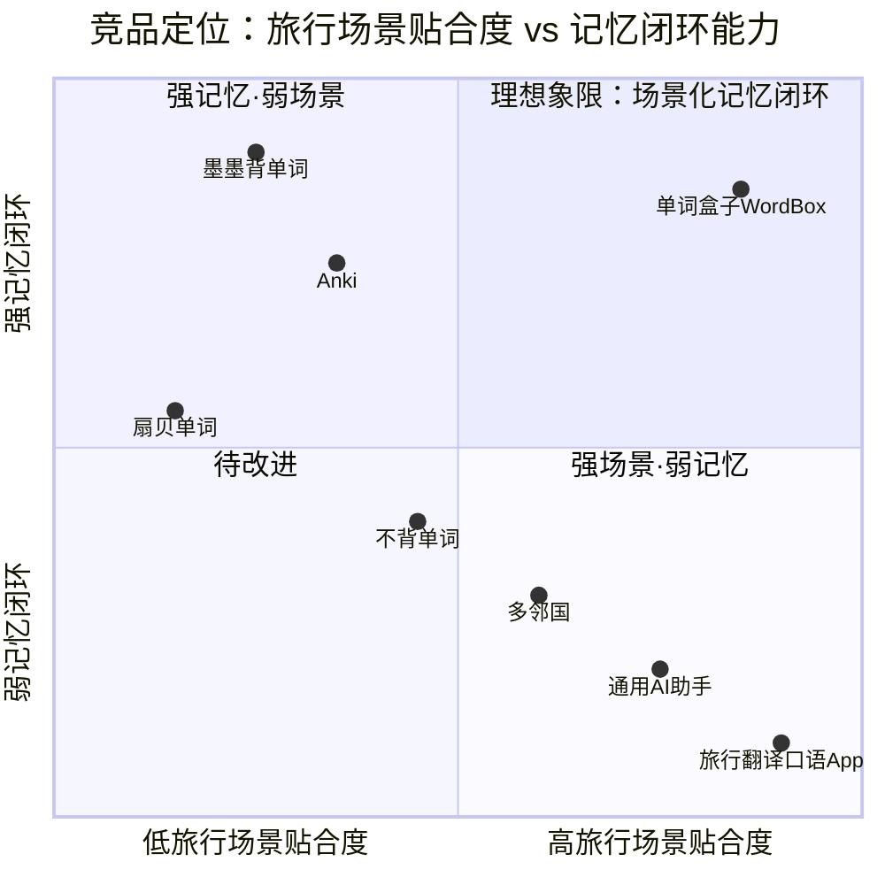

# 单词盒子 (WordBox) — 产品需求文档 PRD（完整版）

| 项目 | 内容 |
|------|------|
| **产品名称** | 单词盒子 (WordBox) |
| **项目名 (snake_case)** | `wordbox_harmony` |
| **作者** | 许清楚 / Alice（Product Manager） |
| **版本** | v1.1 |
| **日期** | 2026-11（v1.1 修订：2026-11-09） |
| **状态** | Draft（待架构师评审；Q1 / Q2 / Q10 / Q11 / Q13 已按用户决议定稿，Q12 为待确认项） |
| **目标平台** | **鸿蒙 7（HarmonyOS 7 / HarmonyOS NEXT）原生移动端 App** |
| **技术栈基线** | ArkTS + ArkUI（声明式 UI）+ DevEco Studio；HarmonyOS API 12+ |
| **目标用户** | **准备出国旅游 / 出境的人群**（非考研党、非学生应试人群） |
| **核心价值** | **每天 10 分钟，通过 AI 情景对话学「用得上的旅行单词」** |

> **数据声明**：本文档中所有留存率、正确率提升、市场规模类数值均为**产品假设 / 待验证目标值**，非真实市场调研数据；MVP 上线后由埋点验证并回归修订。竞品分值亦为定性评估（假设 / 待验证）。
>
> **需求语言规范**：`must` = P0 必做（MVP 验收项）、`should` = P1 应做、`could` = P2 可做。功能清单逐项标注。

---

## 1. 原始需求复述（严格基线）

用户要求交付一款面向**准备出国旅游的人**的**鸿蒙 7 原生 App**：以**每天 10 分钟**的轻量节奏，通过 **AI 对话**在**真实旅行语境**中学单词；必备功能包含**艾宾浩斯复习曲线、生词本、每日打卡、打卡日历、学习统计**；交付物包含完整 PRD、系统架构设计、任务拆解清单、可运行工程代码、完整测试与报告。

**与旧版参考件的差异（禁止沿用）**：旧版为 React Native / 考研应试 / 15 分钟 / 考研词表；本版全部重写为 **鸿蒙 7 / 出国旅行 / 10 分钟（600 秒阈值）/ 旅行场景词表 + AI 情景对话**。参考件仅用于文档规格与质量基线。

### 1.1 v1.1 变更记录（2026-11-09）

> 本次为**增量修订**（版本号保持 **v1.1**），共落实五组用户决议：Q1 端侧推理、Q2 华为账号、Q10/Q11 游客进度口径与合并方式、**游客数据 7 天窗口 + D5/D7 登录引导**、**用户确认滑动窗口 + D8 起每日登录引导 + 可「不再提示」**；**Q3~Q9 原有 MVP 默认决议一律不变**（240 词自建词表、600s 有效交互、本地 00:00 日切、语音 P1、休息日 P1 关闭、手机竖屏等）。§4 竞品事实性描述与象限图分值、G1~G3、5 个用户故事主体、§7 八大场景词库均未改动。

| 变更项 | v1.0（原决议） | **v1.1（用户新决议）** | 牵连章节 |
|--------|---------------|----------------------|---------|
| **Q1 AI 能力** | 云侧大模型 API（HTTP 调用） | **鸿蒙端侧推理（On-Device Inference）**：本地模型随包 / 首启内置、推理全程不出端、无需 INTERNET 即可生成情景对话、NPU 加速 + CPU 回退；失败降级 `ScriptedAI`；`AIService` 抽象层保留；**不再选择云厂商、不再调用云侧 HTTP 大模型 API** | §2.3 / §3 US-05 / §8-A2·A3·A10 / §9-Q1 / §10 NFR |
| **Q2 账号体系** | 游客模式 + 全本地存储，账号体系延至 P2 | **MVP 直接接入华为账号（Account Kit）**；游客模式可选但 **must 不提供进度统计**；仅登录态可查看 F-07 打卡日历与 F-08 学习统计 | §2.3 / §5.1 F-05·F-07·F-08·F-19·F-20 / §5.3 F-15·F-17 / §6 / §8-A9 / §9-Q2·Q10·Q11 / §10 NFR / §11 |
| **Q10 / Q11 / Q12 游客进度** | v1.0 无账号体系，不存在游客态与进度迁移问题 | **Q10 已确认采用解释 A**（游客数据照常落盘、F-07/F-08 页面门禁不展示）；**Q11 改为「登录成功后弹窗，由用户选择是否合并游客进度」** —— 明确推翻 v1.1 初稿的「不做迁移合并」；新增 **Q12**（选择不合并时游客数据保留本地、不删除、不展示，「我的」提供再次合并入口）；落地功能 F-21 | §5.1 F-19·F-20·F-21 / §6.6·§6.7 / §8-A9·A11 / §9-Q10·Q11·Q12 / §10 可靠性 / §11 |
| **Q13 游客数据窗口与登录引导** | v1.1 初稿游客数据长期保留、无登录引导 | **用户追加决议**：游客数据**只保留前 7 天**（窗口外不再保留）、F-21 合并**只合并窗口内进度**、**第 5 天与第 7 天打开 App 时提示是否登录账号以便保存进度**；落地功能 F-22、约束 A12、待确认 Q13 | §5.1 F-21·F-22 / §6.8 / §8-A11·A12 / §9-Q11·Q12·Q13 / §10 NFR / §11 |
| **Q13 确认与登录引导频次** | v1.1 第三封：D5 / D7 各弹一次、Q13 待确认 | **用户最终决议**：采用滑动窗口（Q13 升级为**已确认决议**）；**D8 起若仍未登录则每天弹 1 次直到登录、每天只弹 1 次**；弹窗提供 `去登录` / `暂不` / `不再提示` 三个动作，**选择「不再提示」后往后永不弹，未选择则持续每日弹**；落地 F-22 / A12 / §6.8 | §5.1 F-22 / §6.8 / §8-A12 / §9-Q13 展开说明 / §10 可测试性 / §11 |

**问题状态**：**Q13 已由用户明确确认为「解释 A 滑动窗口」，不再作为待确认项**；Q10、Q11 亦已由用户确认为**最终决议**。Q13 采用 `[today-6, today]` 共 7 个自然日、解释 B 不采用，合并也只合并窗口内进度；**Q12 仍为待确认（P1）**，MVP 默认「**窗口内**游客数据保留、不删除、不展示，窗口外按 7 天窗口策略清理；『我的 / 设置』提供『合并游客进度』入口」。登录引导以游客首次产生学习数据的自然日为 **D1**：**D5 弹 1 次 / D6 不弹 / D7 弹 1 次 / D8 起未登录则每天弹 1 次直到登录**，弹窗可勾选「不再提示」永久关闭。

---

## 2. 产品定义

### 2.1 一句话定位

> 面向出境游旅客的「旅行场景词 + AI 情景对话 + 艾宾浩斯调度 + 打卡闭环」鸿蒙原生轻学习 App：出发前每天 10 分钟，把机场、海关、酒店、餐厅里**真的会用到的词**练成条件反射。

### 2.2 三个正交、可度量的产品目标

三者分别回答「**来不来学**（频率）/ **怎么学**（语境质量）/ **记不记得住**（留存）」，互不重叠。

| # | 目标 | 成功度量指标（均为假设 / 待验证） | 正交维度 |
|---|------|-----------------------------------|---------|
| **G1** | **让「每天 10 分钟」成为出发前可持续的习惯** | 次日留存 ≥ 45%；7 日连续打卡率 ≥ 30%；单次有效学习时长中位数 ∈ [9, 11] 分钟；日均打卡完成率 ≥ 60% | 使用频率 / 习惯 |
| **G2** | **用 AI 旅行情景对话取代机械抽认卡，让单词在真实语境中复现** | 当日每个新词 **must** 在 ≥ 1 段旅行情景对话中出现（复现率 100%）；情景答题正确率较纯抽认卡基线 ≥ +20%；单次会话 AI 情景回合数 ≥ 6 | 学习方式 / 语境质量 |
| **G3** | **用艾宾浩斯曲线把「遗忘」变成可调度事件，复习踩在遗忘前夜** | 30 天后旅行词留存率 ≥ 70%；到期复习任务按时完成率 ≥ 80%；断更 > 7 天的词 100% 自动降级重排 | 记忆效果 / 留存 |

> **v1.1 差异化强化（Q1 新决议）**：AI 情景对话改由**鸿蒙端侧推理**驱动，带来两项可度量卖点 —— ① **数据不出端**：对话与学习数据零网络外发（华为账号授权除外）；② **出境无网可用**：飞机上 / 漫游断网时 AI 对话仍 100% 可用，全功能离线闭环。该补强不改变 §4 竞品事实性描述与象限图分值。

### 2.3 边界（明确不做）

- **不**做应试词书（考研 / GRE / 四六级）、**不**做纯抽认卡主流程、**不**做 15 分钟以上长任务、**不**做 K12 学科内容。
- MVP **含**华为账号登录与会话态（Q2 新决议 / F-19）；**不**含云同步、社交分享、订阅付费（延至 P2）。
- MVP **不**调用云侧大模型 API：AI 情景对话采用**鸿蒙端侧推理**（Q1 新决议），推理全程不出端；`CloudAI` 仅作 `AIService` 抽象层预留扩展、**不实现**。

---

## 3. 用户画像与用户故事

> 统一格式：**作为 [角色]，我希望 [功能]，以便 [收益]**。每个故事附 2–3 条**可验收**的交互步骤。

### US-01 自由行游客 · 林晓（28 岁，首次欧洲自由行，出发前 3 周）

> 作为**第一次自由行、怕在机场和海关张不开嘴的旅客**，我希望**每天用 10 分钟和 AI 扮演的值机员 / 海关官员实景对话**，以便**出发前就把 check-in、declaration 这些词练到能脱口而出**。

- 打开 App → 首页 must 显示「今日待学 8 新词 + 12 复习」及「10:00」目标时长，一键「开始学习」。
- 进入 AI 对话页 → 选择场景「机场值机」→ AI 以值机员身份发问，当日词 *boarding pass* / *aisle seat* 必须出现在对话中；用户作答后 AI 纠错并给出评分反馈。
- 有效学习累计达 600 秒 → 自动结算并打卡，返回首页显示连续天数 +1。

### US-02 商务出行 · 陈先生（42 岁，临时出差、时间碎片）

> 作为**临时被派出境、经常断更的商务出行者**，我希望**断更后 AI 能按我的实际遗忘情况重排复习计划**，以便**不用从头再学、几天空隙也不白费**。

- 断更 9 天后打开 App → 首页 must 提示「已重排复习：X 词降级需重学、Y 词顺延」。
- 进入复习 → 系统按 `lastReviewedAt` 实际间隔重算 EF / 间隔，> 7 天未学的词 must 标记「需重学」并优先出队。
- 完成复习后 → 统计页 must 更新「复习完成率」与「重学词数」。

### US-03 亲子游家长 · 王女士（36 岁，带娃出境、需应急表达）

> 作为**带着孩子出境、最担心点餐过敏和突发状况的家长**，我希望**把「餐厅点餐 / 紧急求助」的词收进生词本并随时取用**，以便**真遇到事时能立刻翻出来用**。

- 对话中长按任意词（如 *allergic* / *pharmacy*）→ 加入生词本，must 自动进入艾宾浩斯调度队列。
- 生词本 → 按「餐厅点餐 / 紧急求助」场景分组筛选、搜索、查看释义与例句。
- 次日学习 → AI must 优先用生词本中的词生成情景对话（如扮演服务员询问过敏原）。

### US-04 退休出境游 · 周叔（62 岁，跟团 + 自由行，重仪式感）

> 作为**想看得见自己进步、靠打卡坚持的退休出境游旅客**，我希望**打卡日历和学习统计清楚展示我的连续记录与掌握曲线**，以便**每天有动力打开、出发前更有底气**。

- 首页 → must 显示「连续打卡 N 天」与本周打卡格（✓ / ✗ / ○）。
- 打卡日历页 → 月视图热力，must 展示「本月打卡 X / Y 天」「最长连续 Z 天」。
- 统计页 → must 展示 7 / 30 / 90 日词汇掌握曲线、累计学习时长、8 大场景掌握分布。

### US-05 背包客 · 阿杰（24 岁，落地后网络不稳定）

> 作为**落地后常无稳定网络、又要临时查词练口语的背包客**，我希望**没网时也能复习生词本、跑预置情景对话并完成打卡**，以便**在飞机上 / 漫游断网时也不中断习惯**。

- 关闭网络 → 打开 App，生词本、复习队列、打卡日历、统计 must 100% 本地可用（端侧推理为默认形态，无需网络）。
- 开始学习 → **端侧 AI 推理无需网络**；模型未就绪 / 设备算力不足时 must 自动降级为**预置情景对话脚本**（ScriptedAI），当日词仍可练。
- 完成 600 秒有效学习 → 离线打卡成功，全程无网络依赖、本地数据不丢。

---

## 4. 竞品分析

### 4.1 竞品对比表（7 个，覆盖记忆类 / 语境类 / 游戏化 / 翻译工具 / 通用 AI）

| # | 竞品 | 类别 | 核心优势 | 核心劣势 | 我们的差异化 |
|---|------|------|---------|---------|-------------|
| C1 | **墨墨背单词** | 记忆调度 | 艾宾浩斯调度口碑好、上瘾机制成熟 | 按词收费、词书应试化、无 AI 互动、无旅行语境 | 免费核心 + **旅行场景词** + AI 情景对话 |
| C2 | **Anki** | 记忆调度 | SM-2 算法最强、卡组高度可定制 | 学习曲线陡、需自建旅行卡组、无 AI、UI 老旧 | 开箱即用的**内置 8 大旅行场景词库** + 原生 AI 陪练 |
| C3 | **不背单词** | 语境例句 | 真人例句丰富、UI 精致 | 复习策略弱、无个性化调度、例句非旅行定制 | AI **角色扮演实景对话**（不只是看例句）+ 艾宾浩斯 |
| C4 | **扇贝单词** | 词书社区 | 词书体系完善、社区活跃 | 应试导向、模式机械（选词 / 填空）、缺场景语境 | 以「出国旅行」为唯一场景主线，去应试化 |
| C5 | **多邻国 Duolingo** | 游戏化口语 | 游戏化强、含旅行短句模块 | 碎片化句型、无科学复习闭环、无中文旅客定制词表 | **单词级**深度学习 + 艾宾浩斯 + 打卡日历闭环 |
| C6 | **旅行翻译 / 口语速成类 App**（如有道翻译官、Google 翻译、旅行口语 100 句） | 即时工具 | 落地即用、旅行场景贴合度最高、查词快 | 只解决「这一句」，**零记忆、零复习、零留存** | 把「查得到」变成「记得住」：AI 练 + 调度 + 留存 |
| C7 | **通用 AI 助手**（ChatGPT / 豆包等） | 通用 AI | 可自由角色扮演、对话能力强 | 非学习工具、无词表 / 无调度 / 无持久化 / 无打卡，需用户自己会提问 | 内置旅行词库 + 自动排课 + 打卡统计，**零提问门槛** |

**关键洞察（假设 / 待验证）**：市场呈「**强记忆·弱场景**」（C1/C2/C3/C4）与「**强场景·弱记忆**」（C5/C6/C7）两极分化，**缺少同时占据「旅行场景贴合 + 记忆闭环」的中文原生产品**；本产品以「旅行场景词 + AI 情景对话 + 艾宾浩斯 + 打卡」组合切入右上空白象限。

**v1.1 定位补强**：叠加「鸿蒙端侧推理 = 数据不出端 + 出境无网可用」，进一步拉开与云侧 AI 类竞品（C7）及纯在线翻译工具（C6）的差距；7 个竞品的事实性描述与象限图分值保持不变。

### 4.2 竞品象限图（Mermaid）

> 分值为 0~1 定性评估（假设 / 待验证），在四象限内**均匀铺开**以体现定位分布，非实测数据。



---

## 5. 功能清单与优先级

**级别约定**：`must` = P0（MVP 验收项，缺一不可）/ `should` = P1（重要增强）/ `could` = P2（后续迭代）。

### 5.1 P0 — MVP 必做（`must`）

| ID | 功能名 | 级别 | 描述 | 验收要点（可度量） |
|----|--------|------|------|-------------------|
| **F-01** | 每日学习首页 | must | 展示今日新词数 / 待复习数、连续打卡天数、10:00 目标时长、本周打卡格；一键进入学习 | 必须显示 `新词数 / 复习数 / 连续天数 / 剩余目标分钟` 四项；点击「开始学习」≤ 1 跳进入 F-02；数据来自 F-04 调度队列 |
| **F-02** | AI 情景对话学习 | must | AI 扮演旅行角色（值机员 / 海关 / 前台 / 服务员 / 店员等），在 8 大场景语境中带出当日词，支持纠错、评分、会话内取词 | 每个当日新词必须在 ≥ 1 段情景对话中复现；单次会话 ≥ 6 个 AI 回合；回复解析出 `quality 0–5` 并回写 F-04；顶部显示 `mm:ss / 10:00` 倒计时 |
| **F-03** | 生词本 | must | 手动添加 / 对话中长按取词；支持搜索、按 8 大场景分组、删除、查看详情（释义 + 旅行例句） | 新增词必须自动进入 F-04 调度队列；搜索响应 ≤ 300ms（本地 300 词条内）；分组数与词库场景数一致（8） |
| **F-04** | 艾宾浩斯调度 | must | 类 SM-2 算法：按 `quality 0–5` 调整 EF（下限 1.3）与复习间隔；生成「今日待复习队列」；断更重排 | 间隔序列可验证（1/6/…天）；间隔 ≥ 30 天标记 `mastered`；> 7 天未学 100% 降级「需重学」；纯函数、不可变更新、可注入 `clock` |
| **F-05** | 本地存储 | must | 词库、生词本、学习记录、打卡数据、调度状态全部本地持久化（鸿蒙 Preferences / KV / RDB），抽象 `StorageService`；**按账号 `userId` 分区存储**（游客 `guest` 分区 / 登录态账号分区，见 A9） | 冷启动无需联网；杀进程重启后数据 100% 不丢；游客与账号分区数据互不串读；对外仅暴露接口，实现可替换（含内存实现供测试） |
| **F-06** | 每日打卡 | must | 当日**有效学习累计 ≥ 600 秒（10 分钟）**自动打卡；每日仅记 1 次；计算连续天数 | 阈值严格 = 600s；未达阈值不打卡且提示剩余时长；同日重复学习不重复打卡；以本地时间 00:00 为日切 |
| **F-07** | 打卡日历 | must | 月视图热力日历，展示每日打卡状态、本月打卡天数、最长连续天数 | 月视图覆盖当月全部日期；已打卡 / 未打卡 / 未来日三态可区分；「本月 X / Y 天」「最长连续 Z 天」与 F-06 数据一致；**游客态不展示任何进度数据**，仅显示「登录解锁」引导（见 F-20 / Q10） |
| **F-08** | 学习统计 | must | 7 / 30 / 90 日词汇掌握曲线、累计有效学习时长、复习完成率、8 大场景掌握分布 | 三个时间窗可切换；指标与 F-04 / F-06 数据源一致，允许误差 0；离线可查看；**游客态不展示任何进度数据**，仅显示「登录解锁」引导（见 F-20 / Q10） |
| **F-19** | 华为账号登录 | must | 基于华为账号（Account Kit）一键登录 / 登出；会话态（`guest` / `authenticated`）持久化；保留游客入口；经 `AccountService` 抽象（见 A9） | 未登录 must 提供「登录华为账号」引导与游客入口；登录 / 登出后会话态立即刷新且重启后保持；账号授权失败 must 可退回游客态且不影响学习；UI 层不绑定具体 Kit 实现；**登录 / 授权成功后 must 按条件弹出「是否合并游客进度」选择**（仅检测到游客进度时弹，见 F-21 / Q11） |
| **F-20** | 进度统计门禁 | must | 按会话态控制 F-07 打卡日历 / F-08 学习统计的进度数据可见性：游客态展示门禁引导，登录态展示全量数据 | 游客态两页 must 不渲染任何进度数字 / 曲线 / 日历热力；登录态 must 展示与 F-06 数据源零误差一致的全量数据；门禁判定放在**数据读取层**（Service / Repository）而非仅 UI 隐藏（见 A9 / Q10 解释 A） |
| **F-21** | 游客进度迁移合并 | must | 登录华为账号后按条件弹出「是否迁移合并未登录时的学习进度」对话框，由用户选择；选择 `合并进度` 时把游客分区**窗口内**数据合并进当前华为账号分区 | ① **触发**：华为账号授权成功后、进入首页前，**仅当检测到存在游客态学习进度时才弹**，无游客数据不弹；② **选项**：`合并进度` / `不合并，保留账号已有进度`，must 可取消（取消等同「暂不处理」）且可后续再次触发；③ **选择结果 must 持久化**，避免每次登录重复弹窗；④ **合并范围**：生词本词条、StudyRecord（艾宾浩斯进度）、CheckIn（打卡与学习时长）、连续天数、统计聚合数据；⑤ **冲突规则**（产品语义，具体算法交架构师）：同日打卡取「已打卡 / 学习时长较大」者且不重复累计、同词复习记录取进度更新的一条且**不得回退到更差状态**、生词本按词条去重；⑥ **合并 must 幂等**：重复执行不产生重复数据、不重复累加时长、不重复打卡；⑦ 合并后连续天数与 7/30/90 日统计 must 重算且与 F-06 数据源一致（误差 0）；⑧ 选择「不合并」时**窗口内**游客数据 **must 不删除**（见 Q12）；⑨ 合并后首页 / 打卡日历 / 学习统计 must **立即刷新为合并结果**；⑩ 全流程 must 可在**无网络下完成**（纯本地数据合并，不依赖云同步）；⑪ **合并范围限定**：仅覆盖 **7 天窗口内**的游客进度，窗口外数据**不合并、不回灌、不计入统计重算**（见 F-22 / Q13 / A12） |
| **F-22** | 游客数据 7 天窗口与登录引导 | must | 游客态学习数据仅在最近 7 个自然日滑动窗口内保留，窗口外数据滚动清理；以游客首次产生学习数据的自然日为 D1，按 D5 / D7 / D8+ 规则在打开 App 时提示「登录华为账号以便保存进度」；**D8 起未登录则每天弹 1 次直到登录，弹窗可选「不再提示」永久关闭** | ① **窗口**：`[today-6, today]` 共 **7 个自然日**，本地时间 00:00 日切（与 A8 一致），窗口外游客数据不保留；窗口规则对游客的**生词本 / StudyRecord / CheckIn / 连续天数一律一致**；② **清理 must 幂等**（重复执行无副作用），冷启动与读取时均可触发，且**不阻塞首帧**；③ **触发日规则**：D1~D4 不弹 / **D5 弹 1 次** / D6 不弹 / **D7 弹 1 次** / **D8 及以后只要仍未登录，每天都弹 1 次，直到用户登录为止**；已登录一律不弹；④ **每天最多弹 1 次**（当日已弹则不再弹，按本地 00:00 日切重置）；选 `暂不` 仅**当日**不再弹、次日按规则继续弹；⑤ 弹窗提供 **`去登录` / `暂不` / `不再提示`** 三个动作；`不再提示` must 持久化 `neverPrompt = true` **永久关闭**，并持久化 `neverPrompt: boolean` 与 `lastPromptDate: 'YYYY-MM-DD'` 避免重复弹窗；⑥ **`不再提示` 只关闭类型 A 登录引导弹窗，不影响 Q11 / F-21 的类型 B 合并选择弹窗**（登录成功后该弹窗仍按条件触发）；⑦ 弹窗含**引导性进度摘要** +「游客进度仅保留最近 7 天」提示；点 `去登录` → 华为账号授权 → 成功后按 Q11 触发**类型 B 合并选择弹窗**；授权失败可退回游客态、不阻断学习；⑧ **空窗口 / 无游客进度时不弹登录引导**；**必须严格区分两类弹窗**：类型 A = 游客态「登录引导」（本功能），类型 B = 登录成功后「是否合并游客进度」（Q11 / F-21），时序 **A → 点「去登录」→ 授权成功 → B**，不得合并成一个弹窗、与 §6.7 时序不得混淆；⑨ 弹窗内进度摘要属**引导性提示**，不是统计页、不构成 F-07/F-08 的进度展示，**F-20 门禁依然成立**；窗口规则与合并范围联动：**F-21 仅合并窗口内进度**，窗口外不合并、不回灌、不计入统计重算（见 Q13 / A12）；⑩ **窗口过滤与「是否该弹引导」判定 must 为纯 TS 内核纯函数、可注入 `clock`、可在无真机无网络下 100% 单测**（见 A12） |

> **P0 覆盖核对**：每日学习首页 ✓ / AI 情景对话学习 ✓ / 生词本 ✓ / 艾宾浩斯调度 ✓ / 本地存储 ✓ / 每日打卡 ✓ / 打卡日历 ✓ / 学习统计 ✓ —— 8 项用户必备功能全部落在 P0；**v1.1 新增** 华为账号登录 F-19 ✓ / 进度统计门禁 F-20 ✓ / 游客进度迁移合并 F-21 ✓ / 游客数据 7 天窗口与登录引导 F-22 ✓ —— 合计 **12 项 P0**。

### 5.2 P1 — 重要增强（`should`）

| ID | 功能名 | 级别 | 描述 | 验收要点 |
|----|--------|------|------|---------|
| F-09 | 旅行场景词书切换 | should | 8 大场景任选 / 组合作为当日词源；支持按目的地行程推荐 | 切换后 F-01 待学数应随之重算 |
| F-10 | 语音能力（TTS / STT） | should | 基于 HarmonyOS Core Speech Kit 的单词发音与跟读，经 `SpeechService` 抽象 | 无麦克风权限时文字流程不受影响；权限仅在使用时申请 |
| F-11 | 休息日机制 | should | 每周允许 1 天不学习不掉连续 | 连续天数计算可配置开关，默认关闭 |
| F-12 | 生词本导入 / 导出 | should | CSV / JSON 导出与导入 | 导出后重新导入词条数一致 |
| F-13 | 预置情景对话脚本库 | should | 每场景 ≥ 3 套离线脚本，作为 AI 不可用时的兜底（支撑 F-02 离线降级） | 断网时仍能完成 600 秒有效学习并打卡 |

### 5.3 P2 — 后续迭代（`could`）

| ID | 功能名 | 级别 | 描述 | 验收要点 |
|----|--------|------|------|---------|
| F-14 | OCR / 拍照取词 | could | 基于 HarmonyOS OCR Kit 识别菜单、标识牌取词入生词本 | 可后置，不阻塞 MVP |
| F-15 | 云同步 / 多设备 | could | 借助鸿蒙分布式能力跨设备同步学习数据 | 账号体系已在 MVP 具备（Q2 / F-19），本项仅同步能力后置 |
| F-16 | 打卡分享海报 | could | 生成连续打卡海报分享 | 依赖系统分享能力 |
| F-17 | 订阅付费 / 高级端侧模型 | could | 订阅付费、更高规格端侧模型包（**账号体系已进 MVP，不属本项**） | 与 §9 Q2 新决议一致：账号体系已在 MVP 落地，仅付费与高级模型后置 P2 |
| F-18 | 多语种目的地扩展 | could | 日语 / 泰语 / 法语旅行词库 | 数据层需预留 `locale` 字段 |

---

## 6. UI 设计稿要点（ASCII 线框图）

> 鸿蒙 ArkUI 声明式、手机竖屏优先；中文、大字号、单手可达；深色模式适配。**§6.1~§6.8 共 8 张线框**：5 个核心页面 + 账号页 / 游客态门禁示意 / 游客进度合并弹窗 / D5·D7 及 D8+ 登录引导弹窗，均为结构示意、非视觉稿。

### 6.1 首页 HomeScreen（F-01 / F-06 / F-19 登录态标识）
```
┌───────────────────────────────┐
│ 单词盒子      [👤 登录华为账号]│  ← 游客态引导
│ 🔥 连续 12 天   出发倒计时21天│
│ 端侧 AI · 离线可用             │
├───────────────────────────────┤
│  今日任务        目标 10:00   │
│  ┌─────────────────────────┐  │
│  │ 新词 8    复习 12       │  │
│  │ 进度 ▓▓▓▓░░░  06:12    │  │
│  │  [   开始学习   ]       │  │
│  └─────────────────────────┘  │
│  本周 ✓ ✓ ✓ ✓ ✗ ✓ ○          │
│  今日场景：机场值机 / 过海关   │
├───────────────────────────────┤
│ [首页][生词本][日历][统计][我的]│
└───────────────────────────────┘
```
> 登录态：顶栏替换为「👤 华为账号 · 已登录」；游客态显示「登录华为账号」引导并可从「我的」进入账号页（§6.6）。**两种会话态均可直接开始学习**，学习 / 打卡链路不受登录态影响（Q10 解释 A）。

### 6.2 AI 情景对话页 ChatScreen（F-02）
```
┌───────────────────────────────┐
│ ← 机场值机      ⏱ 06:12/10:00│
├───────────────────────────────┤
│ 🛫 AI(值机员):                │
│  "May I see your boarding     │
│   pass? Window or aisle seat?"│
│                               │
│         You: "Aisle, please." │
│                               │
│ 🛫 AI: ✓ 用得对！aisle seat  │
│   = 靠过道座位。再试一句…     │
│   [quality: 5]                │
├───────────────────────────────┤
│ 今日词 [boarding pass]        │
│       [aisle seat] [gate]     │
│  (长按单词 → 加入生词本)      │
├───────────────────────────────┤
│ [输入消息…]            [发送] │
└───────────────────────────────┘
```

### 6.3 生词本 VocabularyScreen（F-03）
```
┌───────────────────────────────┐
│ 生词本  共 46 词    [+ 添加]  │
│ [🔍 搜索单词 / 释义        ]  │
├───────────────────────────────┤
│ 场景筛选                      │
│ [全部][机场][海关][酒店][餐厅]│
│ [问路][购物][交通][紧急]      │
├───────────────────────────────┤
│ ▸ allergic  过敏的            │
│   餐厅点餐 · 下次复习 11/12   │
│   "I'm allergic to nuts."     │
│ ───────────────────────────  │
│ ▸ pharmacy  药店              │
│   紧急求助 · 下次复习 11/10   │
│   "Where is the nearest…?"    │
│ ───────────────────────────  │
│ ▸ tax refund 退税  [需重学]   │
├───────────────────────────────┤
│ [首页] [生词本] [日历] [统计] │
└───────────────────────────────┘
```

### 6.4 打卡日历 CalendarScreen（F-07）
```
┌───────────────────────────────┐
│      2026 年 11 月   ‹   ›    │
│  日   一   二   三   四  五  六│
│       1   2   3   4   5   6   │
│       ■   ■   ■   ■   □   □   │
│   7   8   9  10  11  12  13   │
│   ■   ■   ■   ■   ■   ○   ○   │
│  14  15  16  17  18  19  20   │
│   …                           │
│  ■ 已打卡  □ 未打卡  ○ 未来   │
├───────────────────────────────┤
│ 本月打卡   12 / 30 天         │
│ 最长连续   9 天               │
│ 累计有效学习  2 小时 06 分    │
├───────────────────────────────┤
│ [首页] [生词本] [日历] [统计] │
└───────────────────────────────┘
```

**游客态门禁示意（F-20，Q10 解释 A）**：
```
┌───────────────────────────────┐
│      2026 年 11 月   ‹   ›    │
│   🔒 登录后可查看打卡日历      │
│                               │
│   你仍可照常学习与打卡，       │
│   进度数据已保存在本机。       │
│  [  登录华为账号，解锁进度  ]  │
├───────────────────────────────┤
│ [首页] [生词本] [日历] [统计] │
└───────────────────────────────┘
```

### 6.5 学习统计 StatsScreen（F-08）
```
┌───────────────────────────────┐
│ 学习统计   [7日][30日][90日]  │
├───────────────────────────────┤
│ 累计掌握  128 词   ↑ 较上周+18│
│ 累计时长  6h 20m              │
│ 复习完成率  86%               │
├───────────────────────────────┤
│ 掌握曲线                      │
│  140│        ╭────            │
│  100│    ╭───╯                │
│   60│ ╭──╯                    │
│    0└────────────────→ 30日   │
├───────────────────────────────┤
│ 场景掌握分布                  │
│ 机场 ▓▓▓▓▓▓░░ 75%           │
│ 海关 ▓▓▓▓░░░░ 50%           │
│ 餐厅 ▓▓▓▓▓▓▓▓ 100%          │
│ 紧急 ▓▓░░░░░░ 25% ← 待加强  │
├───────────────────────────────┤
│ [首页] [生词本] [日历] [统计] │
└───────────────────────────────┘
```

**游客态门禁示意（F-20，Q10 解释 A）**：
```
┌───────────────────────────────┐
│ 学习统计   [7日][30日][90日]  │
│   🔒 登录后可查看学习统计      │
│                               │
│   累计掌握 / 掌握曲线 /        │
│   场景分布均为登录态可见。     │
│  [  登录华为账号，解锁进度  ]  │
├───────────────────────────────┤
│ [首页] [生词本] [日历] [统计] │
└───────────────────────────────┘
```

### 6.6 账号 / 我的 AccountScreen（F-19）
```
┌───────────────────────────────┐
│ 我的                          │
├───────────────────────────────┤
│ 游客态：                      │
│  [ 登录华为账号 ]  ← 一键登录  │
│  [ 继续以游客身份使用 ]        │
│  ⓘ 游客模式不展示进度统计     │
│    （学习 / 打卡照常保存）     │
│ ───────────────────────────  │
│ 登录态：                      │
│  👤 华为账号  已登录          │
│  会话态 authenticated         │
│  [ 合并游客进度 ]  ← Q12 入口  │
│  [ 退出登录 ]                 │
│  ⓘ 端侧 AI · 数据不出端       │
├───────────────────────────────┤
│ [首页] [生词本] [日历] [统计] │
└───────────────────────────────┘
```
> 「合并游客进度」入口仅在检测到游客分区存在进度数据时显示（Q12），点击后再次发起 F-21 合并流程。

### 6.7 游客进度合并确认弹窗（F-21 / Q11）
```
┌───────────────────────────────┐
│  发现未登录时的学习进度 🔒     │
├───────────────────────────────┤
│  未登录期间：                  │
│    学习 5 天 / 掌握 32 词      │
│    打卡 4 天 / 累计 52 分钟    │
│                               │
│  是否合并到当前华为账号？      │
│                               │
│  [      合并进度      ]       │
│  [ 不合并，保留账号已有进度 ] │
│  [ 取消（暂不处理） ]    ✕    │
├───────────────────────────────┤
│  ⓘ 稍后可在「我的」再次发起   │
│    合并为本地操作，无需网络    │
└───────────────────────────────┘
```
> 触发时机：华为账号登录 / 授权成功后、**进入首页前**；**仅当检测到存在游客态学习进度时才弹**（无游客数据不弹，避免打扰）。取消等同「暂不处理」并可后续再次触发；选择结果持久化避免每次登录重复弹窗；合并完成后首页 / 打卡日历 / 学习统计立即刷新为合并结果。选择「不合并」时**窗口内**游客数据不删除（Q12）。**本弹窗仅合并最近 7 天窗口内的进度**，窗口外数据不合并、不回灌（见 F-22 / Q13 / A12）。

### 6.8 第 5·7 天及之后登录引导弹窗（F-22 / Q13）
```
┌───────────────────────────────┐
│   登录以保存学习进度 🔒        │
├───────────────────────────────┤
│  未登录期间已累计：            │
│    学习 5 天 / 掌握 32 词      │
│    累计 52 分钟                │
│                               │
│  ⚠ 游客进度仅保留最近 7 天    │
│    登录后可长期保存并继续累计  │
│                               │
│  [      去登录      ]         │
│  [       暂不       ]         │
│  [     不再提示     ]         │
│  ⓘ 不再提示后不再提醒         │
├───────────────────────────────┤
│  ⓘ 引导性摘要，非统计页       │
│  D5/D7 各一次 · D8 起每日一次 │
└───────────────────────────────┘
```
**类型 A 触发规则（D1 = 游客首次产生学习数据的自然日，本地 00:00 日切）**：

| 日序 | 行为 |
|------|------|
| D1~D4 | 不弹 |
| **D5** | 弹 1 次 |
| D6 | 不弹 |
| **D7** | 弹 1 次 |
| **D8 及以后** | 只要**仍未登录**，**每天都弹 1 次**，直到用户登录为止 |
| 已登录 / 无游客进度（空窗口） | 一律不弹 |

**三个动作**：`去登录` → 拉起华为账号授权 → 授权成功后按 Q11 触发**类型 B 合并选择弹窗**；`暂不` → 当日不再弹、次日按规则继续；`不再提示` → 持久化 `neverPrompt = true`，**往后所有类型 A 弹窗都不再弹**（永久生效），但**不影响类型 B**。
**每日最多 1 次**（当日已弹不再弹，按本地 00:00 日切重置）；需持久化 `neverPrompt: boolean` 与 `lastPromptDate: 'YYYY-MM-DD'`。授权失败可退回游客态、不阻断学习。**不再提示仅关闭类型 A 登录引导弹窗，不影响类型 B（Q11 / F-21）合并选择弹窗**（登录成功后该弹窗仍按条件触发）。
> **时序**：类型 A（登录引导）→ 点「去登录」→ 华为账号授权成功 → **类型 B（§6.7「是否合并游客进度」）**。两类弹窗**不得合并成一个**。
> **窗口提示**：游客进度仅保留最近 7 个自然日（Q13 已确认滑动窗口），合并也只带入窗口内进度；弹窗内的进度摘要属**引导性提示**，不是统计页、不构成 F-07/F-08 的进度展示，**F-20 门禁依然成立**。

---

## 7. 旅行主题词库方向

**MVP 自建核心词表**：8 大场景 × 每类约 30 词 ≈ **240 词**（规模为假设 / 待验证，可随埋点扩充）；全部为通用旅行高频词与短语，**自建、无第三方词书版权依赖**；随包内置，首次启动无需下载。数据结构 must 预留 `scene` / `locale` / `exampleInScene` 字段。

| # | 场景分类 | 典型语境 | 示例词（英文 / 中文） |
|---|---------|---------|----------------------|
| S1 | **机场值机** Airport & Check-in | 换登机牌、选座、行李托运、找登机口 | `boarding pass` 登机牌 · `aisle / window seat` 过道 / 靠窗座 · `baggage allowance` 行李限额 · `carry-on` 随身行李 · `gate` 登机口 · `check-in counter` 值机柜台 |
| S2 | **过海关** Customs & Immigration | 出示证件、说明行程、申报 | `passport` 护照 · `visa` 签证 · `declaration` 申报 · `purpose of visit` 来访目的 · `nothing to declare` 无申报 · `onward ticket` 返程 / 续程票 |
| S3 | **酒店入住** Hotel Check-in | 预订、入住退房、房型、押金、设施 | `reservation / booking` 预订 · `check-in / check-out` 入住 / 退房 · `twin / double room` 双床 / 大床房 · `deposit` 押金 · `wake-up call` 叫醒服务 · `room key / card` 房卡 |
| S4 | **餐厅点餐** Dining & Ordering | 看菜单、点单、过敏、结账、小费 | `menu` 菜单 · `starter / main course` 前菜 / 主菜 · `allergic` 过敏的 · `still / sparkling water` 无气 / 气泡水 · `the bill (check)` 账单 · `tip` 小费 |
| S5 | **问路导航** Directions & Navigation | 问路、地铁换乘、地标、往返票 | `intersection / block` 路口 / 街区 · `landmark` 地标 · `underground / subway` 地铁 · `platform / transfer` 站台 / 换乘 · `round-trip` 往返 · `one-way` 单行 |
| S6 | **购物退税** Shopping & Tax Refund | 试穿、尺码、免税、退税单 | `tax refund / VAT` 退税 / 增值税 · `receipt` 收据 · `duty-free` 免税 · `fitting room` 试衣间 · `size` 尺码 · `refund form` 退税单 |
| S7 | **交通购票** Transportation & Tickets | 买票、时刻表、票价、改签 | `one-way / return ticket` 单程 / 往返票 · `timetable` 时刻表 · `rail pass` 通票 · `fare` 票价 · `seat reservation` 订座 · `platform change` 站台变更 |
| S8 | **紧急求助** Emergency & Help | 丢行李、看病、报警、保险、使馆 | `lost luggage` 行李遗失 · `pharmacy` 药店 · `embassy` 使馆 · `insurance` 保险 · `ambulance / police` 救护车 / 警察 · `prescription` 处方 |

> 每个词条 must 含：`word` / `phonetic`（可选）/ `meaningZh` / `scene` / `exampleInScene`（旅行实景例句）/ `aiRolePrompt`（该场景下 AI 扮演角色提示词），以支撑 F-02 的情景对话生成与离线脚本兜底。

---

## 8. 详细技术需求分析（架构师输入）

| 约束编号 | 约束（给架构师的硬要求） | 对应需求 |
|---------|------------------------|---------|
| **A1** | **10 分钟阈值**：有效学习计时口径 = 前台对话页累计交互时长，严格 **600 秒**触发打卡；计时器与 `clock` 必须可注入以便单测 | F-06 / G1 |
| **A2** | **AI 可替换抽象层（v1.1 按 Q1 调整）**：统一 `AIService` 接口，实现清单改为 **`OnDeviceAI`（主实现，鸿蒙端侧推理）/ `ScriptedAI`（离线与降级兜底）/ `MockAI`（测试）** 三类；`CloudAI` **不实现**，仅作为抽象层预留扩展点；UI 层禁止硬编码任何厂商 SDK / 模型实现；须能从回复解析 `[[QUALITY:n]]` 回写调度 | F-02 / F-04 / NFR / Q1 |
| **A3** | **离线优先 = 默认形态（v1.1 按 Q1 调整）**：词库、脚本模板、复习调度、打卡、统计与 **AI 端侧推理**全部本地可跑，全功能离线闭环、无网络依赖；仅当**端侧推理失败 / 模型未就绪 / 设备算力不足**时 must 自动降级 `ScriptedAI`，不阻断打卡闭环 | US-05 / F-13 / Q1 |
| **A4** | **存储抽象**：`StorageService` 接口 + 鸿蒙本地实现 + 内存实现（测试用）；所有 Service 支持 `clock` 与依赖注入，保证 QA 可纯逻辑单测 | F-05 / 测试交付 |
| **A5** | **鸿蒙 7 原生**：ArkTS + ArkUI 声明式、DevEco Studio 工程、API 12+；不得引入 React Native / WebView 混合方案；权限最小化 | 平台基线 |
| **A6** | **旅行词库数据模型**：词条结构含 `scene` / `locale` / `exampleInScene` / `aiRolePrompt`；内置 8 场景种子数据 | §7 |
| **A7** | **调度纯函数化**：`EbbinghausScheduler` 为纯函数、不可变更新，输入 `quality 0–5` 输出新 EF / 间隔 / 状态，便于 100% 单测覆盖 | F-04 / G3 |
| **A8** | **日切口径**：本地时间 00:00 为日切；跨时区暂不处理（见 Q8） | F-06 |
| **A9** | **华为账号与会话态（v1.1 按 Q2 新增，按 Q11 补充）**：新增 `AccountService` 抽象，会话态枚举 `guest` / `authenticated` 并持久化；**数据分区 key 规约：`guest:` 与 `user:{uid}:` 两套命名空间**，游客态写 `guest:`、登录态写 `user:{uid}:`（见 F-05 / A4，合并时读写边界由架构师定）；进度统计门禁（F-20）判定 **must 放在数据读取层**（Service / Repository），不得仅在 UI 层隐藏；游客态照常写 CheckIn 与跨日聚合数据，以保证 F-06 / F-07 / F-08 数据源零误差一致（Q10 已确认解释 A）；**会话态跃迁 `guest → authenticated` 时 must 触发「游客进度存在性探测 + 合并选择」检查（F-21 / Q11）**；`AccountService` must 暴露「游客态是否存在进度数据」探测能力与登录成功事件；合并过程 must 幂等 | F-19 / F-20 / F-21 / Q2 / Q10 / Q11 / Q12 |
| **A10** | **端侧推理约束（v1.1 按 Q1 新增）**：模型随包或首启内置解压（体积为假设 / 待验证）；must 探测 NPU 可用性并支持 CPU 回退；界定推理内存上限与单次推理超时；首 token 延迟指标**无网络依赖**；失败 / 超时降级 `ScriptedAI`；模型文件与算力调用遵循最小权限，禁止申请与功能无关权限 | Q1 / A2 / §10 NFR |
| **A11** | **游客进度迁移合并（v1.1 按 Q11 新增，按 Q13 补充）**：新增 `MigrationService` / `ProgressMergeService`，**纯 TS 内核、纯函数化、幂等**，可注入 `clock` 与 `StorageService` 以便 **100% 单测**；合并范围 = 生词本 / StudyRecord / CheckIn / 连续天数 / 统计聚合（冲突规则与统计重算的产品语义见 F-21，具体算法由架构师定）；**合并前 must 先按 A12 的 7 天窗口过滤**，窗口外数据不参与冲突规则、不回灌、不计入统计重算；合并 must 可在**无网络下完成**、不依赖云同步；异常中断可恢复且不产生重复数据；选择结果持久化避免重复弹窗；合并前后统计口径一致 | F-21 / F-22 / Q11 / Q12 / Q13 / §10 可靠性 |
| **A12** | **游客数据 7 天窗口与登录引导（v1.1 按 Q13 新增，按 Q13 定稿补充）**：新增 `GuestRetentionPolicy` / `RetentionService`，**窗口过滤、窗口外清理与「是否该弹引导」判定 must 为纯 TS 内核纯函数** —— 建议签名（具体由架构师定）：`isWithinWindow(dateYMD, now)` / `filterWithinWindow(records, now)` / **`pruneOutsideWindow(records, now)`（幂等）** / **`shouldPromptLogin(guestFirstStudyDateYMD, now, promptState, session)`（返回是否弹 + 弹窗类型）**；**全部可注入 `clock`、可在无真机无网络下 100% 单测**（FakeClock 覆盖 **D5 / D6 / D7 / D8 / 跨月 / 每日只弹一次 / 不再提示**）；`shouldPromptLogin` must 实现 D1~D4 不弹 / D5 弹 / D6 不弹 / D7 弹 / **D8+ 未登录每日弹一次直到登录** / 已登录不弹 / `暂不` 当日不重弹 / `neverPrompt` 永久不弹 / 空窗口不弹 的**状态机**，并持久化 `neverPrompt: boolean` 与 `lastPromptDate: 'YYYY-MM-DD'`；**`不再提示` 只关闭类型 A，不影响类型 B（Q11 / F-21）**；共享常量 must **集中定义**：`GUEST_RETENTION_DAYS = 7`、`LOGIN_PROMPT_DAYS = [5, 7]`、**`PROMPT_DAILY_AFTER_DAY = 7`**（另 `DAILY_GOAL_SECONDS = 600` 见 A1）；窗口口径与 **A8 本地 00:00 日切**一致；清理 must 幂等、异常中断可恢复、不误删窗口内数据；`guest:` 分区 must 带日期索引以支持窗口过滤与清理；**A11 合并前 must 先按本窗口过滤**，窗口外数据不参与冲突规则、不回灌、不计入统计重算 | F-21 / F-22 / Q13 / §10 NFR |

---

## 9. 待确认问题 Open Questions + MVP 默认决议

| # | 问题 | 负责方 | 优先级 | **MVP 默认决议** |
|---|------|--------|--------|-----------------|
| **Q1** | 采用**鸿蒙哪个端侧推理能力 / 本地模型**？模型随包内置还是首启解压？NPU / CPU 回退策略？（原「选哪家云厂商」子问题不再适用） | 架构师 + PM | P0 | **鸿蒙端侧推理（On-Device Inference）**：本地模型随包 / 首启内置，推理全程不出端、**无需 INTERNET** 即可生成情景对话，NPU 加速 + CPU 回退；端侧模型不可用 / 资源不足时降级 `ScriptedAI`；`AIService` 抽象层保留；**不再调用云侧 HTTP 大模型 API、不再选择云厂商**（`CloudAI` 仅预留扩展、不实现） |
| **Q2** | 账号体系如何接入？游客模式是否可用、是否提供进度统计？ | PM + 架构师 | P0 | **MVP 直接接入华为账号（Account Kit）一键登录**；游客模式**可选但 must 不提供进度统计**；仅登录态可查看 F-07 打卡日历与 F-08 学习统计的进度数据（门禁见 F-20 / Q10 解释 A）；账号 / 会话态进 MVP，云同步 / 订阅付费仍延至 P2 |
| **Q3** | 旅行词库版权与规模如何定？ | PM | P0 | **自建** 8 大场景 × 约 30 词 ≈ 240 词核心表，内置随包、无第三方版权依赖；规模为假设 / 待验证，上线后按埋点扩充 |
| **Q4** | 「10 分钟」计时口径：自然时长还是有效交互？后台 / 锁屏是否计时？ | 架构师 | P0 | 仅**前台对话页有效交互累计**，达 600s 自动打卡；后台 / 锁屏暂停计时；本地时间 00:00 日切 |
| **Q5** | 出境后无网 / AI 不可用如何保证打卡闭环？ | 架构师 | P0 | 每场景预置 ≥ 3 套 `ScriptedAI` 情景脚本，离线可用；词库 / 复习 / 打卡 / 统计 100% 离线 |
| **Q6** | 语音（TTS / STT）放 P0 还是 P1？鸿蒙各版本能力差异如何抹平？ | 架构师 | P1 | **P1**：MVP 用文字对话；经 `SpeechService` 抽象 + Core Speech Kit，麦克风权限仅使用时申请 |
| **Q7** | 隐私合规：端侧推理下「零出端」如何保证？账号授权的网络请求如何与 AI 推理解耦？ | PM + 架构师 | P0 | **对话与学习数据零出端、无 AI 网络请求**（Q1 端侧推理）；须如实区分：**AI 推理全程无网络请求**，而**华为账号授权 / 令牌刷新可能需要网络**（与 AI 推理无关，走系统账号能力）；账号信息按最小必要原则处理、不采集与功能无关的 PII；遵守《个人信息保护法》与 HarmonyOS 应用市场隐私规范 |
| **Q8** | 跨时区（出发后目的地时区）如何处理日切与连续天数？休息日是否启用？ | 架构师 + PM | P1 | MVP **统一本地时间 00:00 日切**、暂不处理跨时区；休息日机制 P1 且默认关闭 |
| **Q9** | 是否需要适配折叠屏 / 平板 / 车机？ | PM + 架构师 | P2 | MVP 仅**手机竖屏**；数据层与布局用响应式约束预留扩展，不做多端适配 |
| **Q10** | 【**已确认决议**】游客进度如何落盘与展示？ | PM + 架构师 | P0（已确认，非待确认） | **用户最终确认采用解释 A**：游客照常完成 10 分钟学习 / 打卡 / 生词本 / 艾宾浩斯调度，**数据照常本地落盘**（保证 F-06/F-07/F-08 数据源零误差一致、不破坏 A8），但 **F-07 打卡日历与 F-08 学习统计页面在游客态做门禁、不展示任何进度数据**；登录华为账号后才展示。解释 B（游客完全不写跨日数据）**不采用**。详见下方「Q10 展开说明」 |
| **Q11** | 【**已确认决议**】游客进度如何并入账号？ | PM + 架构师 | P0（已确认，非待确认） | **用户最终选择：游客登录账号后，弹出「是否迁移合并未登录时的学习进度」对话框，由用户自行选择**。完整产品语义见下方「Q11 展开说明」；**v1.1 初稿「不做迁移合并」的默认建议作废**；落地功能 = F-21。**合并范围限定：仅覆盖 7 天窗口内的游客进度，窗口外数据不合并、不回灌、不计入统计重算**（见 F-22 / Q13 / A12） |
| **Q12** | 用户选择「不合并」时，游客期间的进度数据如何处理？ | PM + 架构师 | P1 | **MVP 默认**：选择「不合并」时，**窗口内**游客数据保留在游客本地分区、**不删除、不展示**，可在「我的 / 设置」再次发起合并；**窗口外数据按 7 天窗口策略清理，不再保留、也不参与后续合并**（见 F-21 / F-22 / §6.6 / §6.7 / Q13） |
| **Q13** | 【**已确认决议**】「游客数据只保留前 7 天」采用哪种窗口口径？登录引导如何触发？ | PM + 架构师 | P0（已确认，非待确认） | **用户已明确确认「采用滑动窗口」**：以当日为基准、本地时间 00:00 日切，游客数据仅保留 `[today-6, today]` 共 **7 个自然日**，每天滚动清理窗口外数据；**合并也只合并窗口内进度**；解释 B（固定首 7 天有效期、D8 起清空且不再写入）**不采用**，但保留说明与取舍（见下方「Q13 展开说明」）。**登录引导**：D1 = 游客首次产生学习数据的自然日，D1~D4 不弹 / **D5 弹 1 次** / D6 不弹 / **D7 弹 1 次** / **D8 起未登录则每天弹 1 次直到登录**；已登录不弹、无游客进度（空窗口）不弹、**每天最多 1 次**；弹窗三个动作 `去登录` / `暂不` / `不再提示`，选 `不再提示` 持久化 `neverPrompt = true` **永久关闭类型 A**（不影响类型 B 合并弹窗）；`暂不` 当日不再弹、次日继续；持久化 `lastPromptDate`。详见 §6.8 与「Q13 展开说明」 |

> **问题计数**：Q1~Q13 共 **13 条**（Q10 / Q11 / **Q13** 已由用户确认为最终决议；Q12 为待确认问题；其余为原有问题）。

#### Q10 展开说明（已确认决议：解释 A）

| 解释 | 含义 | 对架构 / 测试的影响 | 取舍 |
|------|------|--------------------|------|
| **解释 A（轻量，用户已确认 ✅）** | 游客照常学习、打卡、写生词本与艾宾浩斯调度，CheckIn 与跨日聚合数据**照常本地落盘**；仅 **F-07 打卡日历 / F-08 学习统计页面在游客态做门禁**，不渲染任何进度数字 / 曲线 / 热力 | 数据写入链路与登录态完全一致，F-06 / F-07 / F-08 数据源零误差一致（不破坏 A8）；门禁只加在**读取层**（A9）；QA 可用同一套数据流用例覆盖两种会话态 | **最终采用（用户确认）** |
| **解释 B（严格，不采用）** | 游客态完全不写 CheckIn 与跨日聚合数据，仅会话内临时有效 | 需为游客态单独实现一套临时数据链路，登录后历史进度归零、与「登录后立即看到历史进度」冲突，且破坏 §8-A8 日切数据源一致性 | 不采用 |

**采用解释 A 的理由**：① 不破坏 F-06 / F-07 / F-08 数据源一致性与 A8 日切口径；② 实现最小（只加读取层门禁，不改写入链路）；③ 用户登录后可立即看到游客期已累计的完整历史进度，转化体验最好。
**关联 Q11**：游客 → 登录的进度合并口径见 Q11（已确认：登录后弹窗由用户选择），落地功能为 F-21。

#### Q11 展开说明（已确认决议：登录后弹窗由用户选择）

| 要素 | 产品语义（must） |
|------|-----------------|
| **触发时机** | 华为账号登录 / 授权成功后、**进入首页前**；**仅当检测到存在游客态学习进度时才弹**，无游客数据不弹，避免打扰 |
| **弹窗选项** | 两个明确选项：`合并进度` / `不合并，保留账号已有进度`；must 提供取消入口，**取消等同「暂不处理」**，并可后续再次触发（Q12 入口） |
| **选择结果** | must **持久化记录**（按账号维度），避免每次登录重复弹窗；取消不写入「已处理」状态，下次登录可再弹 |
| **合并后刷新** | 合并完成后首页、打卡日历、学习统计 must **立即刷新为合并结果**，无需重启 |
| **合并范围与约束** | 见 F-21：合并范围 / 冲突规则 / 幂等 / 连续天数与统计重算 / 全程离线可完成；**合并仅覆盖 7 天窗口内进度，窗口外数据不合并、不回灌、不计入统计重算（F-22 / Q13 / A12）** |
| **不合并时** | **窗口内**游客数据 must **不删除、不展示**（Q12 默认），账号侧仅展示账号已有进度；**窗口外数据按 7 天窗口策略清理** |
| **线框** | §6.7 游客进度合并确认弹窗；「我的」再次发起入口见 §6.6 |

#### Q13 展开说明（已确认决议：滑动窗口口径与登录引导）

| 解释 | 含义 | 对架构 / 测试的影响 | 取舍 |
|------|------|--------------------|------|
| **解释 A（滑动窗口，用户已确认 ✅）** | 以当日为基准、按本地时间 00:00 日切，游客数据仅保留 `[today-6, today]` 共 **7 个自然日**；每天滚动清理窗口外数据；任意时点登录，合并的都只是最近 7 天窗口内的进度 | 窗口判定可纯函数化（`isWithinWindow` / `filterWithinWindow` / `pruneOutsideWindow`），可注入 `clock`，FakeClock 易覆盖 D6/D7/D8 与跨月边界；长期游客始终有最近 7 天可合并，语义稳定、易测 | **最终采用（用户确认）** |
| **解释 B（固定首 7 天有效期，不采用，备查）** | 以游客首次产生数据的自然日为 D1，数据仅 D1~D7 有效，D8 起清空且不再写入 | 长期游客 D8 后无任何可合并进度；学习链路需增加「不再写入」分支，与 Q10 解释 A「写入链路一致」冲突；清理语义随首数据日漂移，测试矩阵更大 | 不采用 |

**登录引导触发规则（用户最终确认）**：`D1` = 游客**首次产生学习数据的自然日**，按本地时间 00:00 日切计数。

| 日序 | 行为 |
|------|------|
| D1~D4 | 不弹 |
| **D5** | 弹 1 次 |
| D6 | 不弹 |
| **D7** | 弹 1 次 |
| **D8 及以后** | 只要**仍未登录**，**每天都弹 1 次**，直到用户登录账号为止 |
| 已登录 / 无游客进度（空窗口） | 一律不弹 |

**每天最多弹 1 次**（当日已弹则不再弹，按本地 00:00 日切重置）。**三个动作**：`去登录` → 拉起华为账号授权 → 授权成功后按 Q11 触发**类型 B 合并选择弹窗**（§6.7）；`暂不` → **当日**不再弹、次日按上表继续；`不再提示` → 持久化 `neverPrompt = true`，**往后所有类型 A 弹窗永久不再弹**，且**不影响类型 B**（登录成功后合并弹窗仍按条件触发）。需持久化 `neverPrompt: boolean` 与 `lastPromptDate: 'YYYY-MM-DD'`。授权失败可退回游客态、不阻断学习。
**两类弹窗严格区分**：类型 A = 游客态「登录引导」（F-22，打开 App 时按上表触发）；类型 B = 登录成功后「是否合并游客进度」（Q11 / F-21）。时序 **A → 点「去登录」→ 授权成功 → B**，不得合并成一个弹窗。
**常量集中定义**：`GUEST_RETENTION_DAYS = 7`、`LOGIN_PROMPT_DAYS = [5, 7]`、`PROMPT_DAILY_AFTER_DAY = 7`（见 A12）。
**可替换性**：解释 B 的说明与取舍保留备查；若后续需变更窗口口径，只需修改 Q13 本行决议与 A12 常量，F-22 验收要点无需重写。

---

## 10. 非功能需求 NFR

| 类别 | 需求（must / should / could） | 可度量验收 |
|------|------------------------------|-----------|
| **性能** | must：首页冷启动 ≤ 1.5s、首页首帧渲染 ≤ 500ms；**端侧推理首 token ≤ 2s（本地 NPU / CPU 生成，无网络依赖）**；ArkUI 列表滑动 ≥ 55fps；倒计时误差 ≤ ±1s | 冷启动 / 首帧 / 帧率 / 端侧首 token 以 DevEco Profiler 采集；断网下复测首 token 指标不劣化 |
| **离线可用性** | must：生词本、今日复习队列、打卡日历、学习统计、内置词库、**端侧 AI 情景对话**与 Scripted 降级脚本 **100% 离线可用**；**全功能离线闭环、无网络依赖**（仅华为账号授权 / 令牌刷新可能需要网络，与 AI 推理无关） | 飞行模式下走通 US-05 全流程：端侧 AI 对话 + 打卡成功；已登录用户离线重启后会话态不丢失 |
| **隐私与安全** | must：**对话与学习数据零出端、无 AI 网络请求**；学习数据默认本地持久化、不上传；须如实区分「AI 推理无网络请求」与「华为账号授权 / 令牌刷新需网络」；账号信息按最小必要原则处理、不采集与功能无关的 PII；**游客数据按最小必要原则仅保留最近 7 天，窗口外自动清理**（见 F-22 / Q13）；敏感权限零默认申请 | 抓包验证**无任何 AI 推理请求外发**；账号授权请求仅限系统账号能力；隐私清单与权限列表一致；D8 检查窗口外游客数据已清理 |
| **鸿蒙 7 平台与权限** | must：HarmonyOS 7 / NEXT、ArkTS + ArkUI、DevEco Studio、API 12+；`ohos.permission.INTERNET` **不再用于 AI 对话**，改为**华为账号授权所需（should，仅登录 / 令牌刷新时使用）**；端侧模型文件随包或首启解压、只读访问应用自有存储，NPU / CPU 算力调用走系统能力、**不单独申请权限**；`MICROPHONE`（F-10，使用时申请）、`VIBRATE`（打卡反馈）为 should 且可选；**禁止申请与功能无关权限**；should 适配深色模式与系统字体缩放 | 权限声明白名单核对（确认 INTERNET 用途仅为账号）；端侧模型加载不触发额外授权弹窗；深色模式 / 大字号下无遮挡截断 |
| **端侧推理**（v1.1 由原云侧 AI 调用条目改写） | must：模型随包或首启内置解压；NPU 可用性探测 + CPU 回退；单次推理超时 ≤ 10s、推理内存占用设上限；失败 / 超时 / 模型未就绪 must 降级 `ScriptedAI`；**弱网 / 断网无感**（不依赖网络状态）；`AIService` 可替换；禁止在 UI 层硬编码厂商 SDK / 模型实现 | 模拟模型未就绪 / 推理超时 / 低内存，验证降级与打卡不中断；飞行模式下对话功能完全可用 |
| **可测试性** | must：所有 Service 支持 `clock` 注入与依赖注入；调度 / 存储 / 打卡 / 统计为可纯逻辑单测的纯函数或可替换实现；**窗口与登录引导判定为纯 TS 内核纯函数，FakeClock 可覆盖 D5 / D6 / D7 / D8 / 跨月 / 每日只弹一次 / 不再提示（A12）** | QA 可在无真机 / 无网络下运行单元与集成测试；FakeClock 模拟 D1→D8，验证窗口过滤、引导触发日、每日一次、不再提示永久生效且不影响合并弹窗、清理幂等 |
| **包体与资源** | should：内置词库、脚本模板与**端侧模型文件**随包或首启解压，首次启动零下载；**端侧模型体积上限为假设 / 待验证**（须评估其对包体与首启时长的影响，见 A10）；冷启动不做全量词库解析 | 首启离线可用、无网络 loading 阻塞；模型解压后冷启动指标不劣化 |
| **可靠性** | must：杀进程 / 崩溃重启后学习记录、打卡、调度状态 100% 不丢；同日不重复打卡；**游客进度合并过程异常中断可恢复、不产生重复数据**（幂等，见 F-21 / A11），**合并前后统计口径一致**；**窗口清理幂等、崩溃中断后可恢复、不误删窗口内数据**（见 F-22 / A12） | 异常中断恢复测试；合并中途强杀后重启重跑，校验无重复词条 / 无重复打卡 / 无重复累计时长；窗口清理中途强杀重启重跑，校验窗口内数据完整、窗口外已清理 |

---

## 11. 原始需求覆盖核对表

| 用户原始要求 | 落点 |
|-------------|------|
| 鸿蒙 7 原生 App（ArkTS + ArkUI / DevEco Studio） | §1 / §8-A5 / §10 |
| 目标用户 = 准备出国旅游的人 | §2.2 / §3 全部故事画像 |
| 每天 **10 分钟**、AI 对话学单词 | G1 / F-02 / F-06 / §8-A1（600s 阈值） |
| 真实旅行语境（8 大场景） | §3 / §7 / F-02 |
| 艾宾浩斯复习曲线 | F-04 / G3 / §8-A7 |
| 生词本 | F-03 / US-03 |
| 每日打卡 | F-06 |
| 打卡日历 | F-07 |
| 学习统计 | F-08 |
| 完整 PRD（目标 / 故事 / 竞品 / 优先级 / 待确认问题） | 全文 11 章 |
| 竞品分析 + 象限图 | §4（7 个竞品 + Mermaid） |
| 全中文 / 表格化 / must-should-could / 指标可度量 / 不虚构市场数据 | 全文 + 开头数据声明 |
| **v1.1** 鸿蒙端侧推理（数据不出端 / 出境无网可用） | §2.2 差异化强化 / §8-A2·A3·A10 / §9-Q1 / §10 端侧推理 |
| **v1.1** 华为账号登录与会话态（guest / authenticated） | F-19 / §8-A9 / §9-Q2 / §6.6 账号页 |
| **v1.1** 游客进度合并由用户选择（登录后弹窗 / 幂等 / 离线可完成 / 仅限窗口内） | F-21 / F-19 验收要点 / §6.7 弹窗 / §8-A9·A11·A12 / §9-Q11 展开说明 / §10 可靠性 |
| **v1.1** 游客态不展示进度统计（数据照常落盘、仅页面门禁） | F-20 / F-07·F-08 验收要点 / §8-A9 / §9-Q10 已确认解释 A |
| **v1.1** 游客数据仅保留前 7 天（滑动窗口，Q13 已确认） | F-22 / §8-A12 / §9-Q13 展开说明 / §10 隐私与安全 |
| **v1.1** 合并仅带入窗口内进度（窗口外不合并、不回灌、不计入统计重算） | F-21 / Q11 / §8-A11·A12 |
| **v1.1** D5·D7 及 D8+ 每日登录引导、可「不再提示」（两类弹窗时序 A→B） | F-22 / §8-A12 / §6.8 / §9-Q13 |

---

**本文档作为架构师下一阶段的输入**（系统架构设计、任务拆解、工程实现、测试验收均以本 PRD 的 P0 功能清单、§8 架构约束、§9 MVP 默认决议、§10 NFR 为准）。
