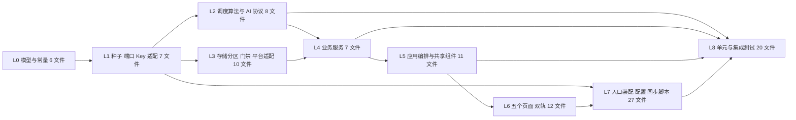
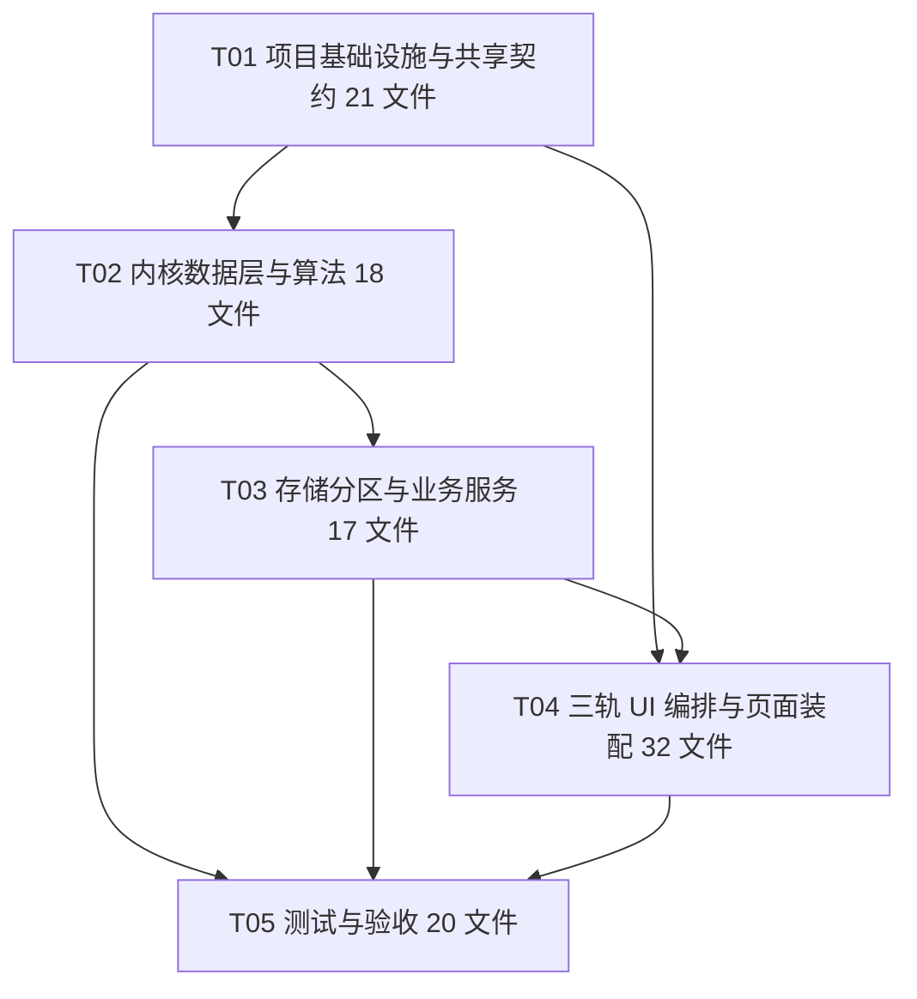

# 单词盒子 WordBox — 任务拆解清单与 API Spec（TASK_BREAKDOWN.md）

| 项目 | 内容 |
|------|------|
| 项目名 | `wordbox_harmony` / 单词盒子 (WordBox) |
| 文档版本 | v1.0（架构定稿） |
| 架构师 | 高见远（Bob / Architect） |
| 上游输入 | `PRD.md` v1.1 + `ARCHITECT_FINAL_BRIEF.md` + `ARCHITECTURE.md`（本目录，接口逐字一致） |
| 目标 | 让工程师按 L0→L8 顺序产出**可运行工程代码**，让 QA 按同一份签名写出**可真实实跑**的单元 / 集成测试 |
| 工程现实 | 构建环境仅 Node 22.22.2 + npm 10.9.7；三轨架构（内核 A / 鸿蒙 B / H5 预览 C）见 `ARCHITECTURE.md` §2 |

> **阅读顺序**：§1 装环境 → §2 按 L0~L8 逐文件实现 → §4 严格照 API Spec 写签名 → §5 遵守 Shared Knowledge 全部约定 → §6 验收。任何接口签名变更必须同步修改 `ARCHITECTURE.md` §5 与本文档 §4。

---

## 1. Required Packages

### 1.1 Node 侧 `package.json`（可直接落盘使用）

```json
{
  "name": "wordbox-harmony",
  "version": "1.0.0",
  "private": true,
  "type": "module",
  "engines": { "node": ">=22.0.0" },
  "scripts": {
    "test": "vitest run",
    "test:unit": "vitest run tests/unit",
    "test:integration": "vitest run tests/integration",
    "test:coverage": "vitest run --coverage",
    "test:watch": "vitest",
    "typecheck": "tsc --noEmit -p tsconfig.json",
    "sync:core": "node scripts/sync-core.mjs",
    "check:core-sync": "node scripts/check-core-sync.mjs",
    "dev": "vite",
    "build": "vite build",
    "preview": "vite preview"
  },
  "devDependencies": {
    "typescript": "^5.7.3",
    "vitest": "^2.1.9",
    "@vitest/coverage-v8": "^2.1.9",
    "vite": "^6.0.7"
  }
}
```

| 脚本 | 真实实跑能力 | 说明 |
|------|:------------:|------|
| `npm test` | ✅ | 运行 `tests/unit` + `tests/integration` 全部用例 |
| `npm run test:unit` | ✅ | 仅纯函数 / Service 单元测试 |
| `npm run test:integration` | ✅ | 仅内核集成测试（三张时序图场景） |
| `npm run test:coverage` | ✅ | `@vitest/coverage-v8` 产出覆盖率报告（内核目标 ≥ 90%） |
| `npm run typecheck` | ✅ | `tsc --noEmit`，`strict: true`，**不产出构建物** |
| `npm run dev` | ✅ | 启动轨 C H5 预览（真实可交互），无需鸿蒙 SDK |
| `npm run check:core-sync` | ✅ | 校验轨 B 镜像与 `core/src` 哈希一致，防三轨漂移 |

**Vitest 配置要点**（`vitest.config.ts`）：`environment: 'node'`（内核零 DOM 依赖，**不需要 jsdom**）；`include: ['tests/**/*.test.ts']`；`coverage.provider: 'v8'`；`coverage.include: ['core/src/**/*.ts']`；`alias: { '@core': './core/src', '@adapters': './adapters' }`。
**Vite 配置要点**（`vite.config.ts`）：`resolve.alias` 把 `@core` 指向 `core/src/index.ts`，让轨 C **直接 import 内核源码**；`server.port: 5173`；无前端框架插件。

### 1.2 鸿蒙侧依赖（`harmony/oh-package.json5`，本环境不安装、不编译）

```json5
{
  "name": "wordbox_harmony",
  "version": "1.0.0",
  "description": "WordBox HarmonyOS 7 native entry",
  "main": "index.ets",
  "author": "",
  "license": "Apache-2.0",
  "dependencies": {},
  "devDependencies": {}
}
```

| 能力 | 来源 | 说明 |
|------|------|------|
| ArkTS / ArkUI | HarmonyOS SDK API 12+ 内置 | 无 npm 第三方运行时依赖 |
| `@kit.ArkData` / `@ohos.data.preferences` | 系统 Kit | `HarmonyPreferencesStorage` 实装 `StorageService` |
| `@kit.AccountKit` | 系统 Kit | `HuaweiAccountProvider` 实装 `AccountProvider`；唯一可能使用 `INTERNET` 的链路 |
| 端侧推理 / NPU 探测 | 系统能力（`@kit` 推理相关接口） | `HarmonyInferenceEngine` 实装 `InferenceEngine`；模型文件随包或首启解压 |
| 构建工具 | DevEco Studio 5.x / hvigor / ohpm | 装 SDK 的机器上编译；本环境只落盘源码 |

> **硬约束**：`harmony/oh-package.json5` 的 `dependencies` 保持为空对象，`core/src` **禁止引入任何 npm 运行时包或 `@ohos.*` / `@kit.*` import**；所有系统能力必须经 `ports/ports.ts` 的端口注入。

---

## 2. 按依赖顺序的逐文件任务清单（L0 → L8）

> 列说明：**层** = L0~L8 依赖层级；**依赖** = 本文件 import 的已有文件/层；**逻辑分析** = 必须实现的函数 / 类 / 关键分支；**验收要点** = QA 断言点。
> **任务分组**：L0~L8 是 9 个**层级标签**（用于依赖排序，不单独立任务）；按功能分组后收敛为 **5 个任务 T01~T05**（见 §3），满足「任务数 ≤ 5、每任务 ≥ 3 文件、第一个任务为项目基础设施」的工程约束。

### L0 — 模型与常量层（6 文件）

| # | 路径 | 层 | 依赖 | 逻辑分析 | 验收要点 |
|---|------|----|------|----------|----------|
| 1 | `core/src/models/constants.ts` | L0 | 无 | 集中导出全部常量：`DAILY_GOAL_SECONDS=600`、`DEFAULT_NEW_CAP=8`、`MS_PER_DAY=86_400_000`、`SM2_INITIAL_EF=2.5`、`SM2_MIN_EF=1.3`、`SM2_QUALITY_PASS=3`、`SM2_FIRST_INTERVAL_DAYS=1`、`SM2_SECOND_INTERVAL_DAYS=6`、`SM2_MASTERED_INTERVAL_DAYS=30`、`SM2_RELEARN_GAP_DAYS=7`、`SM2_GAP_EF_PENALTY=0.2`、`GUEST_RETENTION_DAYS=7`、`LOGIN_PROMPT_DAYS: readonly number[] = [5,7]`、`PROMPT_DAILY_AFTER_DAY=7`、`AI_FIRST_TOKEN_TIMEOUT_MS=2000`、`AI_INFERENCE_TIMEOUT_MS=10000`、`AI_MAX_RETRY=1`、`ALL_SCENES: readonly Scene[]`、`DEFAULT_SETTINGS` | 全库 grep 不得出现第二处硬编码 600 / 7 / [5,7] / 2.5 / 1.3；`ALL_SCENES.length === 8`；常量全为 `readonly`/`const` |
| 2 | `core/src/models/types.ts` | L0 | 无 | 完整定义 `ARCHITECTURE.md` §4 全部 enum（Scene/SessionKind/WordStatus/WordSource/AIProviderKind/AcceleratorKind/ChatRole/DialogType/PromptActionKind/MergeChoiceKind/StatsWindow/DayState/GateReason/PromptSkipReason/MergeSkipReason/ConflictRule/ConflictSource）与全部 interface（Word/StudyRecord/CheckIn/ChatMessage/StatsSummary/AccountSession/GuestPromptState/MergeDecision/MergeResult/Settings/DateWindow/DatedEntity/PruneResult/PruneReport/GuestSnapshot/DailyQueue/StreakInfo/GateDecision/Gated/CalendarDay/CalendarMonth/SceneMeta/SceneWordCount/WordFilter/NewWordInput/WordEntry/StorageEntry/AIContext/AIPrompt/AIReply/ParsedAIReply/AIResponseEnvelope/AccountAuthResult/AccountTransition/LoginPromptInput/PromptSummary/LoginPromptDecision/MergePromptDecision/GuideActionResult/AuthFlowResult/BootstrapResult/HomeOverview/LearningTurn/LearnSummary/MergePlan/MergeConflict/MasteryPoint/SceneMastery） | 所有字段 `readonly`；集合为 `readonly T[]`；零 `any`/`unknown`；`tsc --noEmit` 通过；与 §4 代码块逐字一致 |
| 3 | `core/src/models/errors.ts` | L0 | types.ts | `ErrorCode` 全枚举；`AppError`；`Result<T>`；`ok<T>(value)` / `fail<T>(code, detail)`；`mapAccountKitError(kitCode: string): ErrorCode`（外部码→内部码纯映射表）；`mapInferenceError(kitCode: string): ErrorCode` | `ok` 时 `error===undefined`、`fail` 时 `value===undefined`；未知外部码统一映射为 `E_ACC_AUTH_FAILED` / `E_AI_ENGINE_ERROR`；纯函数 |
| 4 | `core/src/utils/date.ts` | L0 | constants.ts, types.ts, errors.ts | `isYMD` 严格 `YYYY-MM-DD` 校验；`parseYMD`/`formatYMD`；`addDays`（UTC 日序号 `Date.UTC(y,m-1,d)/MS_PER_DAY + delta`）；`diffDays`；`compareYMD`；`dayIndexOf(first,today)=diffDays+1`（today<first 返回 0）；`windowFrom(today,days)` 返回 `[today-(days-1), today]`；`weekGrid` | 跨月（10-31→11-01）、跨年、闰年 02-29、DST 免疫；`windowFrom('2026-11-09',7).fromYMD==='2026-11-03'`；`dayIndexOf(D1,D1)===1`；非法 YMD 返回 `Result.fail(E_INVALID_DATE)` 路径不抛异常 |
| 5 | `core/src/utils/id.ts` | L0 | constants.ts, types.ts | `fnv1a(input)` 32 位确定性 hex；`wordIdOf(text,scene,source)`（种子 `w-{scene}-{slug}`，用户 `u-{fnv1a}`）；`sessionIdOf(uid,ymd,nowMs)` | 同输入恒等输出；不同 `scene` 同词得到不同 ID；纯函数无 `Date.now()` |
| 6 | `core/src/utils/collection.ts` | L0 | types.ts | 不可变 `sortBy` / `uniqBy` / `groupBy` / `maxBy` / `stableStringify`（用于幂等键规范化）；全部返回新数组，不 mutate 入参 | 入参对象引用不变；`stableStringify` 对键顺序不同的等价对象输出相同字符串（幂等键正确性基础） |

### L1 — 种子数据 / 端口契约 / Key 规约 / 内核适配（7 文件）

| # | 路径 | 层 | 依赖 | 逻辑分析 | 验收要点 |
|---|------|----|------|----------|----------|
| 7 | `core/src/data/seedWords.ts` | L1 | types.ts, constants.ts, id.ts | 8 场景 × 30 词 = **240** 条 `Word`，逐条含 `word/phonetic/meaningZh/scene/locale/exampleInScene/aiRolePrompt/source=Seed/createdAtYMD=''`；`aiRole` 按 8 场景区分（值机员/海关官员/前台/服务员/路人/店员/售票员/求助台） | `seedWords.length===240`；每场景 30 条且 `scene` 合法；无第三方词书版权依赖；`createdAtYMD` 为空表示内置词不参与游客窗口清理 |
| 8 | `core/src/data/scriptTemplates.ts` | L1 | types.ts, constants.ts | 每场景 **≥3 套**离线脚本，每套 **≥6 回合**；每回合含 `aiText`、`mustUseWordIndexes`、`qualityRule`（依据用户上一句是否含目标词给 5 或 3）；导出 `scriptFor(scene, turnIndex, seed)` 确定性选取 | 8×3=24 套；任意场景连续取 6 回合不抛错、每回合都带目标词；完全无网络调用 |
| 9 | `core/src/ports/ports.ts` | L1 | types.ts | 声明 6 个端口接口：`Clock`、`StorageService`、`AIService`、`InferenceEngine`、`AccountProvider`、`SpeechService`（P1 仅声明）；无实现、无平台 import | 零 `@ohos.*` / `window.*` / `node:*` import；签名与 §4/§5 逐字一致 |
| 10 | `core/src/ports/keys.ts` | L1 | types.ts | 实现 §7.2 全部 Key 构造函数与 `partitionOf(session)`；`user:{uid}:` / `guest:` / `global:` 三类前缀；**全库唯一 Key 拼接点** | `partitionOf(guest)==='guest:'`；`partitionOf(user)===` `user:{uid}:`；`checkInKey('guest:','2026-11-09')==='guest:checkins:2026-11-09'`；`dateFromCheckInKey` 可逆；其他 Service 内不得出现字符串字面量 Key |
| 11 | `core/src/ports/codec.ts` | L1 | types.ts, errors.ts | `JsonCodec.encode<T>` = `JSON.stringify`；`decode<T>(raw, validate)` = `JSON.parse(raw) as T` **（全库唯一 `as T` 点）** + 字段校验器；校验失败返回 `fail(E_STORAGE_READ)`；捕获解析异常不抛出 | 合法 JSON 往返一致；非法 JSON / 缺字段返回 `ok=false`；`as T` 只在 `grep` 本文件命中 1 处 |
| 12 | `core/src/adapters/memoryStorage.ts` | L1 | ports.ts, types.ts, errors.ts | `MemoryStorageService : StorageService`，`Map<string,string>`；`batchSet` 先全部校验再一次性写入（原子性）；`keys(prefix)` 按字典序返回；`clear()` 供测试重置 | 写入后 `get` 可读；`batchSet` 中途失败零写入；`keys('user:a:')` 不返回 `guest:`；测试可实跑 |
| 13 | `core/src/adapters/systemClock.ts` | L1 | ports.ts, types.ts | `SystemClock : Clock`，唯一允许直接调用 `new Date()` 的内核文件；`todayYMD()` 用本地年月日分量（A8 本地 00:00 日切）；`msFromYMD` 构造本地 00:00 | 本地时区下 `todayYMD()` 与系统日历一致；不引入 Node/DOM 专有 API；FakeClock 可完全替代 |

### L2 — 调度算法与 AI 协议（8 文件）

| # | 路径 | 层 | 依赖 | 逻辑分析 | 验收要点 |
|---|------|----|------|----------|----------|
| 14 | `core/src/services/scheduler.ts` | L2 | L0, L1 | `createEbbinghausScheduler()` 返回纯函数对象：`createRecord`（EF=2.5、rep=0、interval=0、due=today、status=New）；`review`（§6.2 公式，非法 quality 原样返回）；`isDue`；`rebaseAfterGap`（gap>7 → Relearning/rep=0/interval=1/EF 降 0.2 且不低于 1.3/due=today）；`statusOf`；`progressRank`（字典序数值）；`buildDailyQueue`（relearn 优先、due≤today、新词取无记录种子词按 ALL_SCENES 顺序补满 newCap） | 100% 单测；q=5 连续复习间隔序列 `1→6→15→38` 且第 5 次 `Mastered`；q=2 后 rep 归零、lapses+1、status=Relearning、EF 不低于 1.3；断更 9 天必进 `relearnWordIds` 且排最前；**不 mutate 入参**（`Object.freeze` 入参测试） |
| 15 | `core/src/services/quality.ts` | L2 | types.ts, errors.ts | `QualityTagParser.parse/strip/clamp`：确定性字符串扫描提取**最后一个**合法 `[[QUALITY:n]]`；`n∈[0,5]` 整数；缺失/越界/非整数 → `quality=-1`；`displayText` 剥离全部标签并 trim | 覆盖：无标签、末尾合法、多标签取最后、`[[QUALITY:6]]`、`[[QUALITY:-1]]`、`[[QUALITY:x]]`、标签在正文中；`quality` 恒为 -1 或 0..5 |
| 16 | `core/src/services/prompt.ts` | L2 | L0, L1, types.ts | `PromptStrategy.build(ctx)` 拼装 `AIPrompt`：system 注入场景 aiRole + 零联网约束；user 注入历史末句 + targetWords + turnIndex；`qualityProtocol` 固定「末尾附 `[[QUALITY:n]]`」 | 8 场景 system 文案各不相同且含角色词；targetWords 不为空时必出现在 prompt 中；纯函数、确定性 |
| 17 | `core/src/services/scriptedAI.ts` | L2 | L1, types.ts, errors.ts | `ScriptedAI : AIService`，`kind=Scripted`；`generate` 从 `scriptFor(scene,turnIndex)` 取脚本，按 `qualityRule` 依据上一条用户消息是否含目标词生成 `[[QUALITY:5]]` / `[[QUALITY:3]]`；`isReady()` 恒 true | 完全离线、无网络、无 SDK；连续 6 回合覆盖当日全部目标词；降级后调度仍可推进 |
| 18 | `core/src/services/mockAI.ts` | L2 | ports.ts, types.ts, errors.ts | `MockAI : AIService`，构造注入回复队列与故障码队列；`forceFailure(code)` 可强制 `AI_MODEL_NOT_READY` / `AI_INFERENCE_TIMEOUT` / `AI_OUT_OF_MEMORY` / `AI_EMPTY_REPLY`；`setTags(raw)` 可注入任意 QUALITY 文本 | 100% 覆盖降级分支；不依赖平台；可重复运行 |
| 19 | `core/src/services/onDeviceAI.ts` | L2 | ports.ts, types.ts, constants.ts, errors.ts, prompt.ts | `OnDeviceAI : AIService`，构造注入 `InferenceEngine`；`generate`：`probeAccelerator()`→`UNAVAILABLE` 映射 `E_AI_MODEL_NOT_READY`；`loadModel()` 失败→ `E_AI_ENGINE_ERROR`；`infer(prompt, 10000)`；首 token>2000ms → `E_AI_FIRST_TOKEN_TIMEOUT`；总耗时>10000ms → `E_AI_INFERENCE_TIMEOUT`；内存超限 → `E_AI_OUT_OF_MEMORY`；空回复 → `E_AI_EMPTY_REPLY`；成功返回 `AIReply(provider=OnDevice)`；`timeoutMs=10000` | **零 `@ohos.*` import**（只依赖端口）；全部错误码可单测触发；CPU 回退路径（probe 返回 CPU）仍成功；`unload` 在失败路径被调用 |
| 20 | `core/src/services/aiRouter.ts` | L2 | ports.ts, types.ts, constants.ts, errors.ts, quality.ts | `createAIProviderRouter(primary, fallback, parser)`；`reply` 主实现失败后最多重试 1 次（`attempts≤2`）→ 调 `fallback.generate` → `parser.parse` → 组装 `AIResponseEnvelope(degraded, errorChain, attempts)`；`currentProvider()` 反映最近一次实际 Provider | 主成功时 `degraded=false` 且 `errorChain=[]`；主失败时 `degraded=true` 且 `attempts≤2` 且 `errorChain` 含真实错误码；降级后 `parsed.quality` 仍合法；超时路径可在 Node 实跑 |
| 21 | `core/src/services/scene.ts` | L2 | L0, L1, types.ts | `SceneService.all()` 返回 8 个 `SceneMeta`（labelZh/icon/aiRole/seedCount=30）；`wordsOf(scene)` 从种子取 30 条；`rolePrompt(scene)`；`suggestedScenes(settings,todayYMD)`；`labels()` | `all().length===8`；每场景 `wordsOf` 返回 30 条且 `scene` 匹配；纯函数确定性 |

### L3 — 存储抽象、数据分区、读取层门禁、平台适配（10 文件）

| # | 路径 | 层 | 依赖 | 逻辑分析 | 验收要点 |
|---|------|----|------|----------|----------|
| 22 | `core/src/services/progressGate.ts` | L3 | L0, L1, types.ts, errors.ts | `ProgressGate.check/guard/require`：`session.kind===Guest` → `GateDecision(allowed:false, reason:Guest, unlockHint:'登录华为账号，解锁进度')` 且 `guard` 的 `data=undefined`；`require` 返回 `fail(E_NOT_AUTHENTICATED)` | **门禁在读取层**：传入真实 StatsSummary 时游客态 `Gated.data===undefined`（不是 UI 隐藏）；登录态 `data` 全量透传；100% 单测 |
| 23 | `core/src/services/repository.ts` | L3 | L1, progressGate.ts, types.ts | `ScopedRepository` 全量实现 §5 签名；所有 Key 经 `keys.ts`；`save*` 同步维护 `guest:index:dates` / `user:{uid}:index:dates`（写 CheckIn 时把 `dateYMD` 加入索引并去重排序）；`loadGuestSnapshot` 内置窗口过滤并调 `pruneGuestPartition`；`batchWrite` 单次原子批次 | 游客与账号分区**互不串读**；写 CheckIn 后索引必含该 YMD；`loadGuestSnapshot` 永不返回窗口外条目；`batchWrite` 失败零写入；`codec.decode` 字段校验生效 |
| 24 | `adapters/preview/localStorage.ts` | L3 | ports.ts, types.ts, errors.ts | `LocalStorageAdapter : StorageService`，`window.localStorage` 字符串 KV；`keys(prefix)` 遍历 `length`+`key(i)`；`batchSet` 先校验后一次性写 | 轨 C 可真实落盘；刷新页面后数据仍在；不进 Vitest（DOM 依赖，属轨 C） |
| 25 | `adapters/preview/fakeClock.ts` | L3 | ports.ts, types.ts | `FakeClock : Clock`：`setYMD('2026-11-09')` / `advanceDays(n)` / `setNowMs` / `nowMs` 自增；`todayYMD()` 随推进变化 | 一键推进 D1→D8 及跨月；`advanceDays(1)` 后 `todayYMD` 正确 +1 天；供预览与测试共用 |
| 26 | `adapters/preview/offlineAccountProvider.ts` | L3 | ports.ts, types.ts, errors.ts | `OfflineAccountProvider : AccountProvider`，可配置 `succeed/cancel/networkError` 三种结果；`signIn` 成功返回固定 `uid='demo-uid-001'` 的 `AccountAuthResult`；失败返回对应 `Result.fail` | 无需网络 / 无需 SDK；三种分支均可在 H5 演示；失败不改变会话态 |
| 27 | `adapters/preview/previewAI.ts` | L3 | L2 AI 文件 | 装配预览 Provider：主 `ScriptedAI`、故障演示 `MockAI`、兜底 `ScriptedAI`；导出 `createPreviewRouter()` | H5 可演示端侧失败降级；不含任何 `@ohos.*` / SDK |
| 28 | `harmony/entry/src/main/ets/adapters/HarmonyPreferencesStorage.ets` | L3 | 内核 core 镜像 + `@kit.ArkData` | 用 `@ohos.data.preferences` 实装 `StorageService`；`batchSet` 批量 `put` 后**单次 `flush()`**，失败整批不提交；`keys(prefix)` 用 `getAll` 后过滤 | 装 SDK 机器可编译；杀进程重启数据不丢；需实测中断恢复（OAQ-6） |
| 29 | `harmony/entry/src/main/ets/adapters/HarmonyClock.ets` | L3 | 内核 core 镜像 | `Clock` 鸿蒙实现，本地 00:00 日切口径与 `SystemClock` 一致 | 与内核日期工具输出一致（同 YMD 输入同结果） |
| 30 | `harmony/entry/src/main/ets/adapters/HarmonyInferenceEngine.ets` | L3 | 内核 core 镜像 + 系统推理 Kit | `InferenceEngine` 唯一平台实装：`probeAccelerator()` NPU 探测 + CPU 回退；`loadModel()` 随包/首启解压到应用自有只读目录；`infer(prompt,timeoutMs)` 首 token ≤2s / 总 ≤10s / 内存上限；`unload()` | 唯一持有厂商 SDK 的文件；`probeAccelerator` 返回 `UNAVAILABLE` 时内核自动降级；本环境不编译、不声称实跑 |
| 31 | `harmony/entry/src/main/ets/adapters/HuaweiAccountProvider.ets` | L3 | 内核 core 镜像 + `@kit.AccountKit` | `AccountProvider` 鸿蒙实装；对 unionId 做本地不可逆摘要生成 `uid`；仅存 `displayName`；`signOut` / `refreshToken`；Kit 错误码经 `mapAccountKitError` 归一 | 授权失败 / 用户取消不改会话态；`INTERNET` 用途仅账号；不采集无关 PII |

### L4 — 业务服务（账号 / 打卡 / 统计 / 词本 / 窗口 / 弹窗 / 合并）（7 文件）

| # | 路径 | 层 | 依赖 | 逻辑分析 | 验收要点 |
|---|------|----|------|----------|----------|
| 32 | `core/src/services/checkin.ts` | L4 | L1, L3, scheduler.ts, types.ts | `CheckInService`：`accumulate` 取当日 CheckIn（无则新建 `goalSeconds=600`），只在前台调用才累加；`activeSeconds>=600 && !checkedIn` → 写 `checkedIn=true`、`checkedInAtMs=clock.nowMs()`、`streakAfter=rebuildStreak().current`；已打卡只更新 activeSeconds **不重复 +1**；`rebuildStreak` 从 CheckIn 列表按日连续计算 current/longest（restDayEnabled=false）；`writeCheckIn` 供合并回灌 | 599s 不打卡 / 600s 恰好打卡 / 601s 不重复 / 同日多次 accumulate 只打卡 1 次 / 跨日新建记录；FakeClock 覆盖日切；100% 单测 |
| 33 | `core/src/services/stats.ts` | L4 | L1, L3, progressGate.ts, checkin.ts, types.ts | `StatsService.summary(window, asOf, session)` 内部先 `gate.require(session)` 再聚合，返回 `Gated<StatsSummary>`（游客 `data=undefined`）；7/30/90 掌握曲线按日累计 Mastered 词数；`reviewCompletionRate` 分母为到期任务数；`sceneDistribution` 固定 8 项；`calendar(month,asOf,session)` 生成当月全部日期三态（Checked/Missed/Future）+ 本月打卡数 + 最长连续 + 累计时长，同样门禁；`recomputeAfterMerge` 全量重算（登录态内部，不受门禁） | 与 F-06/F-04 数据源零误差；游客态 `data===undefined` 且无任何数字外泄；月视图覆盖当月全部天数；合并后 7/30/90 三窗全部重算且口径一致 |
| 34 | `core/src/services/wordbook.ts` | L4 | L1, L3, scheduler.ts, types.ts | `WordBookService`：`add` / `addFromChat` 生成 `Word`（`source` 分别 User/Chat，`createdAtYMD=clock.todayYMD()`）并**自动** `scheduler.createRecord` 入 F-04 队列；`remove` 同时删词与对应 record；`list/search/byScene` 按 `WordFilter` 过滤，搜索不区分大小写、子串匹配 | 新增词必产生 StudyRecord；按 8 场景分组数==8；搜索 240+ 词内响应 <300ms（本地）；删除后调度队列不再出现该词 |
| 35 | `core/src/services/account.ts` | L4 | L1, L3, retention.ts, types.ts, errors.ts | `AccountService.current()` 从 `global:account:session` 读，缺省构造 guest；`signIn(auth,clock)` 持久化 `authenticated` 会话（`partition='user:{uid}:'`），计算 `guestProgressExists`（调 `hasGuestProgress(today)`，仅窗口内）与 `decisionAlreadyMade`（查 `mergeDecisionKey`，`choice!==Defer`）；`shouldShowTypeB = guestProgressExists && !decisionAlreadyMade`；`signOut` 回 guest 且不删任何数据；`refresh` 仅更新 `tokenRefreshedAtMs`；`hasGuestProgress` 委托 RetentionService | 重启后会话态保持；授权失败不改变会话；guest↔authenticated 分区 key 不串读；`shouldShowTypeB` 三分支（有进度无决策=true / 无进度=false / 已有决策=false）全测 |
| 36 | `core/src/services/retention.ts` | L4 | L0, L1, L3, types.ts | `createGuestRetentionPolicy()` 纯函数：`windowOf(now)=[today-6,today]`、`isWithinWindow`、`filterWithinWindow`、`pruneOutsideWindow`（幂等，`changed` 仅在有删除时 true）、`isIdempotent`；`RetentionService`：`pruneGuestPartition` 从 `guest:index:dates` 取窗口外 YMD → 组装 `words/records/checkins/chat` 待删 key → `batchRemove` → `rebuildDateIndex`；`loadGuestSnapshot` 仅返回窗口内；`markFirstStudyDate` 仅 `firstStudyYMD===''` 时写 D1；`promptState/savePromptState` | **`pruneOutsideWindow` 幂等**（重复执行 removedCount=0）；D8 时 D1 数据已清理、D2~D8 完整；跨月边界正确；窗口内数据一条不误删；`markFirstStudyDate` 重复调用不覆盖 D1；100% 单测 |
| 37 | `core/src/services/loginPrompt.ts` | L4 | L0, L1, L3, retention.ts, types.ts | `createLoginPromptPolicy()` 纯函数：`shouldPromptLogin` 按 §5.1 **8 条短路分支**返回 `LoginPromptDecision`（恒 `dialogType=A`）；`applyAction` 三动作更新 `lastPromptDate` / `neverPrompt`，不修改 `firstStudyYMD`；`dayIndex`；`buildSummary(snapshot)` 生成引导性摘要（studyDays/wordsLearned/totalMinutes/窗口）；`LoginPromptService.decide/onShown/onAuthSucceeded`，**`onAuthSucceeded` 是唯一能产生 `dialogType=B` 的内核入口**，且不读取 `neverPrompt` | FakeClock 覆盖 D1~D4 不弹 / D5 弹 / D6 不弹 / D7 弹 / D8+ 每日弹 / 跨月 / 当日已弹不重弹 / `暂不` 次日继续 / `neverPrompt` 永久关闭 A 且**类型 B 仍触发** / 已登录不弹 / 空窗口不弹 / 无游客数据不弹；100% 单测 |
| 38 | `core/src/services/migration.ts` | L4 | L0, L1, L3, scheduler.ts, checkin.ts, stats.ts, retention.ts, types.ts | `createProgressMergeService(scheduler)` 纯函数裁决器：三类 `mergeXxx` + `computeIdempotencyKey`（`fnv1a(stableStringify(窗口内快照按键排序))`）；`MigrationService.detect` 查决策 → `MergePromptDecision`；`recordDecision` 对 Merge/KeepAccount 落盘、**Defer 不落盘**；`merge` 严格按 §5.2 八步执行（登录校验 → 窗口过滤 → 空判定 → 幂等账本 → 冲突裁决 → 单次原子 `batchWrite` → 写账本 → 重算）；**不删除游客分区**；`hasDecision` | 幂等：同 key 重复 `merge` 返回 `idempotentHit=true, performed=false` 且零写入；窗口外条目仅计数不回灌；同日打卡不重复累计时长（取较大值）；StudyRecord 绝不从 Mastered 回退；合并后 `recomputed=true` 且 7/30/90 与连续天数重算；中断重跑无重复数据；100% 单测 |

### L5 — 应用编排与共享组件（11 文件）

| # | 路径 | 层 | 依赖 | 逻辑分析 | 验收要点 |
|---|------|----|------|----------|----------|
| 39 | `core/src/services/appFacade.ts` | L5 | L2/L3/L4 全部 | `createWordBoxApp(deps: AppDeps): WordBoxApp`；`bootstrap` 顺序：会话读取 → `pruneGuestPartition` → `markFirstStudyDate` → `decide()` → 返回 `BootstrapResult`；`sendMessage` 编排 AI 路由→quality 解析→调度回写→消息落盘（≥6 回合、目标词全覆盖）；`tickActiveSeconds` 转 `checkIn.accumulate`；`onLoginGuideAction` 三动作；`onHuaweiAuthResult` 授权成功→`AccountService.signIn`→`detect()` 产生类型 B；`onMergeChoice` 三选项；`calendar/statistics` 返回 `Gated<T>`；`todayOverview` 游客态 `streakVisible=false` | 冷启动顺序不可调换；类型 A 与类型 B **不合并成一个弹窗**、时序 A→授权→B；授权失败退回游客态不阻断学习；合并后三页立即刷新；100% 集成测试覆盖 |
| 40 | `preview/components/shell.ts` | L5 | appFacade.ts | 顶栏（会话态标识 / 登录引导）+ 底部 5 tab；仅渲染 `HomeOverview.accountLabel/gateHint` | H5 可交互；游客态显示「登录华为账号」 |
| 41 | `preview/components/modal.ts` | L5 | 无 | 通用弹窗基座：`show(title, body, actions)` / `dismiss()` / 取消回调；不含业务逻辑 | 三动作 / 三选项均可绑定；取消等同 `Defer` 由调用方决定 |
| 42 | `preview/components/typeADialog.ts` | L5 | modal.ts, types.ts | **类型 A**：展示 `PromptSummary`（引导性摘要）+「游客进度仅保留最近 7 天」；三动作 `去登录/暂不/不再提示`；调用 `onLoginGuideAction` | D5/D7/D8+ 各弹 1 次；`不再提示` 后不再出现；**不渲染任何进度数字到 F-07/F-08** |
| 43 | `preview/components/typeBDialog.ts` | L5 | modal.ts, types.ts | **类型 B**：「是否合并游客进度」；三选项 `合并进度/不合并，保留账号已有进度/取消（暂不处理）`；调用 `onMergeChoice` | 仅授权成功后出现；无游客进度不弹；取消不落盘可再触发 |
| 44 | `preview/components/gateView.ts` | L5 | types.ts | F-20 门禁视图：根据 `Gated<T>.allowed` 渲染「🔒 登录后可查看」+「你仍可照常学习与打卡，进度数据已保存在本机」+ 登录按钮；**不读取任何进度数据** | 游客态日历/统计页零进度数字 / 曲线 / 热力 |
| 45 | `preview/components/clockPanel.ts` | L5 | fakeClock.ts | FakeClock 面板：显示当前 YMD、D 序号、`+1 天` / `跳到 D5` / `跳到 D8` / `跨月` 按钮，推进后重新 `bootstrap()` | 一键演示 D1→D8 全部游客态流程；当前环境真实可跑 |
| 46 | `harmony/.../components/LoginGuideDialog.ets` | L5 | 内核 core 镜像 | ArkUI `@CustomDialog` 类型 A，三动作与 `PromptSummary` 同轨 C 语义 | 装 SDK 可编译；不与类型 B 共用组件 |
| 47 | `harmony/.../components/MergeChoiceDialog.ets` | L5 | 内核 core 镜像 | ArkUI `@CustomDialog` 类型 B，三选项 | 仅授权成功后触发 |
| 48 | `harmony/.../components/GateView.ets` | L5 | 内核 core 镜像 | ArkUI F-20 门禁引导组件，只读 `Gated.allowed` | 游客态零进度渲染 |
| 49 | `harmony/.../app/AppState.ets` | L5 | 内核 core 镜像 | `@Observed` 全局状态：`session` / `showTypeA` / `showTypeB` / `bootstrapResult` / `refreshTick`；合并完成后 `refreshTick++` 驱动三页刷新 | 登录/登出/合并后 UI 立即更新，无需重启 |

### L6 — 五个核心页面（双轨，12 文件）

| # | 路径 | 层 | 依赖 | 逻辑分析 | 验收要点 |
|---|------|----|------|----------|----------|
| 50 | `preview/pages/home.ts` | L6 | appFacade.ts, shell.ts | F-01：`todayOverview()` 渲染新词数/复习数/连续天数（游客态显示「登录解锁」而非数字）/剩余目标分钟/本周打卡格/今日场景；「开始学习」1 跳进 chat | 四项数据齐备；≤1 跳进入对话页 |
| 51 | `preview/pages/chat.ts` | L6 | appFacade.ts, modal.ts | F-02：场景选择、AI 回合展示、`mm:ss / 10:00` 倒计时（每秒 `tickActiveSeconds`）、`[[QUALITY:n]]` 解析结果的评分反馈、长按取词入生词本、降级提示 | ≥6 AI 回合；每个当日新词至少复现 1 次；600s 自动打卡；页面失焦暂停计时 |
| 52 | `preview/pages/vocabulary.ts` | L6 | appFacade.ts, shell.ts | F-03：搜索框、8 场景筛选、词条列表（释义+旅行例句+下次复习日+「需重学」标）、手动添加、删除 | 分组数 8；新增词自动入调度；搜索 <300ms |
| 53 | `preview/pages/calendar.ts` | L6 | appFacade.ts, gateView.ts | F-07：`calendar()` 返回 `Gated<CalendarMonth>`；登录态渲染月视图三态热力 + 本月 X/Y 天 + 最长连续 Z 天 + 累计时长；游客态整页替换为 `gateView` | 月视图覆盖当月全部日期；三态可区分；游客态零数字 |
| 54 | `preview/pages/stats.ts` | L6 | appFacade.ts, gateView.ts | F-08：`statistics(7/30/90)` 渲染掌握曲线、累计时长、复习完成率、8 场景掌握分布；游客态整页替换为 `gateView` | 三窗可切换；与 F-04/F-06 数据源误差 0；游客态零曲线/数字 |
| 55 | `preview/pages/account.ts` | L6 | appFacade.ts, shell.ts | F-19 + Q12：游客态「登录华为账号」/「继续以游客身份使用」；登录态显示已登录标识 + **「合并游客进度」再次发起入口**（仅检测到窗口内游客进度时显示）+ 退出登录 | 登录/登出会话态立即刷新；重启保持；再次合并入口可用 |
| 56 | `harmony/.../pages/HomeScreen.ets` | L6 | 内核 core 镜像, AppState.ets | ArkUI 声明式首页，数据源与轨 C 完全同一 `todayOverview()` | 装 SDK 可编译；手机竖屏 |
| 57 | `harmony/.../pages/ChatScreen.ets` | L6 | 内核 core 镜像, AppState.ets | ArkUI 对话页，`onPageShow/onPageHide` 控制前台计时，`onDeviceAI` 由 `AppBootstrap` 注入 | 后台/锁屏暂停计时；降级不中断 |
| 58 | `harmony/.../pages/VocabularyScreen.ets` | L6 | 内核 core 镜像 | ArkUI 生词本，8 场景筛选 + 搜索 + 详情 | 装 SDK 可编译 |
| 59 | `harmony/.../pages/CalendarScreen.ets` | L6 | 内核 core 镜像, GateView.ets | ArkUI 月视图热力，门禁由 `Gated` 驱动 | 游客态零进度数据 |
| 60 | `harmony/.../pages/StatsScreen.ets` | L6 | 内核 core 镜像, GateView.ets | ArkUI 7/30/90 曲线 + 场景分布，门禁由 `Gated` 驱动 | 游客态零曲线 |
| 61 | `harmony/.../pages/AccountScreen.ets` | L6 | 内核 core 镜像, AppState.ets | ArkUI 账号页 + 华为账号一键登录 + Q12 再次合并入口 + 登出 | 会话态刷新；权限最小化 |

### L7 — 入口装配、配置、三轨同步脚本（27 文件）

| # | 路径 | 层 | 依赖 | 逻辑分析 | 验收要点 |
|---|------|----|------|----------|----------|
| 62 | `package.json` | L7 | 无 | §1.1 片段原样落盘，4 条测试脚本齐备 | `npm test` 等 4 条脚本真实实跑 |
| 63 | `tsconfig.json` | L7 | 无 | `strict:true`、`noEmit:true`、`target:ES2022`、`module:ESNext`、`moduleResolution:Bundler`、`paths: {'@core/*':['core/src/*'], '@adapters/*':['adapters/*']}`、`types:[]`（禁 `@types/node` 泄漏）、`lib:["ES2022"]`（**禁 DOM**） | `npm run typecheck` 通过；`core/src` 内 `document`/`window` 引用编译报错 |
| 64 | `vitest.config.ts` | L7 | 无 | `environment:'node'`、`include`、`coverage.provider='v8'`、`coverage.include=['core/src/**/*.ts']`、alias | 无 jsdom 依赖；覆盖率报告可产出 |
| 65 | `vite.config.ts` | L7 | 无 | alias `@core`→`core/src/index.ts`、`@adapters`→`adapters/`；`server.port=5173` | `npm run dev` 启动成功；轨 C import 的是唯一内核源码 |
| 66 | `index.html` | L7 | 无 | 挂载点 + `type="module" src="/preview/main.ts"`，竖屏 viewport | H5 首屏可渲染 |
| 67 | `core/src/index.ts` | L7 | L0~L5 全部 | barrel 导出全部类型/常量/端口/服务工厂；轨 B/C/测试统一 import 入口 | 无循环依赖；导出符号覆盖 §5 全部签名 |
| 68 | `scripts/sync-core.mjs` | L7 | 无 | 遍历 `core/src/**/*.ts` → 生成 `harmony/entry/src/main/ets/core/**/*.ets`（仅加文件头注释、扩展名改 `.ets`），**业务字节不变**；写 `core-manifest.json` | 生成目录禁手工编辑标记；重复执行结果一致 |
| 69 | `scripts/gen-core-manifest.mjs` | L7 | 无 | 对 `core/src` 每文件计算 sha256，输出 `core-manifest.json` | 确定性输出 |
| 70 | `scripts/check-core-sync.mjs` | L7 | sync-core.mjs | 比对镜像文件哈希与清单，不一致 `process.exit(1)` | 手工改镜像必失败；可进 CI |
| 71 | `core-manifest.json` | L7 | gen-core-manifest.mjs | 生成物：文件路径→sha256 | 与 `core/src` 一致 |
| 72 | `preview/main.ts` | L7 | L3/L5/L6, `@core`, clockPanel.ts | 装配 `AppDeps`（LocalStorageAdapter / FakeClock / OfflineAccountProvider / previewAI / 全部内核服务）→ `createWordBoxApp` → `bootstrap()` → 渲染 shell + 首页 + 类型 A 判定 | 当前环境 `npm run dev` 真实可运行、可交互 |
| 73 | `preview/router.ts` | L7 | preview/pages/* | hash 路由 `#/home` `#/chat` `#/vocabulary` `#/calendar` `#/stats` `#/account` | 5+ 页面可切换，无刷新 |
| 74 | `preview/style.css` | L7 | 无 | 手机竖屏优先、中文大字号、单手可达、深色模式适配 | 深色/大字号无遮挡截断 |
| 75 | `harmony/AppScope/app.json5` | L7 | 无 | `bundleName` / `versionCode` / `minAPIVersion 12` / `targetAPIVersion 12` | 符合 API 12+ |
| 76 | `harmony/AppScope/resources/base/element/string.json` | L7 | 无 | `app_name` = 单词盒子 | 资源引用有效 |
| 77 | `harmony/build-profile.json5` | L7 | 无 | `compileSdkVersion 12` / `compatibleSdkVersion 12` / 签名与产品配置 | DevEco 工程结构完整 |
| 78 | `harmony/oh-package.json5` | L7 | 无 | §1.2 片段，`dependencies: {}` | 无第三方运行时依赖 |
| 79 | `harmony/hvigorfile.ts` | L7 | 无 | 标准 hvigor 构建脚本 | 装 SDK 可编译 |
| 80 | `harmony/entry/build-profile.json5` | L7 | 无 | entry 模块构建配置 | — |
| 81 | `harmony/entry/hvigorfile.ts` | L7 | 无 | entry hvigor 脚本 | — |
| 82 | `harmony/entry/oh-package.json5` | L7 | 无 | entry 模块声明，无第三方依赖 | — |
| 83 | `harmony/entry/src/main/module.json5` | L7 | 无 | `mainElement: EntryAbility`、6 个页面路由、**权限白名单**：`INTERNET`（仅账号，should）、`VIBRATE`（should 可选）、`MICROPHONE`（P1 使用时申请，MVP 不启用）；无其他权限 | 权限声明与 §11.3 完全一致；INTERNET 不用于 AI |
| 84 | `harmony/entry/src/main/resources/base/profile/main_pages.json` | L7 | 无 | 6 个页面路径注册 | 与 module.json5 路由一致 |
| 85 | `harmony/.../entryability/EntryAbility.ets` | L7 | AppBootstrap.ets | `onCreate/onWindowStageCreate` 装配端口并 `loadContent` 首页；不写业务规则 | 冷启动 ≤1.5s 由 UI 侧保证 |
| 86 | `harmony/.../app/AppBootstrap.ets` | L7 | 内核 core 镜像 + L3 适配 | 装配 `AppDeps`：`HarmonyPreferencesStorage` / `HarmonyClock` / `HuaweiAccountProvider` / `OnDeviceAI(HarmonyInferenceEngine)` 主 + `ScriptedAI` 兜底；调 `bootstrap()`；把 `AppState` 注入页面 | 端侧推理主实现只在轨 B 注入；UI 层零厂商 SDK |
| 87 | `docs/sequence-diagram.mermaid` | L7 | ARCHITECTURE.md | 3 张时序图抽取件（§8.1/8.2/8.3） | Mermaid 可渲染 |
| 88 | `docs/class-diagram.mermaid` | L7 | ARCHITECTURE.md | 类图抽取件（§9.1） | Mermaid 可渲染 |

### L8 — 单元 / 集成测试（20 文件）

| # | 路径 | 层 | 依赖 | 逻辑分析（用例矩阵） | 验收要点 |
|---|------|----|------|----------|----------|
| 89 | `tests/helpers/fakeClock.ts` | L8 | `@core` | `FakeClock` 测试版：`setYMD/advanceDays/setNowMs`，不依赖系统时间 | 所有测试零 `Date.now()` 依赖 |
| 90 | `tests/helpers/memoryStorage.ts` | L8 | `@core` | 直接复用 `core/src/adapters/memoryStorage.ts`，提供 `resetStorage()` | 每个用例前可重置 |
| 91 | `tests/helpers/fixtures.ts` | L8 | `@core` | 精简种子词夹具、游客快照（D1~D8 数据）、账号快照、含冲突的同日 CheckIn / 同词 StudyRecord | 夹具确定性；可构造窗口外数据 |
| 92 | `tests/unit/date.test.ts` | L8 | date.ts | `addDays` 跨月/跨年/闰年/负偏移；`diffDays`；`dayIndexOf` D1~D8；`windowFrom` 恒 7 天；非法 YMD | ✅ 真实实跑，100% 通过 |
| 93 | `tests/unit/scheduler.test.ts` | L8 | scheduler.ts | q=5 间隔序列 `1→6→15→38`+Mastered；q=2 重置；EF 下限 1.3；`rebaseAfterGap` gap=7 不变 / gap=8 降级；`buildDailyQueue` relearn 优先 + 新词上限 8；不可变性（`Object.freeze`） | ✅ 100% 通过 |
| 94 | `tests/unit/quality.test.ts` | L8 | quality.ts | 无标签/末尾标签/多标签取最后/越界/非整数/标签在正文/`displayText` 剥离 | ✅ 100% 通过 |
| 95 | `tests/unit/aiRouter.test.ts` | L8 | aiRouter.ts, mockAI.ts, onDeviceAI.ts | 主成功 `degraded=false`；模型未就绪/首 token 超时/推理超时/内存超限/空回复全部降级 `ScriptedAI`；`attempts≤2`；`errorChain` 错误码正确；CPU 回退成功；`unload` 被调用 | ✅ 100% 通过 |
| 96 | `tests/unit/checkin.test.ts` | L8 | checkin.ts, fakeClock | 599 不打卡 / 600 恰好打卡 / 601 不重复 / 同日多次 / 跨日新建 / `rebuildStreak` 断更归零 | ✅ 100% 通过 |
| 97 | `tests/unit/stats.test.ts` | L8 | stats.ts, progressGate.ts | 7/30/90 三窗口；掌握曲线点数；复习完成率；8 场景分布；游客态 `Gated.data===undefined`；登录态全量；`calendar` 当月全日期三态 | ✅ 100% 通过 |
| 98 | `tests/unit/wordbook.test.ts` | L8 | wordbook.ts | 新增自动入调度；按 8 场景分组；搜索大小写/子串；删除同步移除 record；`source` 正确 | ✅ 100% 通过 |
| 99 | `tests/unit/account.test.ts` | L8 | account.ts | 会话持久化与重启；`signIn` 分区切换；`shouldShowTypeB` 三分支；`signOut` 不删数据；授权失败不改会话；`refresh` 仅更新时间戳 | ✅ 100% 通过 |
| 100 | `tests/unit/repository.test.ts` | L8 | repository.ts, keys.ts | 分区互不串读；日期索引维护；`loadGuestSnapshot` 只返回窗口内；`batchWrite` 失败零写入；codec 非法 JSON 返回 fail | ✅ 100% 通过 |
| 101 | `tests/unit/retention.test.ts` | L8 | retention.ts | `windowOf` 恒 `[today-6,today]`；`isWithinWindow` 边界；`filterWithinWindow`；**`pruneOutsideWindow` 幂等**（跑 2 次 removedCount 第 2 次为 0）；跨月；不误删窗口内；`markFirstStudyDate` 只写一次 | ✅ 100% 通过 |
| 102 | `tests/unit/loginPrompt.test.ts` | L8 | loginPrompt.ts, fakeClock | **§5.1 全 8 分支**：D1~D4 不弹 / D5 弹 / D6 不弹 / D7 弹 / D8+ 每日弹 / 跨月 / 当日已弹不重弹 / `暂不` 次日继续 / `neverPrompt` 永久关闭 A 且 B 仍触发 / 已登录不弹 / 空窗口不弹 / 无游客数据不弹 / 三动作状态迁移 | ✅ 100% 通过 |
| 103 | `tests/unit/migration.test.ts` | L8 | migration.ts | 幂等（同 key 第二次 `idempotentHit=true` 零写入）；窗口外仅计数不回灌；同日打卡取较大 `activeSeconds` 不相加、不重复打卡；StudyRecord 不得从 Mastered 回退；生词本按 ID 去重；`Defer` 不落盘；`recomputed=true`；中断重跑无重复 | ✅ 100% 通过 |
| 104 | `tests/integration/learningFlow.test.ts` | L8 | appFacade.ts 等 | 时序图①：bootstrap→队列→6 回合端侧对话→quality 解析→调度回写→持久化→600s 打卡→统计更新；断言目标词 100% 复现、打卡 1 次、统计误差 0 | ✅ 真实实跑通过 |
| 105 | `tests/integration/aiFallback.test.ts` | L8 | aiRouter.ts, scriptedAI.ts | 时序图②：模型未就绪 / 超时 / 内存超限 → 降级 ScriptedAI，对话与 600s 打卡不中断，全程无网络调用（spy 内核无 fetch/HTTP） | ✅ 真实实跑通过 |
| 106 | `tests/integration/guestLoginMerge.test.ts` | L8 | appFacade.ts, account.ts, migration.ts | 时序图③ 类型 B：游客有进度 → 登录成功 → 弹 B → 选合并 → 窗口过滤 → 冲突裁决 → 幂等写入 → 连续天数与 7/30/90 重算 → 三页刷新；无游客进度不弹；已有决策不弹；取消可再触发；不合并时窗口内数据不删除 | ✅ 真实实跑通过 |
| 107 | `tests/integration/guestWindowD1toD8.test.ts` | L8 | appFacade.ts, fakeClock, retention, loginPrompt | FakeClock 推进 D1→D8：逐日窗口清理（D8 时 D1 数据已清、D2~D8 完整）、D5/D7 各弹 1 次、D8 起每日 1 次、每日最多 1 次、`不再提示` 永久关闭 A 但登录后 B 仍触发、跨月边界、清理幂等 | ✅ 真实实跑通过 |
| 108 | `tests/integration/gate.test.ts` | L8 | stats.ts, progressGate.ts | F-20：游客态 `statistics/calendar` 均 `allowed=false, data=undefined`；登录后同一数据源全量一致（误差 0）；游客照常写 CheckIn 与 StudyRecord（解释 A） | ✅ 真实实跑通过 |

---

## 3. 任务依赖图与 5 个任务分组

### 3.1 L0~L8 层级依赖图



### 3.2 5 个任务分组（≤5 任务，每任务 ≥3 文件，T01 为基础设施）

| 任务 | 名称 | 覆盖层级与文件数 | 依赖 | 优先级 |
|------|------|------------------|------|--------|
| **T01** | **项目基础设施与共享契约** | L0 模型契约 3（constants/types/errors）+ L7 配置入口同步脚本 18 = **21 文件** | 无 | **P0** |
| **T02** | 内核数据层与算法 | L0 工具 3 + L1 7 + L2 8 = **18 文件** | T01 | P0 |
| **T03** | 存储分区与全部业务服务 | L3 10 + L4 7 = **17 文件** | T02 | P0 |
| **T04** | 三轨 UI 编排与页面装配 | L5 11 + L6 12 + L7 剩余入口/文档 9 = **32 文件** | T01、T03 | P0 |
| **T05** | 测试与验收 | L8 **20 文件** | T02、T03、T04 | P0 |

> T01 把「配置文件 + 入口文件 + 依赖声明 + 共享类型契约」一次性收齐，保证后续任务只依赖一个稳定底座；T04 只依赖 T01 的契约与 T03 的服务门面，不与 T02 形成线性长链。

### 3.3 任务依赖图（T01~T05）



---

## 4. 完整 API Spec（工程师照此实现，QA 照此写测试）

> 与 `ARCHITECTURE.md` §5 **逐字一致**。所有 `Promise<Result<T>>` 方法不抛异常；纯函数同步返回；`clock` 显式注入。

### 4.1 `Clock` / `StorageService` / `JsonCodec`

| 方法 | 入参 | 出参 | 异常 / 边界 |
|------|------|------|-------------|
| `Clock.nowMs()` | — | `number` epoch ms | FakeClock 可覆盖 |
| `Clock.todayYMD()` | — | `string` `'YYYY-MM-DD'` | 本地 00:00 日切（A8） |
| `Clock.ymdFromMs(ms)` | `number` | `string` | 用本地时间分量 |
| `Clock.msFromYMD(ymd)` | `string` | `number` | 本地 00:00 epoch ms；非法 YMD → 0 |
| `StorageService.get(key)` | `string` | `Promise<Result<string \| undefined>>` | 不存在 → `ok(true)` 且 `value=undefined` |
| `StorageService.set(key,value)` | `string,string` | `Promise<Result<boolean>>` | 失败 → `ok=false` + `E_STORAGE_WRITE` |
| `StorageService.remove(key)` | `string` | `Promise<Result<boolean>>` | 删除不存在的 key 仍 `ok=true` |
| `StorageService.keys(prefix)` | `string` | `Promise<Result<readonly string[]>>` | 按字典序；无匹配返回空数组 |
| `StorageService.batchSet(entries)` | `readonly StorageEntry[]` | `Promise<Result<boolean>>` | **原子**：部分失败必须整批不提交 → `E_STORAGE_BATCH_PARTIAL` |
| `StorageService.batchRemove(keys)` | `readonly string[]` | `Promise<Result<boolean>>` | 同上，幂等 |
| `JsonCodec.encode<T>(value)` | `T` | `string` | 纯 `JSON.stringify` |
| `JsonCodec.decode<T>(raw, validate)` | `string`, 校验器 | `Result<T>` | 解析异常 / 校验失败 → `fail(E_STORAGE_READ)`；**全库唯一 `as T` 点** |

### 4.2 `EbbinghausScheduler`

| 方法 | 入参 | 出参 | 异常 / 边界 |
|------|------|------|-------------|
| `createRecord(wordId, todayYMD)` | `string,string` | `StudyRecord` | `ef=2.5, rep=0, interval=0, due=today, status=New, lastReviewedYMD='', createdAtYMD=updatedAtYMD=today` |
| `review(record, quality, todayYMD)` | `StudyRecord, number, string` | `StudyRecord`（**新对象**） | `quality` 非 0..5 整数 → **原样返回入参**；`q<3` 重置；`interval>=30` → Mastered；EF 下限 1.3；不 mutate |
| `isDue(record, todayYMD)` | `StudyRecord,string` | `boolean` | `dueYMD <= todayYMD` 且 `status !== Mastered` |
| `rebaseAfterGap(record, todayYMD)` | `StudyRecord,string` | `StudyRecord` | `gap>7` → Relearning/rep=0/interval=1/EF-0.2(≥1.3)/due=today；否则原样 |
| `statusOf(intervalDays, lapses, relearn)` | `number,number,boolean` | `WordStatus` | `relearn=true` 优先 Relearning；`intervalDays>=30` → Mastered |
| `buildDailyQueue(words, records, todayYMD, newCap)` | `readonly Word[], readonly StudyRecord[], string, number` | `DailyQueue` | `relearnWordIds` 排最前；`reviewWordIds` 为 due 词；`newWordIds` 取无 record 的种子词按 ALL_SCENES 顺序补满 `newCap`；`total` 为三者之和 |
| `progressRank(record)` | `StudyRecord` | `number` | 合并「不得回退」比较基准，见 §6.2 公式 |

### 4.3 AI 层

| 方法 | 入参 | 出参 | 异常 / 边界 |
|------|------|------|-------------|
| `AIService.isReady()` | — | `Promise<boolean>` | `ScriptedAI` 恒 true |
| `AIService.generate(ctx)` | `AIContext` | `Promise<Result<AIReply>>` | 失败返回 `ok=false` + AI_* 错误码，**不抛异常** |
| `InferenceEngine.probeAccelerator()` | — | `Promise<AcceleratorKind>` | `NPU`/`CPU`/`UNAVAILABLE` |
| `InferenceEngine.loadModel()` | — | `Promise<Result<boolean>>` | 模型未就绪 → `E_AI_MODEL_NOT_READY` |
| `InferenceEngine.infer(prompt, timeoutMs)` | `string, number` | `Promise<Result<string>>` | 超时/内存/空回复映射对应 AI_* 码 |
| `InferenceEngine.unload()` | — | `Promise<Result<boolean>>` | 失败不阻断降级 |
| `QualityTagParser.parse(raw)` | `string` | `ParsedAIReply` | 最后一个合法 `[[QUALITY:n]]`；缺失/越界 → `quality=-1`；`displayText` 剥离全部标签 |
| `QualityTagParser.strip(raw)` | `string` | `string` | 纯字符串扫描，trim |
| `QualityTagParser.clamp(n)` | `number` | `number` | 合法返回 0..5，否则 -1 |
| `PromptStrategy.build(ctx)` | `AIContext` | `AIPrompt` | 8 场景 system 不同；targetWords 必现；纯函数 |
| `AIProviderRouter.reply(ctx, clock)` | `AIContext, Clock` | `Promise<AIResponseEnvelope>` | 主失败重试 ≤1 次（`attempts≤2`）→ fallback；`degraded` / `errorChain` 正确 |
| `AIProviderRouter.currentProvider()` | — | `AIProviderKind` | 反映最近一次实际 Provider |

### 4.4 `ScopedRepository` / `ProgressGate`

| 方法 | 入参 | 出参 | 异常 / 边界 |
|------|------|------|-------------|
| `ProgressGate.check(session)` | `AccountSession` | `GateDecision` | 游客 → `allowed=false, reason=Guest, unlockHint` |
| `ProgressGate.guard<T>(session, data)` | `AccountSession, T` | `Gated<T>` | 游客 → `data=undefined`（**读取层拦截，不是 UI 隐藏**） |
| `ProgressGate.require(session)` | `AccountSession` | `Result<AccountSession>` | 游客 → `fail(E_NOT_AUTHENTICATED)` |
| `ScopedRepository.partition(session)` | `AccountSession` | `string` | `'guest:'` / `'user:{uid}:'` |
| `loadWords/loadRecords/loadChatMessages/loadSettings(session)` | `AccountSession` (+`sessionId`) | `Promise<Result<readonly T[]\|Settings>>` | 读失败 → `E_STORAGE_READ`；跨分区零泄漏 |
| `loadCheckIns(session, fromYMD, toYMD)` | `AccountSession,string,string` | `Promise<Result<readonly CheckIn[]>>` | 含端点，按 YMD 升序 |
| `saveWord/saveRecord/saveCheckIn/saveChatMessage/saveSettings` | `AccountSession, T` | `Promise<Result<boolean>>` | 写 CheckIn 时维护日期索引；失败 `E_STORAGE_WRITE` |
| `dateIndex(partition)` / `rebuildDateIndex(partition, dates)` | `string` (+`readonly string[]`) | `Promise<Result<readonly string[]\|boolean>>` | 索引升序去重 |
| `batchWrite(partition, entries)` / `batchRemove(partition, keys)` | `string, readonly ...` | `Promise<Result<boolean>>` | 单次原子批次，合并/清理依赖此幂等性 |
| `loadGuestSnapshot(nowYMD)` | `string` | `Promise<Result<GuestSnapshot>>` | **内置窗口过滤**，永不返回窗口外数据 |

### 4.5 `CheckInService` / `StatsService` / `WordBookService` / `SceneService`

| 方法 | 入参 | 出参 | 异常 / 边界 |
|------|------|------|-------------|
| `CheckInService.accumulate(dateYMD, deltaSeconds, clock)` | `string, number, Clock` | `Promise<Result<CheckIn>>` | `deltaSeconds≤0` → `E_INVALID_ARGUMENT`；达 600 且未打卡才写标记；已打卡不重复 +1；跨日新建 |
| `CheckInService.snapshot(dateYMD)` | `string` | `Promise<Result<CheckIn>>` | 无记录返回 `goalSeconds=600, activeSeconds=0, checkedIn=false` 的新对象 |
| `CheckInService.remainingSeconds(dateYMD)` | `string` | `Promise<Result<number>>` | `max(0, 600-activeSeconds)` |
| `CheckInService.streak()` / `rebuildStreak()` | — | `Promise<Result<StreakInfo>>` | `restDayEnabled=false`；断更归零；按日升序 |
| `CheckInService.listRange(from,to)` | `string,string` | `Promise<Result<readonly CheckIn[]>>` | 含端点 |
| `CheckInService.writeCheckIn(checkIn)` | `CheckIn` | `Promise<Result<boolean>>` | 供合并回灌，覆盖写幂等 |
| `StatsService.summary(windowDays, asOfYMD, session)` | `StatsWindow,string,AccountSession` | `Promise<Result<Gated<StatsSummary>>>` | 游客 `data=undefined`；窗口 7/30/90；与 F-04/F-06 误差 0 |
| `StatsService.calendar(monthYMD, asOfYMD, session)` | `string,string,AccountSession` | `Promise<Result<Gated<CalendarMonth>>>` | 游客 `data=undefined`；月视图覆盖当月全部日期三态 |
| `StatsService.recomputeAfterMerge(uid, asOfYMD)` | `string,string` | `Promise<Result<StatsSummary>>` | 登录态内部重算，不受门禁；合并后必调 |
| `WordBookService.list/search/add/addFromChat/remove/byScene` | 见 §5 签名 | `Promise<Result<...>>` | 新增必自动建 `StudyRecord`；删除同步移除 record；`search` 大小写不敏感 |
| `SceneService.all/wordsOf/rolePrompt/suggestedScenes/labels` | 见 §5 签名 | 同步值 | `all().length===8`；每场景 `wordsOf` 30 条 |

### 4.6 `AccountService` / 外部账号契约

| 方法 | 入参 | 出参 | 异常 / 边界 |
|------|------|------|-------------|
| `AccountService.current()` | — | `Promise<Result<AccountSession>>` | 无持久化会话 → 构造 guest（`uid='guest', partition='guest:'`） |
| `AccountService.signIn(auth, clock)` | `AccountAuthResult, Clock` | `Promise<Result<AccountTransition>>` | 持久化 `authenticated`；`shouldShowTypeB = guestProgressExists && !decisionAlreadyMade`；**不删除游客数据** |
| `AccountService.signOut(clock)` | `Clock` | `Promise<Result<AccountSession>>` | 回 guest；保留所有分区数据 |
| `AccountService.refresh(auth, clock)` | `AccountAuthResult, Clock` | `Promise<Result<AccountSession>>` | 仅更新 `tokenRefreshedAtMs` |
| `AccountService.hasGuestProgress(nowYMD)` | `string` | `Promise<Result<boolean>>` | **仅窗口内**探测 |
| `AccountService.partitionOf/isAuthenticated` | `AccountSession` | `string` / `boolean` | 纯函数 |

**华为账号（`AccountProvider`）契约与错误码**：

| 外部动作 | 内部方法 | 成功出参 | 错误码 | 会话态约束 |
|----------|----------|----------|--------|------------|
| 一键登录 | `signIn()` | `Result<AccountAuthResult{uid,displayName,expiresAtMs}>` | `E_ACC_NETWORK`（无网）、`E_ACC_CANCELLED`（用户取消）、`E_ACC_AUTH_FAILED`、`E_ACC_KIT_UNAVAILABLE` | **任何失败一律保持原会话态**（游客仍游客），学习链路不中断 |
| 登出 | `signOut()` | `Result<boolean>` | `E_ACC_AUTH_FAILED` | 失败不清除本地会话 |
| 令牌刷新 | `refreshToken()` | `Result<AccountAuthResult>` | `E_ACC_TOKEN_EXPIRED`、`E_ACC_NETWORK` | 失败仅记录，不清已登录会话 |
| Kit 原始码映射 | `mapAccountKitError(kitCode)` | `ErrorCode` | 未知码 → `E_ACC_AUTH_FAILED` | 纯函数、内核归一 |

> `uid` 由鸿蒙 Adapter 对华为 unionId 做本地不可逆摘要；内核只见 `uid`。**账号授权 / 令牌刷新可能需要网络，AI 推理全程无网络请求**，二者严格解耦（Q7）。

**端侧推理（`InferenceEngine`）契约与错误码**：

| 条件 | 内部表现 | 错误码 | 路由行为 |
|------|----------|--------|----------|
| NPU 不可用但 CPU 可用 | `probeAccelerator()` 返回 `CPU` | `E_AI_NPU_UNAVAILABLE`（仅诊断，不阻断） | 继续 CPU 推理 |
| 加速器全不可用 / 模型未就绪 | `probeAccelerator()`=`UNAVAILABLE` 或 `loadModel` 失败 | `E_AI_MODEL_NOT_READY` / `E_AI_ENGINE_ERROR` | 降级 `ScriptedAI` |
| 首 token > 2000ms | 超时 | `E_AI_FIRST_TOKEN_TIMEOUT` | 降级 |
| 总耗时 > 10000ms | 超时 | `E_AI_INFERENCE_TIMEOUT` | 降级 |
| 推理内存超上限 | 引擎拒绝 | `E_AI_OUT_OF_MEMORY` | 降级 |
| 空回复 | 引擎返回空串 | `E_AI_EMPTY_REPLY` | 降级 |
| 其他 | 引擎异常 | `E_AI_ENGINE_ERROR` | 降级 |

> `CloudAI` **不实现、无文件、无网络请求**；`AIProviderRouter(primary, fallback, parser)` 构造参数已支持任意 `AIService` 注入作为未来扩展点。

### 4.7 `GuestRetentionPolicy` / `RetentionService`

| 方法 | 入参 | 出参 | 异常 / 边界 |
|------|------|------|-------------|
| `windowOf(nowYMD)` | `string` | `DateWindow` | 恒 `[today-6, today]`，`days=7` |
| `isWithinWindow(dateYMD, nowYMD)` | `string,string` | `boolean` | 含端点（边界当天均保留） |
| `filterWithinWindow<T>(items, nowYMD)` | `readonly DatedEntity<T>[], string` | `readonly DatedEntity<T>[]` | 纯函数，返回新数组 |
| `pruneOutsideWindow<T>(items, nowYMD)` | `readonly DatedEntity<T>[], string` | `PruneResult<DatedEntity<T>>` | **幂等**：第二次 `removed=[]` 且 `changed=false` |
| `isIdempotent(prev, next, nowYMD)` | 三组参数 | `boolean` | 判定清理前后是否等价 |
| `RetentionService.pruneGuestPartition(nowYMD)` | `string` | `Promise<Result<PruneReport>>` | 冷启动 + 读取时触发；异步不阻塞首帧；窗口内一条不误删 |
| `RetentionService.loadGuestSnapshot(nowYMD)` | `string` | `Promise<Result<GuestSnapshot>>` | 仅窗口内；合并前置入口 |
| `RetentionService.hasGuestProgress(nowYMD)` | `string` | `Promise<Result<boolean>>` | 空窗口 → false（不弹引导） |
| `RetentionService.markFirstStudyDate(nowYMD)` | `string` | `Promise<Result<GuestPromptState>>` | 仅 `firstStudyYMD===''` 时写 D1，重复调用不覆盖 |
| `RetentionService.promptState()` / `savePromptState(state)` | — / `GuestPromptState` | `Promise<Result<GuestPromptState\|boolean>>` | 持久化 `neverPrompt` / `lastPromptDate` |

### 4.8 `LoginPromptPolicy.shouldPromptLogin` 全分支（状态机硬规格）

**签名**：`shouldPromptLogin(input: LoginPromptInput): LoginPromptDecision`，**纯函数，恒 `dialogType = A`**。

| 序 | 条件（按序短路） | `shouldPrompt` | `reason` | `dayIndex` |
|----|------------------|:--------------:|----------|-----------|
| 1 | `session.kind === Authenticated` | false | `AUTHENTICATED` | 照算 |
| 2 | `hasGuestProgress === false` 或 `firstStudyYMD === ''` | false | `NO_GUEST_DATA` | 0 |
| 3 | `window` 内 `GuestSnapshot` 全空 | false | `EMPTY_WINDOW` | 照算 |
| 4 | `state.neverPrompt === true` | false | `NEVER_PROMPT` | 照算 |
| 5 | `state.lastPromptDate === todayYMD` | false | `ALREADY_PROMPTED_TODAY` | 照算 |
| 6 | `d ∈ LOGIN_PROMPT_DAYS`（5 或 7） | **true** | `NONE` | d |
| 7 | `d > PROMPT_DAILY_AFTER_DAY`（d ≥ 8） | **true** | `NONE` | d |
| 8 | 其余（d ∈ 1..4、d === 6、d === 0） | false | `NOT_SCHEDULED_DAY` | d |

- `dayIndex = dayIndexOf(firstStudyYMD, todayYMD)`，D1=1。
- `applyAction(state, action, todayYMD)`：`GoLogin` / `Later` → `lastPromptDate=todayYMD`；`NeverPrompt` → `neverPrompt=true` 且 `lastPromptDate=todayYMD`；三者都不改 `firstStudyYMD`。
- `LoginPromptService.decide` 恒返回 A；**`onAuthSucceeded(transition, nowYMD)` 是唯一能产出 `dialogType=B` 的内核入口**，且**不读取 `neverPrompt`**（故「不再提示」不影响类型 B）。
- `onShown` 持久化 `lastPromptDate`，保证「每天最多 1 次」，日切由 `Clock.todayYMD()` 重置。
- 弹窗内 `PromptSummary` 为**引导性摘要**，不是统计页，不违反 F-20 门禁。

### 4.9 `ProgressMergeService` / `MigrationService`

| 方法 | 入参 | 出参 | 异常 / 边界 |
|------|------|------|-------------|
| `mergeWordLists(a, g)` | `readonly Word[], readonly Word[]` | `MergePlan<Word>` | 按 `Word.id` 去重；账号已有保留账号版本；`conflicts` 记 `WORD_DEDUP` |
| `mergeRecords(a, g)` | `readonly StudyRecord[], readonly StudyRecord[]` | `MergePlan<StudyRecord>` | 取 `progressRank` 较大者；同分取 `updatedAtYMD` 较新；`lapses` 取较小；**不得从 Mastered 回退** |
| `mergeCheckIns(a, g)` | `readonly CheckIn[], readonly CheckIn[]` | `MergePlan<CheckIn>` | `checkedIn=true` 优先；均打卡 → `activeSeconds`/`streakAfter` 取**较大值**（不相加）、`checkedInAtMs` 取较早；不重复打卡 |
| `computeIdempotencyKey(snapshot)` | `GuestSnapshot` | `string` | `fnv1a(stableStringify(窗口内快照按键排序))`，确定性 |
| `MigrationService.detect(uid, nowYMD)` | `string,string` | `Promise<Result<MergePromptDecision>>` | 恒 `dialogType=B`；无窗口内游客进度或已有明确决策 → `shouldShow=false` |
| `recordDecision(uid, choice, nowYMD, clock)` | `string, MergeChoiceKind, string, Clock` | `Promise<Result<MergeDecision>>` | `Merge`/`KeepAccount` 落盘到 `user:{uid}:meta:mergeDecision`；**`Defer` 不落盘**（可再触发） |
| `merge(uid, nowYMD, clock)` | `string,string,Clock` | `Promise<Result<MergeResult>>` | 见下方八步与冲突/幂等约定 |
| `hasDecision(uid)` | `string` | `Promise<Result<boolean>>` | 仅统计 `choice !== Defer` 的明确决策 |

**`merge` 八步（顺序不可调换）**：① 登录校验（否则 `E_MERGE_NOT_AUTHENTICATED`）→ ② `loadGuestSnapshot` 内含窗口过滤，窗口外仅计入 `skippedOutsideWindowCount` → ③ 窗口内为空 → `performed=false, reason=NO_GUEST_DATA`（仅窗口外 → `OUTSIDE_WINDOW_ONLY`），零写入 → ④ `computeIdempotencyKey` 查 `user:{uid}:meta:mergeLedger:{key}`，命中 → `performed=false, idempotentHit=true, reason=ALREADY_MERGED`，零写入 → ⑤ 载入账号分区全量 → 三类 `MergePlan` 裁决 → ⑥ `batchWrite(user:{uid}:...)` **单次原子批次**，随后写账本，**游客分区一律不删除** → ⑦ `CheckInService.rebuildStreak()` + `StatsService.recomputeAfterMerge()` → ⑧ `recomputed=true`，`after` 为重算结果，调用方刷新三页。

**幂等与崩溃恢复**：游客分区合并后保持原样，中断重跑生成**相同 key 与相同 plan**；账本已写则命中幂等零写入，账本未写则 `batchWrite` 覆盖写（KV 覆盖幂等）。结果保证：无重复词条、无重复打卡、无重复累计时长。窗口外数据**不合并、不回灌、不计入统计重算**。

### 4.10 `WordBoxApp` 编排门面

| 方法 | 入参 | 出参 | 关键约束 |
|------|------|------|----------|
| `bootstrap(clock)` | `Clock` | `Promise<Result<BootstrapResult>>` | 顺序：会话 → 窗口清理 → D1 → 类型 A 判定；清理不阻塞首帧 |
| `todayOverview(clock)` | `Clock` | `Promise<Result<HomeOverview>>` | 游客态 `streakVisible=false`，显示「登录解锁」而非数字 |
| `startLearning(scene, clock)` | `Scene, Clock` | `Promise<Result<DailyQueue>>` | 队列来自 `buildDailyQueue` |
| `sendMessage(sessionId, userText, clock)` | `string,string,Clock` | `Promise<Result<LearningTurn>>` | AI 路由→quality 解析→调度回写→落盘；`quality=-1` 不回写调度 |
| `tickActiveSeconds(sessionId, seconds, clock)` | `string,number,Clock` | `Promise<Result<CheckIn>>` | 仅前台调用；转 `checkIn.accumulate` |
| `finishLearning(sessionId, clock)` | `string,Clock` | `Promise<Result<LearnSummary>>` | 校验 `allTargetWordsCovered`；`aiRounds≥6` |
| `onLoginGuideAction(action, clock)` | `PromptActionKind, Clock` | `Promise<Result<GuideActionResult>>` | `GoLogin` → `launchAccountKit=true`；恒 `dialogType=A` |
| `onHuaweiAuthResult(auth, clock)` | `AccountAuthResult \| undefined, Clock` | `Promise<Result<AuthFlowResult>>` | `undefined`/失败 → 保持 guest；成功 → `signIn` → `detect()` 产出**类型 B** |
| `onMergeChoice(choice, clock)` | `MergeChoiceKind, Clock` | `Promise<Result<MergeResult>>` | `Defer` 不落盘；`Merge` 走八步；合并后刷新三页 |
| `calendar(monthYMD, clock)` / `statistics(windowDays, clock)` | `string/StatsWindow, Clock` | `Promise<Result<Gated<...>>>` | 门禁在读取层，游客 `data=undefined` |
| `addWord(input, clock)` | `NewWordInput, Clock` | `Promise<Result<WordEntry>>` | 自动入调度队列 |
| `createWordBoxApp(deps)` | `AppDeps` | `WordBoxApp` | 全部依赖注入；**禁止在内核内 new 任何平台对象** |

---

## 5. Shared Knowledge（全员共享约定，违反即返工）

### 5.1 全部常量（唯一来源 `core/src/models/constants.ts`）

| 常量 | 值 | 用途 |
|------|-----|------|
| `DAILY_GOAL_SECONDS` | `600` | 自动打卡阈值（A1 / F-06） |
| `DEFAULT_NEW_CAP` | `8` | 每日新词上限（US-01 新词 8） |
| `MS_PER_DAY` | `86_400_000` | UTC 日序号换算（不参与本地日切） |
| `SM2_INITIAL_EF` | `2.5` | 初始易度因子 |
| `SM2_MIN_EF` | `1.3` | EF 下限 |
| `SM2_QUALITY_PASS` | `3` | `q>=3` 通过 |
| `SM2_FIRST_INTERVAL_DAYS` | `1` | 第 1 次成功复习间隔 |
| `SM2_SECOND_INTERVAL_DAYS` | `6` | 第 2 次成功复习间隔（交付总监裁决：采用经典 SM-2 值 6） |
| `SM2_MASTERED_INTERVAL_DAYS` | `30` | `interval>=30` → Mastered |
| `SM2_RELEARN_GAP_DAYS` | `7` | 断更 `>7` 天降级重排 |
| `SM2_GAP_EF_PENALTY` | `0.2` | 断更 EF 下调量 |
| `GUEST_RETENTION_DAYS` | `7` | 游客滑动窗口天数（Q13 / A12） |
| `LOGIN_PROMPT_DAYS` | `[5, 7]` | 类型 A 固定触发日（D5 / D7） |
| `PROMPT_DAILY_AFTER_DAY` | `7` | `d > 7`（即 D8 起）每日弹 1 次 |
| `AI_FIRST_TOKEN_TIMEOUT_MS` | `2000` | 端侧首 token 上限（A10） |
| `AI_INFERENCE_TIMEOUT_MS` | `10000` | 单次推理总超时（A10） |
| `AI_MAX_RETRY` | `1` | 主实现失败后最多重试 1 次 |
| `ALL_SCENES` | 8 项 `Scene` | 机场值机 / 过海关 / 酒店入住 / 餐厅点餐 / 问路导航 / 购物退税 / 交通购票 / 紧急求助 |
| `DEFAULT_SETTINGS` | `dailyGoalSeconds=600, newWordsPerDay=8, restDayEnabled=false, preferredScenes=ALL_SCENES, darkMode=false, aiProvider=OnDevice, locale='en-US'` | 默认设置 |

> **禁止在 `constants.ts` 之外硬编码上述数值**；QA 断言一律从 `@core` import 常量，不写字面量。

### 5.2 Storage Key 规约

| 分区 | 前缀 | Key 模板 |
|------|------|----------|
| 游客 | `guest:` | `guest:words:{wordId}` / `guest:records:{wordId}` / `guest:checkins:{YYYY-MM-DD}` / `guest:chat:{sessionId}:{msgId}` / `guest:index:dates` / `guest:meta:settings` / `guest:meta:promptState` / `guest:meta:mergeMarker` |
| 账号 | `user:{uid}:` | `user:{uid}:words:{wordId}` / `user:{uid}:records:{wordId}` / `user:{uid}:checkins:{YYYY-MM-DD}` / `user:{uid}:chat:{sessionId}:{msgId}` / `user:{uid}:index:dates` / `user:{uid}:meta:settings` / `user:{uid}:meta:mergeDecision` / `user:{uid}:meta:mergeLedger:{idempotencyKey}` |
| 全局 | `global:` | `global:account:session` |

- 所有 Key **必须**经 `ports/keys.ts` 构造函数生成；Service 内不得出现 Key 字符串字面量。
- `guest:` 与 `user:{uid}:` **互不串读**；游客态照常写全量数据（Q10 解释 A），门禁只在读取层。
- `guest:index:dates` / `user:{uid}:index:dates` 为窗口过滤 / 清理 / 合并后重建的**唯一日期索引**。
- 240 内置种子词**不落盘**（在 `seedWords.ts` 代码中），故不参与游客窗口清理。
- 窗口判定日：`Word.createdAtYMD`、`StudyRecord.updatedAtYMD`、`CheckIn.dateYMD`、`ymdFromMs(ChatMessage.createdAtMs)`。

### 5.3 日期约定

| 项 | 约定 |
|----|------|
| 日切 | **本地时间 00:00**（A8 / Q8）；`Clock.todayYMD()` 用本地年月日分量 |
| 跨日算术 | `addDays/diffDays/dayIndexOf/windowFrom` 用 **UTC 日序号** `Date.UTC(y,m-1,d)/MS_PER_DAY`，免疫 DST 与时区偏移 |
| 时刻 | epoch 毫秒；所有 `*AtMs` 字段 |
| 窗口 | `[today-6, today]` 共 7 个自然日，含端点 |
| D1 | 游客首次产生学习数据当日，只写一次 |
| 日序 | `dayIndexOf(D1,today) = diffDays(D1,today)+1`；`today<D1` → 0 |
| FakeClock | 所有测试与 H5 演示必须注入 `FakeClock`，禁止依赖系统真实时间 |

### 5.4 错误约定

| 项 | 约定 |
|----|------|
| 返回 | `Result<T>{ok, value, error}`；`ok=true` → `error=undefined`；`ok=false` → `value=undefined` |
| 抛异常 | **Service 方法不抛异常**；纯函数非法输入返回不变输入或 `fail` |
| 存储 | 写入失败整批不提交（`E_STORAGE_BATCH_PARTIAL`）；读取失败返回安全默认值 |
| 账号 | 任何 `E_ACC_*` 都**保持原会话态**、不阻断学习 |
| AI | 任何 `E_AI_*` 都**降级 `ScriptedAI`**、不弹阻断框、不中断 600s 计时与打卡 |
| 门禁 | `E_GATE_BLOCKED` → `Gated{allowed:false, data:undefined}` |
| 合并 | `E_MERGE_*` → `MergeResult(performed=false, reason=...)`，零写入 |
| 诊断 | `errorChain` 仅本地，不出端、不上传 |

### 5.5 测试约定

| 项 | 约定 |
|----|------|
| 框架 | Vitest 2，`environment:'node'`，**无 jsdom** |
| 实跑 | `npm test` / `test:unit` / `test:integration` / `test:coverage` 四条脚本必须真实产出报告，禁止虚构结果 |
| 替身 | `MemoryStorageService` / `FakeClock` / `MockAI` / `OfflineAccountProvider` 覆盖全部内核测试 |
| 纯函数覆盖 | `scheduler` / `retention` / `loginPrompt` / `migration` 的裁决器 **100% 分支覆盖** |
| FakeClock 矩阵 | D1~D4 / D5 / D6 / D7 / D8+ / 跨月 / 每日只弹一次 / `暂不` / `不再提示` / 已登录 / 空窗口 / 无游客数据 |
| 幂等矩阵 | 窗口清理跑 2 次；`merge` 同 key 跑 2 次；合并中断重跑；窗口清理中断重跑 |
| 门禁矩阵 | 游客态 `statistics/calendar` 的 `data===undefined`；登录态与 F-04/F-06 数据源误差 0 |
| 验证边界 | 内核 ✅ Vitest；轨 C ✅ 浏览器手工交互；轨 B ✅ 仅装 SDK 机器编译验证，**不得声称本环境已实跑** |

### 5.6 ArkTS 兼容性编码规约（内核硬性约束）

| # | 规约 |
|---|------|
| 1 | **禁 `any` / `unknown` / `as any` / 动态属性访问**；`types.ts` 全部显式类型 |
| 2 | **唯一允许的 `as T` 断言点**是 `ports/codec.ts` 的 `decode`，且必须配套字段级 `validate` 校验器 |
| 3 | **禁 `window` / `document` / `localStorage` / `fetch` / `XMLHttpRequest` / `node:*` / `Date.now()`（Service 内）**；只有 `SystemClock` 可 `new Date()` |
| 4 | **禁 `@ohos.*` / `@kit.*` / 任何厂商 SDK import**；系统能力一律经 `ports/ports.ts` 注入 |
| 5 | 禁动态类型技巧：`Object.assign` 动态扩展、`Proxy`、`eval`、反射、解构到隐式类型、可选链后无类型保护的属性写入 |
| 6 | `tsconfig.json` 的 `lib` **只含 `ES2022`**（不含 DOM），`types: []`（禁 `@types/node` 泄漏），`strict: true` |
| 7 | 对象字面量必须有显式声明类型（先声明 interface 再赋值）；集合统一 `readonly T[]`；优先 `for...of` 与显式索引 |
| 8 | `enum` 用字符串枚举 / 数值枚举显式成员；`Record<K,V>` 显式泛型；不用映射类型推导技巧 |
| 9 | `Promise` / `async-await` 可用；不用生成器 / 装饰器 / 命名空间 |
| 10 | 所有跨日字段 `'YYYY-MM-DD'` 字符串；所有时刻 epoch ms；`Result<T>` 用 interface 显式三字段，不用判别联合的可选字段写法 |
| 11 | `core/src/**/*.ts` 由 `sync-core.mjs` 改扩展名为 `.ets` 镜像到轨 B；**禁止在镜像目录手工编辑**，改业务只改 `core/src` |
| 12 | 每次改 `core/src` 后必须跑 `npm run sync:core` 与 `npm run check:core-sync`；不一致即视为构建失败 |

---

## 6. 交付顺序、任务总数与预估代码量

### 6.1 交付顺序

| 阶段 | 内容 | 完成判据 |
|------|------|----------|
| ① T01 | 配置 / 入口 / 共享类型契约 / 三轨同步脚本 | `npm run typecheck` 通过；`check:core-sync` 可运行 |
| ② T02 | 日期工具 + 240 词种子 + 脚本库 + SM-2 + AI 协议 | `test:unit` 中 scheduler/quality/aiRouter 全绿 |
| ③ T03 | 分区存储 + 门禁 + 账号/窗口/弹窗/合并服务 | `test:unit` 中 retention/loginPrompt/migration/account 全绿 |
| ④ T04 | 编排门面 + 三轨组件与页面 + 入口装配 | `npm run dev` 真实可交互；FakeClock 可推进 D1→D8 |
| ⑤ T05 | 20 个测试文件 + 4 条脚本实跑 | `npm test` / `test:unit` / `test:integration` / `test:coverage` 产出**真实报告** |

### 6.2 任务总数与分层统计

| 层级 | 文件数 | 预估代码行 | 归属任务 |
|------|:------:|:----------:|----------|
| L0 模型与常量 | 6 | ≈ 620 | T01(3) / T02(3) |
| L1 种子 / 端口 / Key / 适配 | 7 | ≈ 980 | T02 |
| L2 调度算法与 AI 协议 | 8 | ≈ 1,150 | T02 |
| L3 存储分区 / 门禁 / 平台适配 | 10 | ≈ 1,180 | T03 |
| L4 业务服务 | 7 | ≈ 1,420 | T03 |
| L5 编排与共享组件 | 11 | ≈ 1,150 | T04 |
| L6 五页面（双轨） | 12 | ≈ 1,500 | T04 |
| L7 入口装配 / 配置 / 同步脚本 / 文档 | 27 | ≈ 1,000 | T01(18) / T04(9) |
| L8 单元与集成测试 | 20 | ≈ 1,900 | T05 |
| **合计** | **108 个工程文件** | **≈ 10,900 行（区间 9,800~12,500）** | **5 个任务 T01~T05，全部 P0** |

> 另含 3 份交付文档：`PRD.md` / `ARCHITECTURE.md` / `TASK_BREAKDOWN.md`（不计入 108）。
> P0 功能 12 项（F-01~F-08、F-19~F-22）全部有对应文件落点；P1（F-09~F-13）仅 `SpeechService` 端口与 `restDayEnabled` 常量预留，不实现；P2 不实现。

### 6.3 给工程师的实现注意事项（避免返工）

1. **三轨不漂移**：业务规则只写 `core/src/`。轨 C 直接 `@core` import 源码；轨 B 用 `sync-core.mjs` 生成镜像并跑 `check:core-sync`。**禁止在 ArkUI 页面或 H5 页面里重写 SM-2 / 窗口 / 弹窗 / 合并判定**；页面只调 `WordBoxApp` 门面方法。
2. **测试可实跑**：`core/src` 零 DOM / 零 Node 专有 API / 零 `@ohos.*`；`tsconfig.lib` 不含 DOM 会在编译期挡住误用。所有 Service 只经 `AppDeps` 注入 `Clock` / `StorageService` / `AccountProvider` / `InferenceEngine`，**禁止内部 `new Date()` 或平台对象**，否则 FakeClock 与内存存储无法接管。
3. **两类弹窗严格分离**：类型 A 由 `LoginPromptService.decide()`（游客态冷启动）产出；类型 B 只能由 `onAuthSucceeded` / `MigrationService.detect()`（授权成功后）产出。`neverPrompt` **只被类型 A 状态机读取**，类型 B 的判定链路不得引用它。时序固定 A → 授权成功 → B，不共用一个组件、不合并成一个弹窗。
4. **7 天窗口前置**：`MigrationService.merge` 第一步必须是 `loadGuestSnapshot(nowYMD)`（内含 `filterWithinWindow`），窗口外条目只累加 `skippedOutsideWindowCount`，**不参与冲突裁决、不写入账号分区、不计入统计重算**；`pruneOutsideWindow` 与 `merge` 都必须幂等，且合并后**不删除游客分区数据**（Q12）。
5. **门禁放读取层**：`StatsService.summary/calendar` 内部先 `gate.require(session)`，游客态返回 `Gated{allowed:false, data:undefined}`；但 CheckIn / StudyRecord / Word / ChatMessage **照常落盘**（解释 A），首页 `streakVisible=false` 只影响展示。UI 不得自行判断会话态后偷偷读数据。
6. **两类时间口径别混**：`Clock.todayYMD()` 用本地年月日（日切），`addDays/diffDays/dayIndexOf/windowFrom` 用 UTC 日序号（算术）。混用会导致跨月 / DST 边界用例失败。所有测试注入 `FakeClock`。
7. **`[[QUALITY:n]]` 缺失不惩罚**：解析不到合法标签时 `quality=-1`，该轮**不回写调度**、不弹错、不中断计时与打卡；只有 0..5 才调 `scheduler.review`。ScriptedAI 降级时必须自己产出合法标签，保证离线也能推进调度。
8. **错误与权限如实落地**：Service 不抛异常统一 `Result<T>`；任何 `E_AI_*` 都降级 `ScriptedAI`、任何 `E_ACC_*` 都保持原会话态。`module.json5` 权限白名单只有 `INTERNET`（仅账号）/ `VIBRATE`（可选）/ `MICROPHONE`（P1，MVP 不启用）；内核不得出现 `fetch` / HTTP / socket 调用。
9. **报告口径诚实**：Vitest 报告只覆盖上表内核 ✅ 项；轨 B 编译与轨 C 浏览器交互验证单独标注，**不得混入 Vitest 通过数**；`CloudAI` 与 P1/P2 功能明确不实现，不写空壳实现。
10. **OAQ-1 已裁决（2026-11-09，交付总监）**：`SM2_SECOND_INTERVAL_DAYS = 6`，采用经典 SM-2 序列 `1→6→15→38`，与 PRD F-04「1/6/…」一致；算法与测试断言必须基于该常量推导，禁止硬编码序列。测试报告须写明取值。

---

> **本文档作为工程师下一阶段的输入**（与 `ARCHITECTURE.md` 一并交付；接口签名两文档逐字一致，QA 按同一份签名编写测试）。
